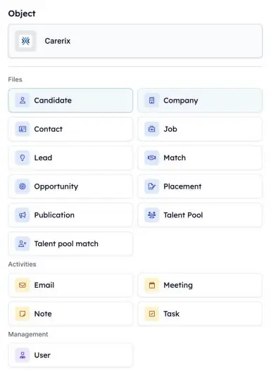
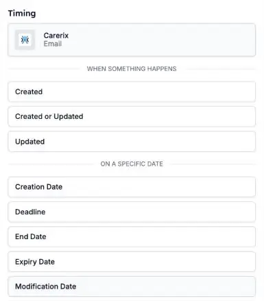

Vos automatisations peuvent désormais réagir à davantage d'événements dans Carerix. Démarrez-en une quand un consultant enregistre une note, quand un e-mail est envoyé ou reçu, ou quand un candidat rejoint un vivier de talents : le suivi se fait sans que personne n'ait à y penser.

<Note>
  Cette fonctionnalité fait partie de la bêta HireData. Consultez [Comment fonctionne la bêta](/fr/beta/how-the-beta-works) pour y participer.
</Note>

## Choisissez ce qui démarre votre automatisation

Ouvrez votre automatisation, cliquez sur le bloc **Start** et choisissez **Carerix**. Sous **Object**, choisissez ce que l'automatisation doit écouter. Choisissez ensuite **quand** elle démarre.

<Frame caption="Choisissez l'enregistrement Carerix qui démarre l'automatisation.">
  
</Frame>

### 1. E-mails

Démarrez une automatisation quand un e-mail est **envoyé ou reçu** et ajouté à Carerix. Les brouillons, la boîte d'envoi, les mailings et les e-mails groupés n'en démarrent pas.

### 2. Notes

Démarrez une automatisation quand une **note** est ajoutée dans Carerix, par exemple après qu'un consultant a enregistré un entretien d'accueil.

### 3. Matches de vivier de talents

Démarrez une automatisation quand l'**appartenance à un vivier de talents** d'un candidat change, par exemple quand il rejoint un vivier.

### 4. Leads et opportunités

Si votre équipe utilise le processus commercial de Carerix, démarrez une automatisation à partir d'un **lead** ou d'une **opportunité**. Consultez [Leads et opportunités](/fr/beta/leads-and-opportunities).

## Démarrer à une date

En plus de **quand quelque chose se produit**, vous pouvez démarrer une automatisation **à une date précise**, comme une échéance ou une date de fin. Vos propres champs de date Carerix figurent aussi dans cette liste. Un champ de date ajouté dans Carerix apparaît ici le lendemain.

<Frame caption="Choisissez quand l'automatisation démarre : quand quelque chose se produit, ou à une date.">
  
</Frame>

## Essayez par vous-même

Ouvrez une automatisation dans [Automations](https://app.hiredata.com/automations), cliquez sur le bloc **Start**, choisissez **Carerix** puis **Email**, **Note** ou **Talent pool match**.
