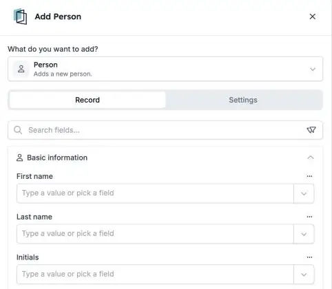

HireData tient sa propre liste de [personnes](/fr/pages/people) : les candidats, contacts et collègues avec qui vous travaillez. Vos automatisations peuvent désormais ajouter, mettre à jour, rechercher et supprimer ces personnes directement, avec les mêmes étapes que pour les autres enregistrements.

<Note>
  Cette fonctionnalité fait partie de la bêta HireData et fonctionne dans le [nouveau créateur d'automatisations](/fr/automations/engine-1-3). Elle remplace l'étape **Sync Person** pour les nouvelles automatisations.
</Note>

## Tenez votre liste de personnes à jour

Dans une nouvelle automatisation, cliquez sur **\+**. Choisissez **Add** ou **Update** sous **Records**, ou **Delete** sous **Lifecycle**, puis **HireData** et **Person**.

<Frame caption="L'étape Add Person, avec les informations de la personne regroupées en sections.">
  
</Frame>

### 1. Ajoutez et mettez à jour des personnes

Renseignez tous les champs que Sync Person pouvait remplir, y compris les **adresses** et les informations de **campagne UTM** qui indiquent d'où vient une personne.

### 2. Trouvez la bonne personne

Utilisez [Find](/fr/automations/look-up-records) avec des filtres pour choisir la personne qu'une étape modifie. L'historique des exécutions affiche le nom des personnes trouvées.

### 3. Supprimez avec prudence

La suppression d'une personne est **définitive**. Si vous annulez une étape qui a ajouté une personne, HireData supprime de nouveau cette personne.

## À savoir aussi

- **Sync Person** n'est plus proposée dans les nouvelles automatisations. Les automatisations qui l'utilisent déjà continuent de tourner.
- **Testez d'abord avec une personne de test**, pour ne pas modifier ou supprimer quelqu'un par erreur.

## Essayez par vous-même

Créez une nouvelle automatisation dans [Automations](https://app.hiredata.com/automations), cliquez sur **\+**, choisissez **Add** sous **Records** et sélectionnez **HireData** et **Person**.
