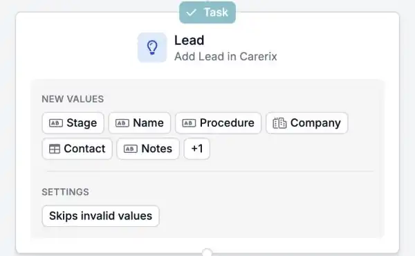

Si votre équipe utilise le processus commercial de Carerix, vos automatisations peuvent désormais suivre aussi vos leads et opportunités. Lancez un workflow quand un lead arrive ou change, et tenez Carerix à jour sans rien ressaisir.

<Note>
  Cette fonctionnalité fait partie de la bêta HireData et fonctionne dans le [nouveau créateur d'automatisations](/fr/automations/engine-1-3). Le processus commercial doit être activé dans votre environnement Carerix. Les options que vous voyez dépendent de la configuration de Carerix chez vous.
</Note>

## Automatisez vos workflows commerciaux

### 1. Démarrez une automatisation à partir d'un lead ou d'une opportunité

Démarrez une automatisation quand un lead ou une opportunité est **créé** ou **mis à jour** dans Carerix, selon un **planning**, ou **manuellement**.

### 2. Rechercher, ajouter et mettre à jour

- **Find** recherche un lead ou une opportunité existant.
- **Add** en crée un nouveau. Comme dans Carerix, la **procédure** et la **catégorie** sont obligatoires.
- **Update** modifie un lead ou une opportunité existant.

Les champs et sections suivent les écrans de lead et d'opportunité que vous connaissez déjà dans Carerix.

<Frame caption="Lead et Opportunity apparaissent à côté des autres enregistrements Carerix.">
  
</Frame>

<Frame caption="Une étape qui ajoute un lead dans Carerix, avec les valeurs qu'elle renseigne.">
  
</Frame>

### 3. Reliez votre suivi

Reliez des **notes**, des **tâches** et des **e-mails** à un lead ou une opportunité, pour que vos consultants voient tout l'historique au même endroit.

## Un exemple

Une entreprise remplit votre formulaire de demande de personnel. Une seule automatisation ajoute l'entreprise et la personne de contact dans Carerix, crée un lead avec les informations du formulaire et donne à un consultant une tâche de rappel.

## Essayez par vous-même

Créez une nouvelle automatisation dans [Automations](https://app.hiredata.com/automations), cliquez sur **\+**, choisissez **Add** sous **Records** et sélectionnez **Lead** ou **Opportunity**.
