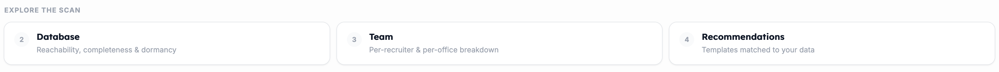
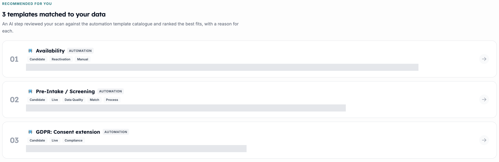

Un scan lit votre base de recrutement directement depuis Carerix et montre, dans un seul rapport, à quel point vos candidats sont joignables et à jour, ce que votre équipe accomplit et quelles automatisations combleraient les manques.

<Note>
  Scan fonctionne aujourd'hui avec Carerix.
</Note>

## Ce que montre le rapport

Le rapport comporte quatre onglets : **Overview**, **Database**, **Team** et **Recommendations**.

### Overview

La taille de votre base en un coup d'œil, ce que HireData a déjà réalisé pour vous, comme les exécutions, les e-mails envoyés et les conversations, et des liens vers les autres onglets.

### Database

Le niveau de complétude et de joignabilité de vos données, avec des vues distinctes pour **Candidates**, **Clients** et **Contacts** :

- **Joignabilité :** combien de candidats vous pouvez joindre par e-mail, mobile, WhatsApp et LinkedIn, et combien ont donné leur consentement.
- **Vivier inactif :** combien de candidats vous avez contactés pour la dernière fois il y a 0–90 jours, 90–180 jours, 180–365 jours ou plus d'un an.
- **Complétude des profils :** combien de profils ont un CV, des compétences, un parcours professionnel, une formation et un canal préféré.

### Team

Les mêmes chiffres par recruteur et par agence, dans les onglets **Recruiters** et **Offices**. Un groupe avec trop peu d'enregistrements pour être comparé est marqué **small sample**.

### Recommendations

Une sélection classée de modèles d'automatisation qui ciblent les manques détectés par le scan, chacun avec la raison de son choix. Ouvrez-en un pour le prévisualiser et le tester, puis activez-le pour créer une automatisation en brouillon que vous pouvez vérifier avant sa mise en ligne.

## Relancer le scan

Cliquez sur **Run again** pour voir ce qui a changé depuis le scan précédent.

Quand un chiffre ne peut pas être récupéré depuis Carerix, le rapport l'indique comme manquant au lieu d'afficher zéro. **How this is measured**, en bas du rapport, explique comment chaque chiffre est calculé.

## Articles liés

- [Vue d'ensemble de l'intégration Carerix](/fr/apps/carerix/overview)
