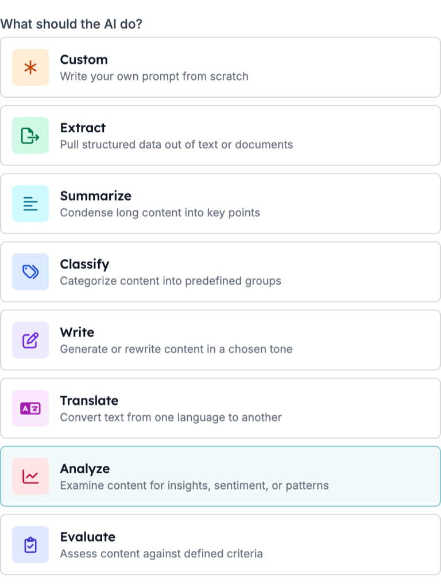
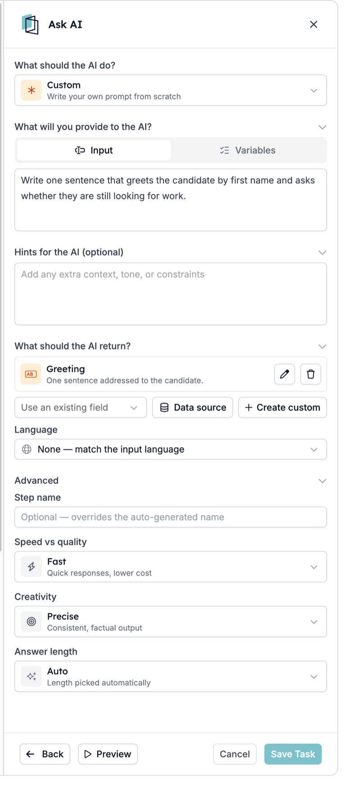
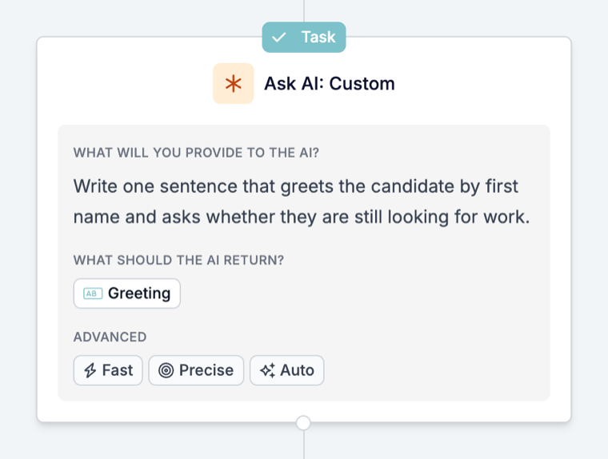

Ask AI est l'étape d'une automatisation qui lit les données de l'exécution et renvoie les réponses que vous demandez : un score d'adéquation, un résumé, une catégorie ou une valeur propre extraite d'un texte plus long. Les réponses sont enregistrées comme des champs, pour que les étapes suivantes puissent les écrire dans un enregistrement ou décider de la suite.

Un exemple type : chaque nouveau match reçoit un score d'adéquation par rapport au poste. Selon ce score, l'automatisation matche le candidat, le refuse ou l'invite à une présélection. Autre exemple : chaque match reçoit un court résumé pour le recruteur avec les points forts, les lacunes et les signaux d'alerte.

Vous décidez de l'usage des réponses. Les étapes suivantes peuvent agir automatiquement, sans vérification préalable, et les réponses peuvent varier d'une exécution à l'autre. Testez donc avant qu'une réponse ne refuse un candidat ou n'envoie un message.

Ce guide décrit la configuration, les tests et les problèmes courants. Pour la description de chaque réglage, consultez la [référence Prompt](/fr/reference/automations/steps/prompt).

## Avant de commencer

Décidez d'abord deux choses :

- **La question à laquelle vous voulez une réponse.** Par exemple : « Ce candidat correspond-il à ce poste ? » Une étape qui répond à une seule question claire est plus facile à tester et à croire qu'une étape qui fait cinq choses.
- **Ce que vous faites de la réponse.** L'écrire dans le match, orienter le candidat ou envoyer un message. Si rien n'utilise la réponse, l'étape ne fait qu'ajouter du temps et un coût à chaque exécution.

## Configurer l'étape

### 1. Ajoutez Ask AI à l'automatisation

Ouvrez l'automatisation, cliquez sur **\+** à l'endroit où l'étape doit aller et choisissez **Prompt**. Le panneau qui s'ouvre a pour titre **Ask AI**.

Placez l'étape après le déclencheur ou la tâche qui charge les données dont elle a besoin. Ask AI ne peut lire que ce que l'exécution contient déjà.

### 2. Choisissez ce que l'IA doit faire

Sous **What should the AI do?**, choisissez la tâche adaptée :

| Choisissez | Quand vous voulez |
| --- | --- |
| **Extract** | Extraire des valeurs précises d'un texte, comme un nom de rue dans une adresse |
| **Summarize** | Réduire un long texte à quelques lignes pour un recruteur |
| **Classify** | Placer un enregistrement dans l'une de vos propres catégories |
| **Write** | Rédiger ou réécrire un texte dans un ton choisi |
| **Translate** | Traduire un texte dans une autre langue |
| **Analyze** | Évaluer quelque chose, comme l'adéquation d'un candidat à un poste |
| **Evaluate** | Vérifier un texte selon des critères que vous décrivez |
| **Custom** | Rédiger vous-même toute l'instruction |

Chaque option sauf **Custom** crée les champs de sortie que cette tâche renvoie habituellement : vous partez de champs qui existent déjà.

### 3. Donnez-lui les données et l'instruction

Sous **What will you provide to the AI?** :

- Dans **Input**, rédigez l'instruction et insérez les variables nécessaires, comme l'intitulé du poste et l'expérience du candidat.
- Dans **Variables**, ajoutez des champs à transmettre avec l'instruction sans les écrire dans le texte.

Utilisez **Hints for the AI (optional)** pour le contexte et les règles, comme « Tu es recruteur. Si le CV ne mentionne pas de permis de conduire, dis-le au lieu de deviner. »

### 4. Décidez de ce qui est renvoyé

Sous **What should the AI return?**, ajoutez un champ de sortie par réponse :

- **Use an existing field** pour associer la réponse à un champ que l'automatisation connaît déjà.
- **Create custom** pour définir un nouveau champ. Choisissez le type qui correspond à la réponse : **Number** pour un score, **Yes / No** pour une vérification, **List** pour l'une de vos propres options, **Text** pour un résumé. Pour une **List**, ajoutez les valeurs autorisées sous **Options**.
- Renseignez **What is it for? (optional)**. Cela indique au modèle ce que doit contenir le champ.

Donnez à chaque champ son propre nom **Reference as**. C'est grâce à ce nom que les étapes suivantes trouvent la réponse.

<Tip>
  Utilisez un champ **List** ou **Yes / No** pour tout ce sur quoi une étape suivante se base pour choisir une branche. Une liste ne peut renvoyer qu'une de vos options ; un texte libre donne une phrase différente à chaque fois.
</Tip>

### 5. Réglez la langue et les options du modèle

- **Language** : laissez **None** pour répondre dans la langue de l'entrée, ou fixez une langue quand l'enregistrement ou le message en attend une.
- **Advanced** : choisissez **Speed vs quality**, **Creativity** et **Answer length**. Pour les scores et les vérifications, **Precise** donne les réponses les plus cohérentes.

Une fois enregistrée, l'étape apparaît sur le canevas avec son prompt, une puce par champ de sortie et les réglages Advanced :

## Testez avec Preview

Cliquez sur **Preview** en bas du panneau, puis sur **Generate an example** pour remplir des données d'exemple réalistes, et exécutez l'étape avant d'enregistrer. Vous pouvez modifier les valeurs d'exemple pour tester un cas précis. Vérifiez chaque champ de sortie, pas seulement le premier.

Testez plusieurs cas : un candidat solide, un candidat faible et un enregistrement avec des informations manquantes. Si la réponse pour le cas incomplet est une supposition, ajoutez une indication qui dit quoi faire quand l'information est absente.

## Utilisez la réponse dans les étapes suivantes

Dans les étapes suivantes, retrouvez chaque réponse sous le nom automatique de l'étape, avec une clé basée sur sa valeur **Reference as**, comme `output.fit_score`. Si Ask AI se trouve dans un [Loop](/fr/reference/automations/steps/loop), utilisez la réponse ou écrivez-la dans un enregistrement à l'intérieur de ce Loop ; les étapes après le Loop ne peuvent pas la lire. L'étape enregistre aussi :

| Variable | Contient |
| --- | --- |
| `is_successful` | Si le modèle a renvoyé une réponse qui correspond aux champs |
| `reasoning` | Comment le modèle est arrivé à la réponse |
| `error_message` | Pourquoi il n'a pas pu répondre, vide en cas de succès |

Étapes suivantes courantes :

- **L'écrire dans l'enregistrement.** Une tâche [Update](/fr/reference/automations/steps/update) écrit le résumé ou le score dans le match ou le candidat.
- **Continuer seulement si cela correspond.** Un [Filter](/fr/reference/automations/steps/filter) ne laisse continuer l'exécution que si un score ou une valeur de liste remplit une condition. Les exécutions qui ne la remplissent pas s'arrêtent là.
- **Envoyer les résultats sur des chemins différents.** Un [Split](/fr/reference/automations/steps/split) avec un Filter dans chaque branche, par exemple une branche pour matcher, une pour refuser et une pour inviter à une présélection.

## Points d'attention

- **La réponse est utilisée dès qu'elle est renvoyée.** Testez avec Preview et quelques vrais enregistrements avant que l'automatisation n'agisse sur la réponse, surtout avant de refuser un candidat ou d'envoyer un message.
- **Une étape sans réponse arrête son exécution.** Quand le modèle ne peut pas répondre, l'étape apparaît comme Cancelled avec la raison dans la chronologie, et les étapes suivantes ne s'exécutent pas. Dans un [Split](/fr/reference/automations/steps/split) ou un [Loop](/fr/reference/automations/steps/loop), seule cette branche ou cette itération s'arrête ; les autres branches et les étapes après le Split ou le Loop peuvent encore s'exécuter. Consultez [Raisons d'annulation d'une exécution](/fr/knowledge-base/run-cancellation-reasons).
- **Une réponse inattendue n'arrête pas l'exécution.** Si une étape suivante dépend de la réponse, vérifiez-la d'abord avec un [Filter](/fr/reference/automations/steps/filter).
- **Pour une seule ligne dans un e-mail**, une [variable IA](/fr/variables/ai-variables) dans le modèle est plus simple qu'une étape. Utilisez Ask AI quand la réponse doit être enregistrée ou orienter l'exécution.

## Dépanner Ask AI

| Ce que vous voyez | Ce qu'il faut vérifier |
| --- | --- |
| La réponse est vague ou ignore cet enregistrement | L'instruction n'a pas de variables. Insérez les champs nécessaires dans **Input** ou ajoutez-les sous **Variables**. |
| Un champ de sortie est toujours vide ou écrasé | Deux champs ont le même **Reference as**. Donnez à chaque champ son propre nom. |
| La réponse est dans la mauvaise langue | **Language** est réglé sur **None** et suit donc l'entrée. Fixez une langue. |
| Les réponses varient beaucoup entre des enregistrements similaires | Réglez **Creativity** sur **Precise** et précisez dans l'instruction ce que contient une bonne réponse. |
| L'exécution affiche Cancelled à l'étape Ask AI | Le modèle n'a pas pu renvoyer une réponse qui correspond aux champs. Lisez la raison dans la chronologie, vérifiez les entrées et simplifiez les champs. |
| Une étape suivante utilise une mauvaise valeur | Vérifiez la sortie avec un **Filter** avant cette étape, et testez le cas dans **Preview**. |
| Le nom de l'étape sur le canevas n'a pas changé | **Step name** ne change que le titre du panneau. La carte et les noms de variables gardent le nom automatique. |

Si l'étape ne se comporte toujours pas comme prévu, contactez [support@hiredata.com](mailto:support@hiredata.com) en indiquant le nom de l'automatisation, l'étape Ask AI, un exemple d'enregistrement et la réponse attendue.
