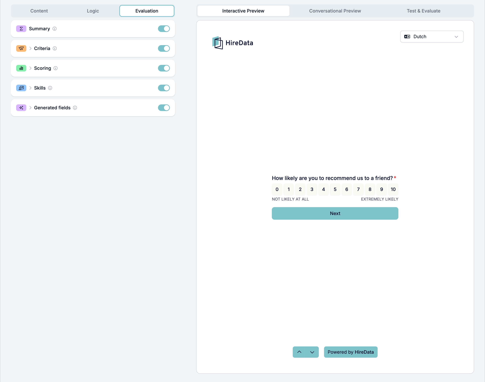
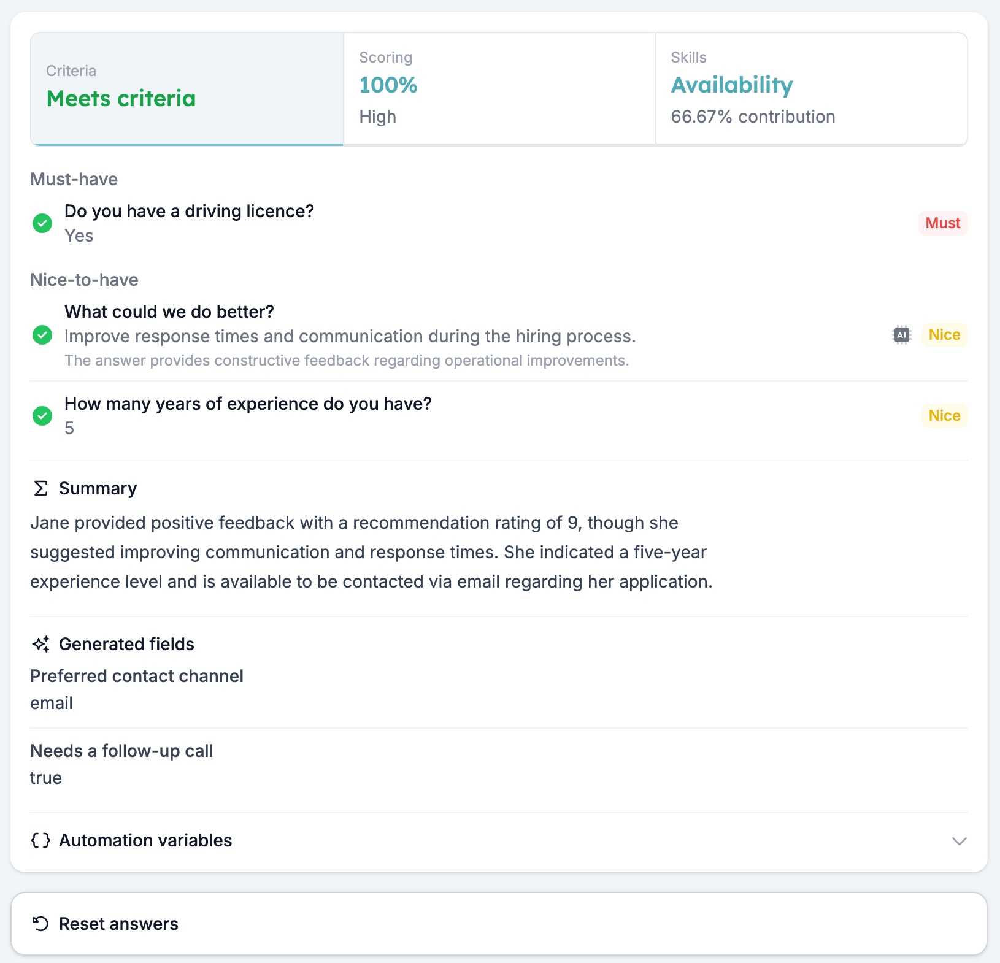
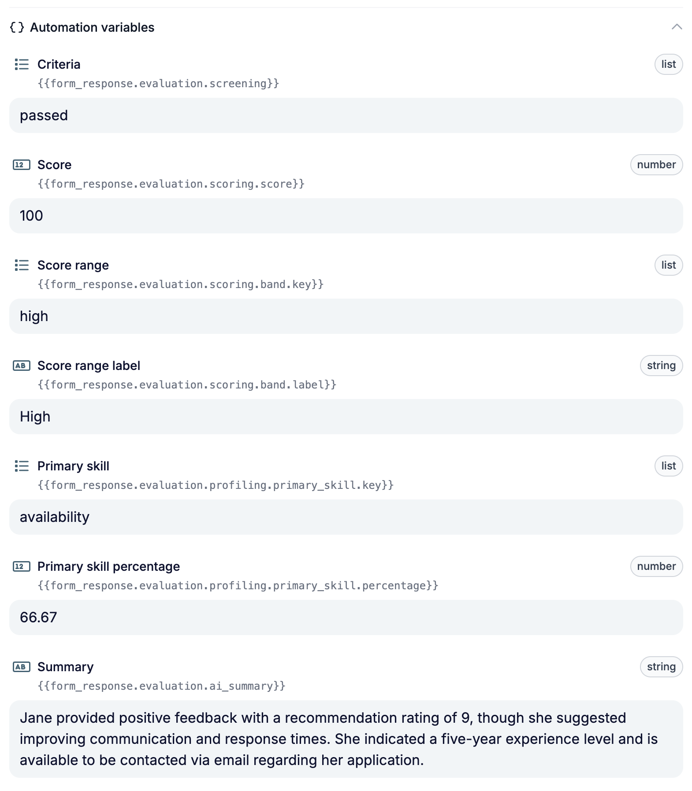

Les évaluations de formulaire prennent en charge le premier tour de présélection. Vous décrivez une seule fois vos questions éliminatoires et ce qu'est une bonne réponse, et chaque réponse complète est vérifiée de la même façon : un verdict sur les critères, un score, un profil de compétences, un résumé pour votre recruteur ou des sorties personnalisées. Votre équipe garde la main sur les décisions.

Ce guide explique comment configurer les évaluateurs, vérifier leurs résultats et résoudre les problèmes de configuration courants.

## Choisissez ce dont vous avez besoin

Vous pouvez activer un seul évaluateur ou en combiner plusieurs.

| Évaluateur | À utiliser pour | Résultat |
| --- | --- | --- |
| **Summary** | Donner à votre équipe un court aperçu de la réponse. | Un paragraphe rédigé par l'IA ; aucun réglage à configurer. |
| **Criteria** | Vérifier vos critères indispensables (questions éliminatoires) et souhaitables. | Meets criteria, Partially meets criteria, Does not meet criteria ou Incomplete. |
| **Scoring** | Attribuer des points aux réponses. | Un pourcentage et un libellé de tranche de score, comme Low, Medium ou High. |
| **Skills** | Identifier les compétences configurées que les réponses révèlent. | Un pourcentage par compétence et la compétence la plus forte. |
| **Generated fields** | Extraire ou générer des valeurs à partir de toute la réponse. | Une valeur pour chaque sortie que vous définissez. |

Par exemple, utilisez Criteria pour vérifier une qualification requise et Scoring pour attribuer des points à l'expérience pertinente. Un score ne remplace pas le verdict des critères : examinez les deux avant de décider de la suite.

## Configurer une évaluation

### 1. Activez l'évaluateur pour le formulaire

Ouvrez votre formulaire et sélectionnez **Evaluation**, à côté de **Content** et **Logic**. Activez les évaluateurs dont vous avez besoin, puis cliquez sur le nom d'un évaluateur pour ouvrir ses réglages.

### 2. Sélectionnez et configurez les questions

Pour **Criteria**, **Scoring** et **Skills**, activez chaque question que vous voulez évaluer.

<Warning>
  L'interrupteur au niveau du formulaire et celui au niveau de la question doivent tous deux être activés. Désactiver un évaluateur pour le formulaire arrête l'évaluation, même si les interrupteurs des questions restent activés.
</Warning>

Configurez chaque question sélectionnée :

- **Criteria :** choisissez **Must-have** pour une question éliminatoire, où une mauvaise réponse signifie que le candidat ne répond pas à vos critères. Choisissez **Nice-to-have** pour un élément qui vous aide à décider qui appeler en premier sans exclure personne. Définissez ensuite la réponse attendue ou les instructions pour l'IA.
- **Scoring :** fixez le nombre maximal de points de la question, puis définissez quand les points sont attribués. Si vous utilisez l'IA, le maximum doit être supérieur à zéro.
- **Skills :** ajoutez les compétences à évaluer, puis définissez quelles réponses contribuent à chaque compétence et leur poids. Ajoutez au moins une compétence avant d'utiliser l'évaluation par IA.

**Summary** fonctionne sur toute la réponse et ne nécessite aucune configuration par question. Pour **Generated fields**, activez l'évaluateur et ajoutez au moins une sortie avec **Create custom**, **Suggest with AI** ou **Data source**.

### 3. Choisissez des règles de réponse ou l'IA

Sous **How to evaluate?**, choisissez :

- **Use answer rules** pour des valeurs fixes ou des comparaisons, comme une option sélectionnée ou un nombre minimal d'années. Les règles donnent le même résultat pour la même réponse.
- **Evaluate with AI** quand l'interprétation de la réponse compte, comme une explication en texte libre. Rédigez des instructions précises sur les éléments que l'IA doit rechercher.

L'instruction pour l'IA est partagée entre Criteria, Scoring et Skills pour une même question. Gardez des instructions cohérentes pour tous les évaluateurs qui utilisent cette question.

Pour tous les réglages, consultez [Criteria](/fr/reference/forms/evaluation/criteria), [Scoring](/fr/reference/forms/evaluation/scoring), [Skills](/fr/reference/forms/evaluation/skills) et [Generated fields](/fr/reference/forms/evaluation/generated-fields).

## Testez vos résultats

Ouvrez **Test & Evaluate** dans le panneau d'aperçu. Saisissez des réponses manuellement ou utilisez **Autofill with AI** pour créer une réponse de test. L'évaluation se lance automatiquement quand vous saisissez ou modifiez une réponse.

<Note>
  Lancer une évaluation enregistre d'abord le formulaire, y compris les modifications non enregistrées. Cela ne crée pas de réponse soumise, n'augmente pas le nombre de réponses et ne déclenche pas d'automatisation.
</Note>

Testez des réponses qui remplissent vos exigences, des réponses qui ne les remplissent pas et des questions sans réponse. Pour le scoring, testez aussi des valeurs juste en dessous et au niveau de chaque seuil.

Ouvrez les panneaux de résultats et vérifiez le détail par question :

- **Criteria :** vérifiez quelles exigences sont remplies ou non et, pour les évaluations par IA, le raisonnement.
- **Scoring :** vérifiez les points attribués par question et le pourcentage total.
- **Skills :** vérifiez comment chaque réponse contribue au profil de compétences.

Comparez le résumé et les sorties générées aux réponses d'origine. Si une sortie demande une information qui peut manquer, utilisez **Hints for the AI (optional)** pour expliquer comment gérer l'information manquante, par exemple en laissant la sortie vide.

Consultez [Test & Evaluate](/fr/reference/forms/testing/test-and-evaluate) pour les scénarios de test et les panneaux de résultats.

## Comprendre les résultats

**Criteria utilise un verdict ordonné.** Un critère indispensable répondu mais non rempli donne **Does not meet criteria**. Sinon, une réponse manquante à une question évaluée donne **Incomplete**. Si toutes les questions évaluées ont une réponse, un critère souhaitable non rempli donne **Partially meets criteria** ; si tout est rempli, le résultat est **Meets criteria**. Vérifiez les questions sautées par la logique du formulaire quand vous analysez un résultat incomplet.

**Le scoring repose sur le total des points.** Le pourcentage correspond aux points obtenus divisés par le total des points maximum des questions configurées. Une question notée sans réponse rapporte zéro point mais compte quand même dans le maximum. Les règles correspondantes s'additionnent, plafonnées au maximum de la question.

**Les pourcentages de compétences montrent des contributions relatives.** Ils décrivent la part de chaque compétence dans le poids total. Une compétence à 80 % ne signifie pas que la personne atteint un niveau de maîtrise de 80 %.

**Les champs générés s'exécutent après Criteria, Scoring et Skills.** Ils peuvent utiliser les réponses et ces résultats d'évaluation pour produire les sorties que vous avez définies.

## Dépanner une évaluation

| Ce que vous voyez | Ce qu'il faut vérifier |
| --- | --- |
| Aucun résultat n'apparaît | Activez l'évaluateur pour le formulaire, activez les questions concernées et configurez leurs règles ou réglages IA. Saisissez une réponse de test. |
| Un critère basé sur des règles n'influence jamais le verdict | Vérifiez qu'il a des conditions. Un critère sans condition est ignoré. |
| Le scoring par IA renvoie une erreur | Fixez le nombre maximal de points de la question à un nombre supérieur à zéro. |
| L'évaluation des compétences par IA renvoie une erreur | Ajoutez au moins une compétence au formulaire. |
| Un score a un pourcentage mais pas de libellé de tranche | Ajoutez une tranche de score avec un minimum de 0 %, et vérifiez les autres seuils. |
| Le score est plus bas que prévu | Vérifiez les questions notées sans réponse ou sautées, et le maximum de points de chaque question. |
| Les champs générés ne renvoient rien | Ajoutez au moins un champ de sortie. |
| Les résultats de l'IA ne correspondent pas à l'évaluation voulue | Relisez les instructions IA partagées de la question, les descriptions des compétences ou les indications des champs générés, puis testez à nouveau. |

## Utiliser les résultats d'évaluation

Les réponses complètes sont évaluées et les résultats sont enregistrés avec elles. Utilisez **Export CSV** ou **Export Excel** dans le menu à trois points de l'éditeur pour exporter les résultats, y compris les pourcentages de compétences et les champs générés.

Pour utiliser un résultat dans une automatisation, ouvrez **Automation variables** en bas de **Test & Evaluate** et copiez la variable affichée à côté de votre valeur de test. Par exemple, le verdict Criteria utilise `{{form_response.evaluation.screening}}`, avec les valeurs `passed`, `passed_with_restrictions`, `rejected` ou `incomplete`.

Comme chaque réponse est évaluée dès qu'elle est complète, une automatisation peut assurer le suivi de chaque candidat immédiatement. Par exemple, faites passer le match à l'étape suivante quand le résultat est **Meets criteria**, et envoyez un court message aux candidats qui ne remplissent pas vos critères, pour que personne n'attende.

<Warning>
  Il n'y a pas encore d'étape d'approbation : une automatisation utilise le résultat dès qu'il est enregistré. Testez vos instructions IA dans **Test & Evaluate** avant qu'un résultat ne déclenche un message aux candidats.
</Warning>

Pour un exemple complet, consultez [Sélectionner et noter les candidats avec un formulaire de présélection](/fr/knowledge-base/cookbook/pre-screening-form).

Si un résultat semble toujours incorrect, contactez [support@hiredata.com](mailto:support@hiredata.com) en indiquant le nom du formulaire, l'évaluateur et la question concernés, la réponse testée, et les résultats attendu et obtenu.
