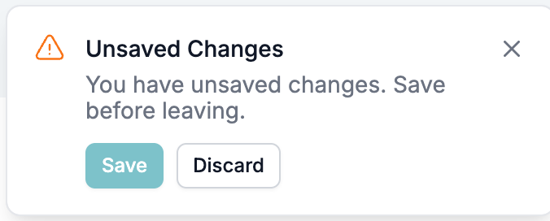

Un modèle d'e-mail est un message que vous rédigez une fois et envoyez de nombreuses fois, dans une automatisation ou une newsletter. Ouvrez **Settings**, puis **Emails** sous **Templates**, et cliquez sur **New Email**. Sélectionnez **Blank Email** ou l'un des modèles prêts à l'emploi, et le nouveau modèle s'ouvre dans l'éditeur.

Cette page cartographie l'éditeur. Pour un guide qui mène un e-mail de la page vierge au prêt-à-envoyer, lisez [Créer un modèle d'e-mail dans HireData](/fr/apps/messaging/emails/setting-up-an-email-template-in-hiredata).

## L'éditeur en un coup d'œil

L'éditeur se compose de trois parties.

- Le champ **Subject** en haut. C'est la ligne que le destinataire voit dans sa boîte de réception, et il accepte les variables.
- L'e-mail lui-même, à la largeur que voient vos destinataires. Vous sélectionnez et modifiez tout directement dessus.
- La barre latérale à droite, avec trois onglets : **Styles** pour les paramètres de ce que vous avez sélectionné, **Add** pour les nouveaux blocs, mises en page et modèles de section, et **Global** pour les paramètres de tout l'e-mail.

Un modèle contient des sections, et une section contient les blocs que le destinataire lit. [Template](/fr/reference/email-builder/template) explique comment les niveaux s'emboîtent.

## Sélectionner et modifier

- **Survolez** un bloc ou une section pour l'encadrer avec son nom.
- **Cliquez** pour le sélectionner. Ses paramètres s'ouvrent dans **Styles**.
- **Cliquez à nouveau sur un bloc de texte sélectionné**, ou double-cliquez dessus, pour modifier le texte.
- **Échap** arrête d'abord la modification, puis efface la sélection.
- **Clavier :** **Tab** sélectionne le premier bloc, les flèches passent d'un bloc à l'autre, **Entrée** modifie et **Suppr** supprime.

Un bloc sélectionné affiche une barre d'actions avec **Move**, **Add below**, **Duplicate** et **Delete**, et un menu avec les paramètres propres à ce type de bloc. Sur un bloc plus haut que l'écran, le menu reste visible.

### Texte

- **Entrée** commence une nouvelle ligne dans le paragraphe ou le titre. Aucun nouveau bloc n'est créé.
- **Listes :** transformez des lignes en liste à puces ou numérotée. Entrée continue la liste.
- **Le menu de texte** règle la police, la taille, la couleur, le surlignage, l'alignement, la liste et le lien, avec d'autres options sous **More**. Il met en forme tout le bloc, ou seulement le texte sélectionné.
- **Liens :** le bouton de lien ouvre un menu pour ajouter, modifier ou supprimer un lien. Un lien saisi sans « https » le reçoit automatiquement.

## Ajouter, copier et déplacer

- **L'onglet Add** liste les mises en page, les modèles de section et les blocs de contenu. Faites-en glisser un sur l'e-mail : une ligne montre où il arrive.
- **Add below** ajoute un bloc sous celui qui est sélectionné. Un nouveau bloc de texte s'ouvre directement en modification.
- **Duplicate** copie un bloc ou une section, traductions comprises.
- **Move** fait glisser un bloc ou une section jusqu'à la ligne où vous le déposez. Échap annule.
- **Les sections** ne se placent qu'au niveau supérieur de l'e-mail, jamais dans une autre section.
- **Une section ou une colonne vidée** garde sa place et affiche une zone où déposer ou ajouter un bloc.

## Choisir un bloc {#choosing-a-block}

| Bloc | Ce qu'il place dans l'e-mail |
| --- | --- |
| [Section](/fr/reference/email-builder/sections) | une bande en travers de l'e-mail, avec son propre fond, son padding et sa bordure |
| Section divisée | une section divisée en colonnes côte à côte, avec sa propre mise en page et son espacement. Elle se sélectionne et se déplace comme un seul bloc |
| [Paragraph](/fr/reference/email-builder/blocks/paragraph) | du texte de corps, y compris des listes à puces et numérotées |
| [Heading](/fr/reference/email-builder/blocks/heading) | un titre, au niveau que vous choisissez |
| [Form](/fr/reference/email-builder/blocks/form) | des boutons qui répondent à une question de l'un de vos formulaires |
| [Image](/fr/reference/email-builder/blocks/image) | une image de votre médiathèque, ou une image portée par une variable |
| [Socials](/fr/reference/email-builder/blocks/socials) | une rangée d'icônes sociales, une par lien |
| [Button](/fr/reference/email-builder/blocks/button) | un appel à l'action qui ouvre une URL |
| Divider | une ligne entre des blocs |
| Whitespace | un espace vide entre des blocs |
| [HTML](/fr/reference/email-builder/blocks/html) | du balisage que vous écrivez vous-même |
| [Signature](/fr/reference/email-builder/blocks/signature) | une image à côté d'un bloc de texte de signature |

Les colonnes s'ajoutent sous forme de section divisée. Les colonnes des e-mails créés avant ce changement sont conservées et peuvent toujours être dupliquées.

## Espacements

Sélectionnez un bloc et cliquez sur **Spacing** pour voir ses marges et son padding sur le canevas. Faites glisser une poignée ou saisissez une valeur, et utilisez le cadenas pour modifier plusieurs côtés ensemble. **Done** conserve les valeurs. La zone d'espacement dans **Styles** modifie les mêmes valeurs. Les blocs Paragraph, Heading et Socials ont aussi des marges gauche et droite.

## Paramètres de tout l'e-mail

L'onglet **Global** contient les paramètres du modèle et **All sections**. Une modification sous **All sections** s'applique à toutes les sections, y compris celles que vous ajoutez ensuite.

**Section width** se définit une seule fois pour tout l'e-mail : **Default**, **Wide** (640px), **Large** (700px) ou **Custom** (entre 640 et 1240 pixels). Le fond, la couleur des liens et les polices se définissent aussi ici.

## La barre d'outils

La barre d'outils court le long du haut de l'éditeur, de **Save** jusqu'aux quatre boutons de panneaux à droite.

**Save** enregistre vos modifications. **Undo** et **Redo** se trouvent à côté et fonctionnent aussi avec les raccourcis clavier habituels. Chaque action compte pour une étape, par exemple un glissement entier ou une modification dans un champ de la barre latérale.

Deux boutons le suivent :

- L'œil ouvre un [aperçu](/fr/reference/email-builder/testing#the-preview) de l'e-mail fini, en largeur mobile, tablette ou ordinateur, avec un sélecteur de langue et un bouton **Copy Preview URL**. Son infobulle vous avertit qu'il enregistre d'abord l'e-mail.
- L'avion en papier ouvre [Test Email](/fr/reference/email-builder/testing#sending-a-test-email). Il vous envoie l'e-mail avec des valeurs réalistes remplies.

**Brand** choisit la marque d'où viennent les couleurs, les polices et le logo de l'e-mail.

Deux commutateurs suivent le sélecteur de marque :

- **Show variable values** est un commutateur d'affichage pour le canevas. Pour lire un e-mail avec de vraies valeurs, utilisez l'[aperçu](/fr/reference/email-builder/testing#the-preview).
- **Show code editor** ouvre le balisage généré. Il n'apparaît que pour les comptes autorisés à modifier les modèles directement.

Quatre boutons à la fin ouvrent des panneaux au-dessus de l'e-mail :

- **Show variable list** liste les variables que cet e-mail peut utiliser, et en ajoute qui vous appartiennent. Voir [Variables](/fr/reference/email-builder/variables).
- **Manage Template** publie l'e-mail ouvert dans la bibliothèque de modèles partagée. Il n'apparaît que pour les comptes qui maintiennent cette bibliothèque.
- **Show objects** lie des enregistrements tels qu'un poste ou un match à l'e-mail. Leurs champs deviennent alors des [variables](/fr/reference/email-builder/variables#bringing-in-a-records-fields) que vous pouvez y écrire.
- **Manage Languages** définit la langue par défaut de l'e-mail et ses [traductions](/fr/reference/email-builder/translations).

## Marque et thème

Chaque couleur et chaque police d'un nouvel e-mail démarre sur une valeur de la marque que vous choisissez dans **Brand**. Le panneau nomme la valeur plutôt que d'afficher un code hexadécimal, par exemple « Theme: Palette Surface Color ».

Changez de **Brand** et l'e-mail entier se restyle, blocs déjà rédigés compris. Remplacez l'une de ces valeurs par une couleur à vous et cette commande cesse de suivre la marque. Voir [Template](/fr/reference/email-builder/template#brand-theme-and-metadata) pour les paramètres qui en décident, et pour la différence entre changer de marque et définir un thème.

## Enregistrer

L'éditeur d'e-mails n'enregistre pas pendant que vous tapez. C'est **Save** qui enregistre. Le bouton d'aperçu et **Send test email** enregistrent chacun avant de s'exécuter, donc l'un comme l'autre valide tout ce que vous avez modifié. Voir [Tester](/fr/reference/email-builder/testing).

Annulez toutes vos modifications et l'e-mail n'est plus considéré comme non enregistré.

Essayez de quitter l'éditeur avec des modifications non enregistrées et un avertissement apparaît. Il propose de les **Save**, ou de les **Discard** et de continuer.

Rechargez la page ou fermez l'onglet et votre navigateur vous demande de confirmer avant de les perdre.

## Voir aussi

- [Créer un modèle d'e-mail dans HireData](/fr/apps/messaging/emails/setting-up-an-email-template-in-hiredata) mène un e-mail de la page vierge au prêt-à-envoyer.
- [Ajouter des images à vos e-mails](/fr/apps/messaging/emails/adding-images-to-your-emails) couvre la médiathèque.
- [Variables](/fr/reference/email-builder/variables) couvre le sélecteur, les valeurs de repli et l'apparence d'une valeur manquante.
- [Traductions](/fr/reference/email-builder/translations) couvre l'envoi d'un même e-mail en plusieurs langues.
- [Tester](/fr/reference/email-builder/testing) couvre l'aperçu, l'envoi de test et ce qu'aucun des deux ne prouve.
- [Form Builder : vue d'ensemble](/fr/reference/forms/overview) couvre les formulaires qu'un bloc Form peut cibler.
