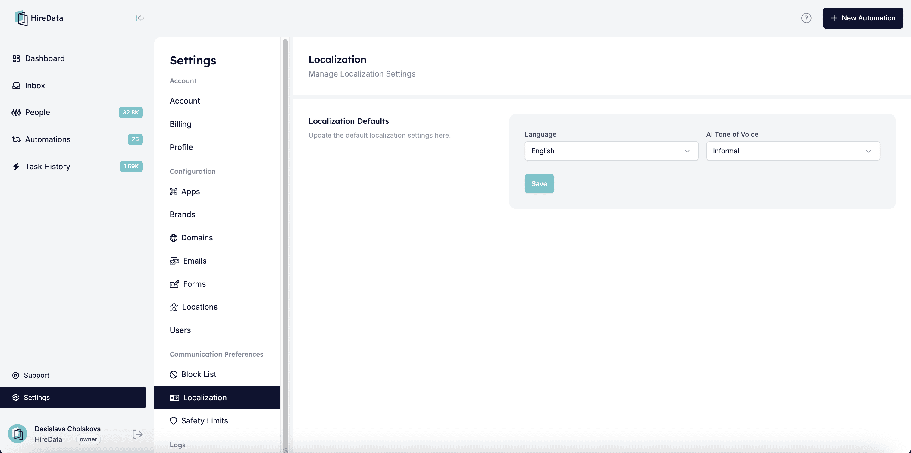
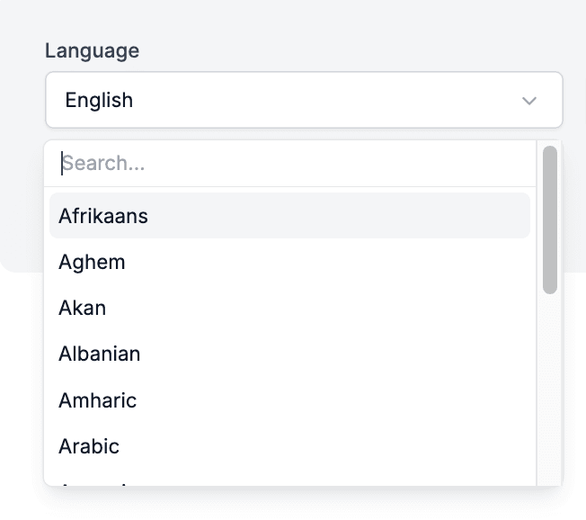
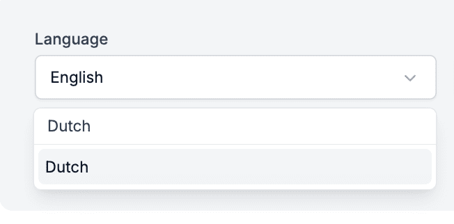
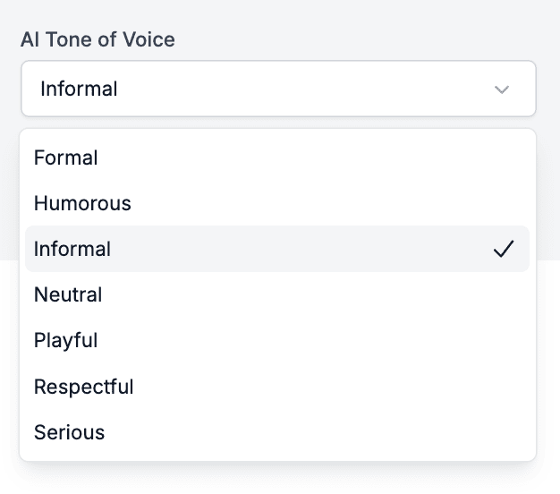
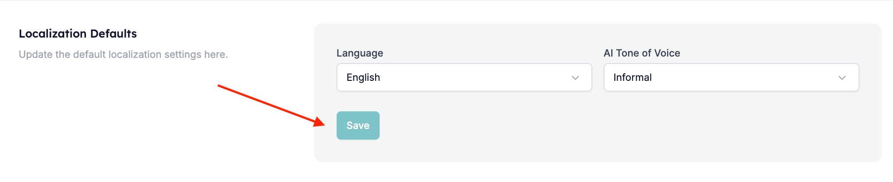
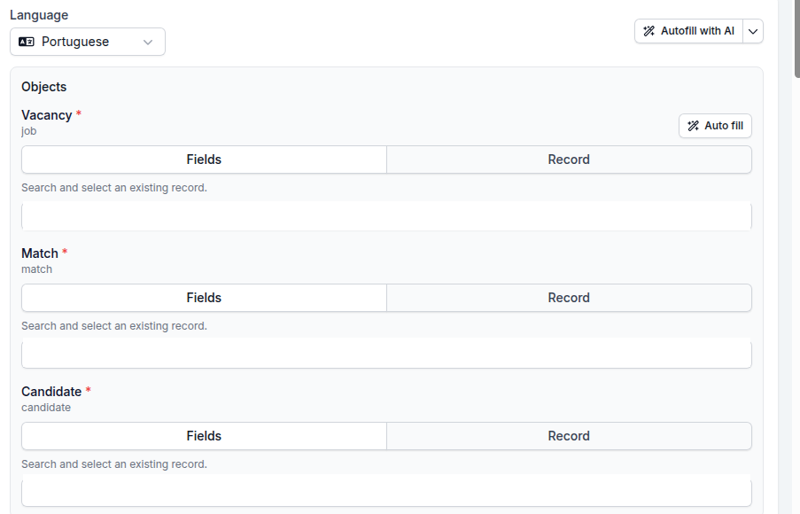
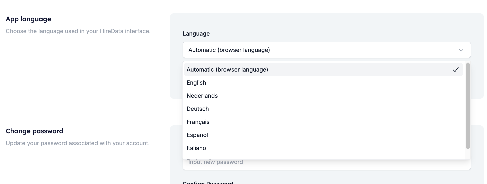

_Personnaliser les paramètres de localisation de votre compte HireData garantit que votre communication s'aligne avec votre audience et votre marque. Ce guide vous accompagne dans la configuration de ces paramètres et leur adaptation à vos besoins spécifiques._

## Étape 1 : Ouvrir la page Localization

Rendez-vous dans le menu **Settings** de HireData et ouvrez la page **Localization**. Vous pouvez y sélectionner une langue par défaut pour vos modèles et un ton de voix pour l'IA de vos conversations WhatsApp.

## Étape 2 : Mettre à jour les paramètres de localisation par défaut

### **2.1. Définir une langue par défaut**

Cliquez sur la case **Language** pour ouvrir une large liste des langues disponibles.

_Si la langue souhaitée n'est pas immédiatement visible, utilisez la barre de recherche pour la trouver rapidement :_

### **2.2. Définir un ton de voix**

Cliquez sur la case **Tone of Voice** pour voir les options disponibles et sélectionner le ton qui correspond le mieux à votre image de marque et à vos besoins de communication.

## Étape 3 : Vérifier et enregistrer

Vérifiez à nouveau votre langue et votre ton de voix sélectionnés. Cliquez sur le bouton **Save** pour appliquer les modifications.

## Les valeurs des champs dans la langue du candidat

Les valeurs issues de votre ATS, comme le secteur d'une offre, le type de lieu de travail ou les langues demandées, s'affichent désormais dans la langue du formulaire, du message WhatsApp ou de l'e-mail où elles apparaissent. Un formulaire de présélection en portugais affiche **Presencial** au lieu de **On site**, même si votre compte est en anglais.

Cela vaut aussi pour les valeurs des enregistrements liés, comme l'offre derrière un match, et pour les options de choix d'un formulaire.

HireData choisit le libellé dans cet ordre :

1. La langue du formulaire, du message ou de l'e-mail.
2. La langue par défaut de votre compte, sur la page **Localization**.
3. La valeur d'origine de votre ATS, quand aucune traduction n'existe.

<Note>
  HireData ne peut afficher qu'une traduction qui existe dans votre ATS. Dans Carerix, les traductions de vos valeurs de liste doivent être activées et renseignées.
</Note>

Pour vérifier un formulaire, ouvrez **Test & Evaluate**, choisissez la langue et sélectionnez un vrai **Vacancy**, **Match** ou **Candidate**. Les questions affichent alors les valeurs que recevra cet enregistrement.

## Définir votre propre langue de l'app

La page Localization définit la langue pour l'ensemble du compte. Chaque utilisateur choisit séparément la langue de sa propre interface HireData.

Ouvrez **Settings**, puis **Profile**, et rendez-vous dans **App language**. Sélectionnez une langue et cliquez sur **Save language**.

La valeur par défaut est **Automatic (browser language)**, qui suit la langue demandée par votre navigateur. Vous pouvez aussi choisir English, Nederlands, Deutsch, Français, Español, Italiano ou Português.

Lorsqu'aucun paramètre utilisateur ne s'applique et qu'aucune langue de navigateur ne peut être trouvée, HireData se rabat sur la langue du compte définie sur la page Localization.

<Note>
  Ce paramètre ne change que l'interface HireData. La langue des e-mails, des messages et du contenu que vous envoyez reste celle du paramètre par défaut du compte et du modèle que vous utilisez. La traduction de l'interface est toujours en cours, certaines parties de l'app restent donc en anglais.
</Note>
