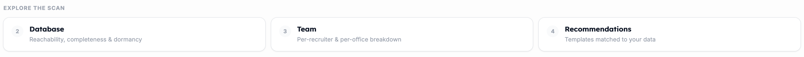
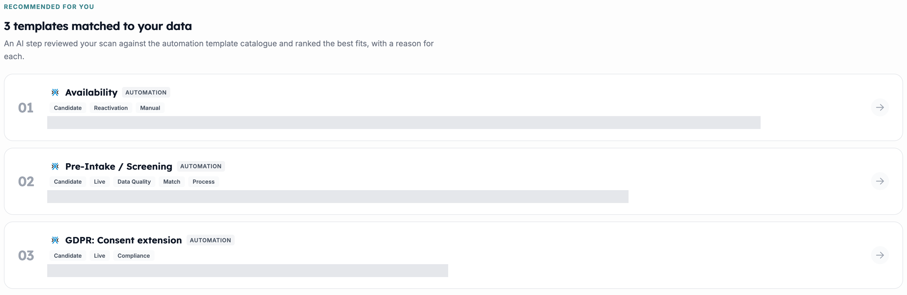

{/* DRAFT FOR REVIEW (EN only), HD-1569. OPEN: who can run a scan and how a customer gets one (Ian, June: app.hiredata.com/scan, not public yet). Audience to decide before publishing. Open Scan issues: HD-2170, HD-2159, HD-2106 (To Be Tested), HD-2105 (To Do), HD-2171 (Triage). Screenshots cropped from the June screenshots in HD-1569: only generic parts, customer name and figures left out or masked. Check they still match the current Scan screens. */}

A scan reads your recruitment database straight from Carerix and shows, in one report, how reachable and up to date your candidates are, what your team achieves, and which automations would close the gaps.

<Note>
  Scan works with Carerix today.
</Note>

## What the report shows

The report has four tabs: **Overview**, **Database**, **Team** and **Recommendations**.

### Overview

The size of your database at a glance, what HireData has already delivered for you, such as runs, emails sent and chats, and links to the other tabs.

### Database

How complete and reachable your data is, with separate views for **Candidates**, **Clients** and **Contacts**:

- **Reachability:** how many candidates you can reach by email, mobile, WhatsApp and LinkedIn, and how many have given consent.
- **Dormant pool:** how many candidates you last worked with 0–90 days ago, 90–180 days ago, 180–365 days ago or more than a year ago.
- **Profile completeness:** how many profiles have a CV, skills, work history, education and a preferred channel.

### Team

The same figures per recruiter and per office, on the **Recruiters** and **Offices** tabs. A group with too few records to compare is marked **small sample**.

### Recommendations

A ranked shortlist of automation templates that target the gaps the scan found, each with the reason it was picked. Open one to preview and test it, and activate it to create a draft automation you can review before it goes live.

## Run it again

Click **Run again** to see what changed since the previous scan.

When a figure can't be retrieved from Carerix, the report marks it as missing instead of showing zero. **How this is measured**, at the bottom of the report, explains how each figure is calculated.

## Related

- [Carerix integration overview](/apps/carerix/overview)
