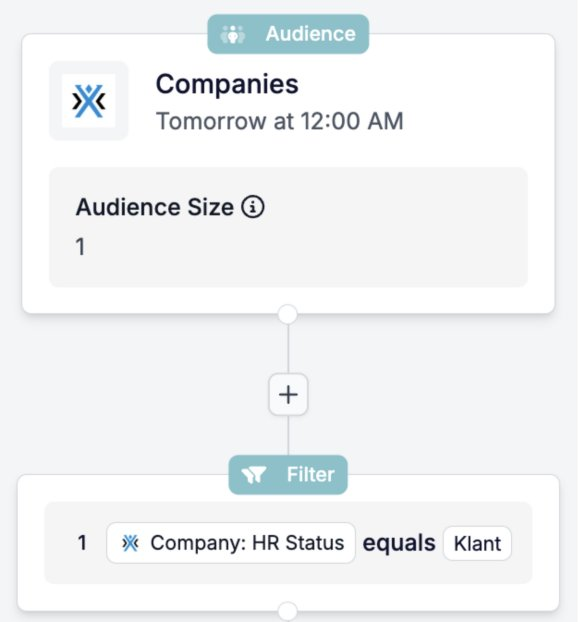
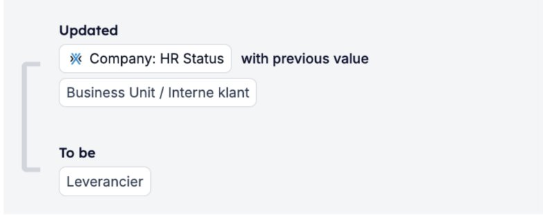

In Carerix kan een bedrijf een status per vakgebied (business line) hebben, bijvoorbeeld één voor HR en één voor Finance. HireData toont elk van die statussen als een eigen veld, met de naam van het vakgebied erin, bijvoorbeeld **Company: HR Status**. Een automatisering kan nu de status van precies één vakgebied controleren of wijzigen.

Voorheen kwamen alle vakgebiedstatussen binnen als één veld, **Company: Status**, waardoor een automatisering niet wist naar welk vakgebied ze keek of welk ze bijwerkte.

## Filteren op één vakgebied

Gebruik het vakgebiedveld overal waar je bedrijven filtert:

- het startfilter van een automatisering
- een **Filter**-stap
- de doelgroep van een geplande automatisering over bedrijven

Bijvoorbeeld: **Company: HR Status** is gelijk aan de status waarop je wilt richten. Bedrijven met die status in een ander vakgebied komen er niet door.

## Eén vakgebied bijwerken

Kies in een [**Update Field(s)**-taak in Carerix](/nl/apps/carerix/update-fields-in-carerix-with-hiredata) het statusveld van het vakgebied dat je wilt wijzigen, zoals **Company: HR Status**, en kies de nieuwe waarde. Alleen de status van dat vakgebied verandert. De andere vakgebieden houden hun status.

Bijvoorbeeld: zodra een plaatsing is aangemaakt, zet je de status van de klant voor dat vakgebied op de waarde die je team voor actieve klanten gebruikt.

## Controleren wat er is veranderd

Open een run en klik op de update-stap. Je ziet het veld met de vorige waarde, en de nieuwe waarde onder **To be**.

## Gerelateerd

- [Velden in Carerix bijwerken](/nl/apps/carerix/update-fields-in-carerix-with-hiredata)
- [Filter](/nl/reference/automations/steps/filter)
- [Velden en relaties activeren](/nl/apps/carerix/how-to-enable-carerix-fields-and-relationships-in-your-automations)
