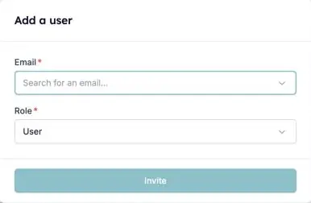

Je hebt de HireData-RMA in Carerix geactiveerd, maar sommige collega's staan niet in HireData. HireData synchroniseert je Carerix-gebruikers bij het koppelen en daarna elke dag opnieuw. Ontbreekt iemand nog na een [handmatige synchronisatie](/nl/apps/carerix/manually-sync-carerix-with-hiredata), dan zit daar meestal een van de onderstaande redenen achter.

### 1. De gebruiker gebruikt HireData al in een ander account

Een persoon heeft één HireData-login, en die login kan bij meerdere accounts horen. Dat gebeurt als je organisatie meer dan één Carerix-omgeving heeft, bijvoorbeeld één per merk of label.

Gebruikt de persoon HireData al via een andere omgeving, nodig hem dan ook uit voor dit account:

1. Open **Settings** en ga naar **Users**.
2. Klik op **Add User**, vul het e-mailadres van de persoon in en kies de rol.
3. De persoon accepteert de uitnodiging vanuit de e-mail.

<Frame caption="Nodig een collega uit die HireData al in een ander account gebruikt.">
  
</Frame>

Na het accepteren opent de persoon het menu onder zijn naam, kiest **Switch Account** en kiest het account dat hij nodig heeft. Zie [Gebruikers uitnodigen voor je account](/nl/introduction/invite-users-to-your-account) voor rollen en het opnieuw versturen van een uitnodiging.

### 2. De gebruiker heeft geen e-mailadres in Carerix

HireData herkent gebruikers aan hun e-mailadres. Een Carerix-gebruiker zonder e-mailadres kan niet aan een HireData-gebruiker worden gekoppeld. Vul het e-mailadres in Carerix in en voer daarna een [handmatige synchronisatie](/nl/apps/carerix/manually-sync-carerix-with-hiredata) uit.

### 3. De gebruiker heeft een gedeeld algemeen adres

Adressen zoals `projects@carerix.com` en `test@example.com` horen niet bij één echte persoon, dus HireData synchroniseert ze nooit. Geef de gebruiker een eigen e-mailadres in Carerix en synchroniseer opnieuw.

## Probeer het zelf

Open [Users in HireData](https://app.hiredata.com/settings/account/users) om te zien wie er gesynchroniseerd is en nodig iedereen uit die ontbreekt. Kom je er niet uit? Neem contact met ons op via de chat in HireData.
