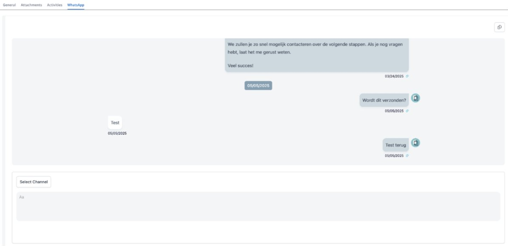

Open je een kandidaat of een match in Carerix, dan toont het tabblad **WhatsApp** het WhatsApp-gesprek met die kandidaat. Je ziet de chat waar je al aan het werk bent, bijvoorbeeld als je een gesprek voorbereidt, in plaats van hem in de inbox te zoeken.

## Waar je het vindt

- **Kandidaat:** open de kandidaat en klik op het tabblad **WhatsApp**, aan het eind van de rij tabbladen.
- **Match:** open de match en klik op het tabblad **WhatsApp**, naast **General**, **Attachments** en **Activities**. Je ziet de chat met de kandidaat van die match.

Het tabblad hoort bij de HireData-app in Carerix (Carerix RMA). Zie je het niet, controleer dan of de app [gekoppeld](/nl/apps/carerix/connect-with-carerix) is.

## Wat het tabblad laat zien

- Elk bericht in het gesprek, verzonden en ontvangen, elk met zijn datum.
- Bestanden die de kandidaat je stuurde, zoals een cv.
- Een berichtvak onderaan. Kies een kanaal bij **Select Channel**, typ je bericht en verstuur het.

WhatsApp laat je alleen een vrij bericht sturen binnen 24 uur na het laatste antwoord van de kandidaat. Daarna begin je met een goedgekeurde template. Zie [Basis van de WhatsApp-inbox](/nl/apps/messaging/whatsapp/whatsapp-inbox-basics).

## Gerelateerd

- [Teller voor actieve WhatsApp-chats in Carerix RMA](/nl/apps/carerix/whatsapp-active-chats-counter-in-carerix-rma)
- [WhatsApp-gesprekken vastleggen in Carerix](/nl/apps/carerix/logging-whatsapp-conversations-in-carerix-with-hiredata)
