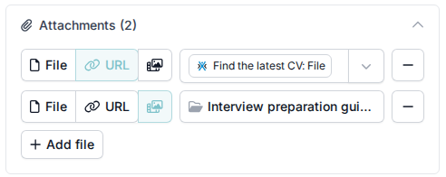
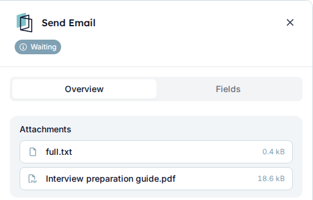

De taak **Send Email** kan nu bestanden bijvoegen. Stuur het nieuwste cv van een kandidaat naar de recruiter of een klant, of voeg dezelfde pdf, zoals een gids ter voorbereiding op een sollicitatiegesprek, toe aan elke e-mail die een automatisering verstuurt.

## Waar je bijlagen toevoegt

Open de taak **Send Email** in je automatisering. Onder **Settings** vind je het onderdeel **Attachments**, naast **Recipient**, **CC and BCC** en **Sender**.

Klik op **Add file** om een rij toe te voegen. Elke rij heeft drie bronnen om uit te kiezen:

- **File** voegt een bestand toe uit een eerdere stap in de automatisering, zoals het cv van een kandidaat. Kies het bij **Choose an uploaded file**.
- **URL** voegt het bestand op een webadres toe.
- **Media library** (het afbeeldingsicoon) voegt een bestand toe dat je naar HireData hebt geüpload, zoals een standaard-pdf.

Voeg zoveel rijen toe als je nodig hebt. Met de knop **−** verwijder je een rij.

## Het nieuwste cv van een kandidaat bijvoegen

Wil je een bestand bijvoegen dat bij een Carerix- of Spott-record staat, zoek het dan eerst op met een **Find**-stap en voeg het daarna toe.

1. Voeg vóór de taak **Send Email** een **Find**-stap toe die de bestanden van de kandidaat opzoekt. Zijn er meerdere, dan komt het nieuwste bestand eerst, dus je krijgt het nieuwste cv. Zie [Records opzoeken](/nl/automations/look-up-records).
2. Open in de taak **Send Email** het onderdeel **Attachments** en klik op **Add file**.
3. Laat **File** geselecteerd en kies het bestand uit je **Find**-stap, bijvoorbeeld **Find the latest CV: File**.
4. Sla de taak op.

## Controleren wat er is verstuurd

Open een run van de automatisering. De stap **Send Email** toont de bestanden die bij de e-mail zijn gevoegd.

<Tip>
  Test eerst met een testkandidaat en je eigen adres, en controleer de ontvangen e-mail voordat je de automatisering aanzet voor echte kandidaten.
</Tip>

Bijlagen werken in elke automatisering, ook in automatiseringen die vóór de nieuwe automatiseringsbouwer zijn gemaakt.

## Gerelateerd

- [Taak Send Email](/nl/reference/automations/tasks/send-email) legt elke instelling van de taak uit.
- [Records opzoeken](/nl/automations/look-up-records) legt de Find-stap uit.
