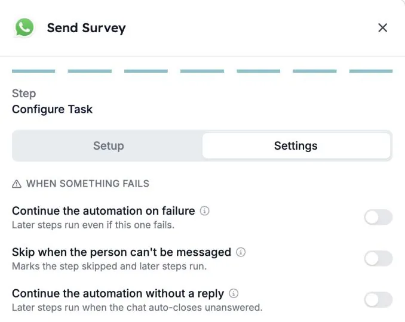
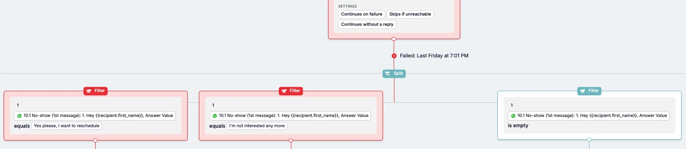

Niet elke kandidaat beantwoordt je WhatsApp. Sommigen reageren nooit, anderen kunnen helemaal geen bericht ontvangen. Elke WhatsApp-stap in een automatisering heeft nu instellingen die bepalen wat er daarna gebeurt: de run stoppen, of doorgaan zodat een latere stap kan opvolgen.

Deze gids legt de drie instellingen uit, hoe je ze aanzet en hoe je een opvolging bouwt voor kandidaten die niet reageren.

## De drie instellingen

Je vindt ze in de WhatsApp-stap, op het tabblad **Settings**, onder **When something fails**.

| Instelling | Wat het doet |
| --- | --- |
| **Continue the automation on failure** | Latere stappen draaien, ook als de WhatsApp-stap mislukt. |
| **Skip when the person can't be messaged** | De stap wordt als overgeslagen gemarkeerd en latere stappen draaien. |
| **Continue the automation without a reply** | Latere stappen draaien als de chat zonder antwoord sluit. |

**Continue the automation without a reply** is alleen beschikbaar voor WhatsApp-gesprekken.

### Wie "geen bericht kan ontvangen"

**Skip when the person can't be messaged** geldt voor mensen die:

- geen telefoonnummer hebben
- zich hebben afgemeld
- geblokkeerd zijn
- al een open chat hebben
- de gesprekslimiet van de automatisering hebben bereikt

## Wat er gebeurt als je niets verandert

- **Nieuwe WhatsApp-stappen** stoppen de run als de stap mislukt en als de kandidaat niet reageert.
- **Bestaande WhatsApp-stappen** houden het gedrag dat ze hadden. De nieuwe instellingen blijven uit tot iemand ze aanzet.

<Note>
  Kandidaten die reageren en daarna stil worden, vallen hier niet onder. Hun runs gaan altijd door.
</Note>

## Een instelling aanzetten

<Steps>
  <Step title="Open de WhatsApp-stap">
    Open je automatisering en klik op de WhatsApp-stap, bijvoorbeeld **Send Survey**.
  </Step>
  <Step title="Ga naar het tabblad Settings">
    Schakel op het laatste scherm van de stap, **Configure Task**, over van **Setup** naar **Settings**.
  </Step>
  <Step title="Zet aan wat je nodig hebt">
    Zet onder **When something fails** een of meer instellingen aan. Elke instelling heeft een korte beschrijving, en het info-icoon ernaast geeft meer uitleg.
  </Step>
  <Step title="Controleer het canvas">
    Terug op het canvas van de automatisering toont de stap welke instellingen aanstaan, zoals **Continues without a reply**, **Continues on failure** en **Skips if unreachable**.
  </Step>
</Steps>

## Voorbeeld: opvolgen bij kandidaten die niet reageren

Stel dat je een WhatsApp-survey stuurt en het opnieuw wilt proberen, of het record van de kandidaat wilt bijwerken, als niemand antwoordt.

1. Zet **Continue the automation without a reply** aan in de WhatsApp-stap.
2. Voeg na de stap een **Split** toe met één **Filter** per uitkomst.
3. Gebruik het antwoord van de kandidaat in de filters. Bijvoorbeeld één filter per antwoordknop, en één filter waarin het antwoord **is empty** voor kandidaten die niet reageerden.
4. Voeg onder het filter voor "geen reactie" de opvolging toe: een herinnering, een e-mail of een update in je ATS.

De stap bewaart ook de reden waarom het niet ging zoals gepland, zoals "geen reactie" of "afgemeld". Filters en takken kunnen die reden ook gebruiken, bijvoorbeeld om alleen een herinnering te sturen naar mensen die niet reageerden.

## Goed om te weten

- **Een bericht dat nooit aankomt, telt als mislukt, niet als geen reactie.** Gebruik **Continue the automation on failure** als latere stappen in dat geval toch moeten draaien.
- **De instellingen werken per stap.** Een automatisering met meerdere WhatsApp-stappen heeft de instellingen nodig op elke stap waar de run moet doorgaan.
- **Stoppen kan nog steeds.** Flows die moeten eindigen als de kandidaat niet reageert, kunnen de instellingen uit laten.

## Probleemoplossing

| Wat je ziet | Wat je controleert |
| --- | --- |
| De run stopt bij de WhatsApp-stap met "Receiver did not reply" | **Continue the automation without a reply** staat uit voor die stap. Zet het aan en controleer of de stappen erna het geval zonder reactie afhandelen. |
| Latere stappen draaien niet voor mensen zonder telefoonnummer of die zich hebben afgemeld | Zet **Skip when the person can't be messaged** aan. |
| Latere stappen draaien niet als een bericht niet is afgeleverd | Zet **Continue the automation on failure** aan. |

Zie [Redenen voor geannuleerde runs](/nl/knowledge-base/run-cancellation-reasons) voor andere redenen waarom een run kan stoppen.

## Gerelateerd

- [Een WhatsApp-automatisering maken in HireData](/nl/apps/messaging/whatsapp/create-a-whatsapp-automation-in-hiredata)
- [Formulieren gebruiken in WhatsApp-gesprekken](/nl/apps/messaging/whatsapp/how-to-use-forms-in-whatsapp-conversations)
- De stappen [Filter](/nl/reference/automations/steps/filter) en [Split](/nl/reference/automations/steps/split)
- [Veiligheidslimieten voor automatiseringen](/nl/settings/automation-safety-limits)
