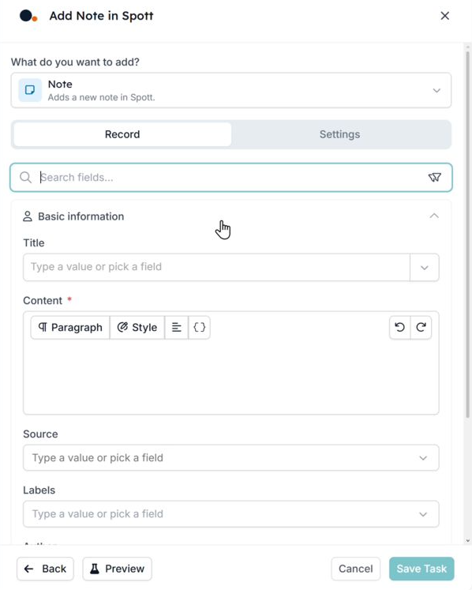
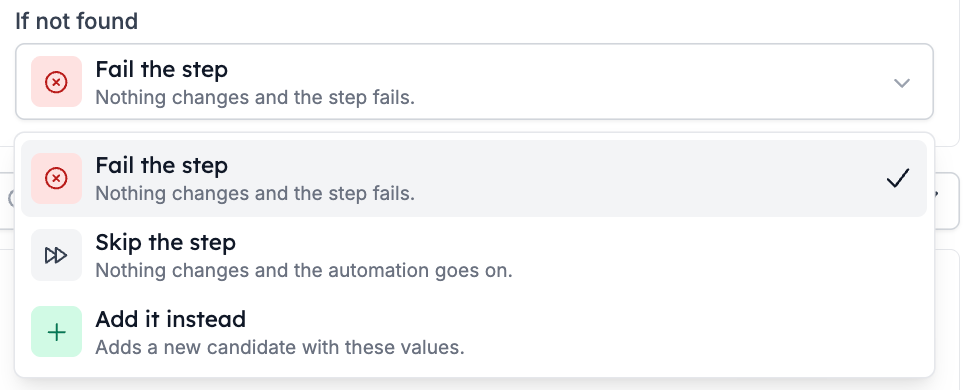
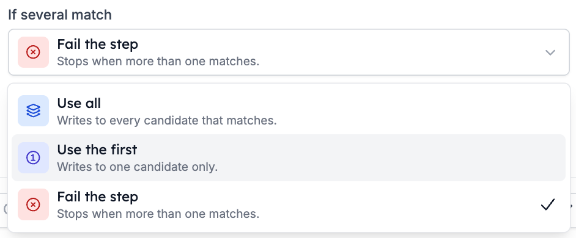
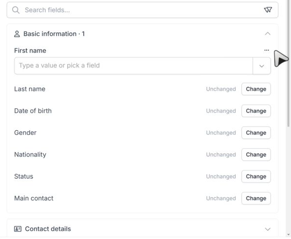
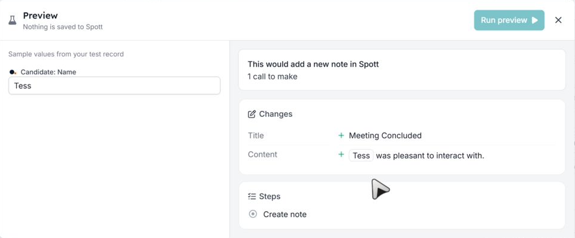
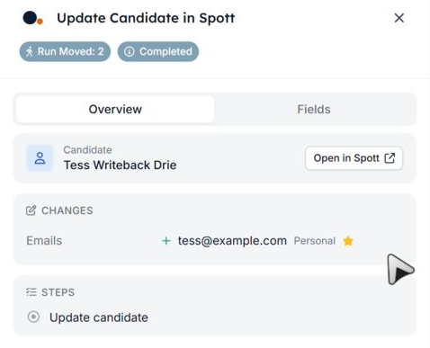

Je automatiseringen kunnen nu terugschrijven naar Spott. Leg een notitie vast na een WhatsApp-gesprek, zet een sollicitatie in de volgende fase wanneer een kandidaat een formulier invult, of houd de contactgegevens van een kandidaat actueel, zonder dat iemand het in Spott hoeft over te typen.

## Stap 1: Voeg een Spott-stap toe

Klik in je automatisering op **\+** en kies de Spott-stap die je nodig hebt. Er is één stap per actie en Spott-object, zoals **Add Note in Spott**, **Update Candidate in Spott** of **Delete Note in Spott**.

Bij **What do you want to add?** kun je altijd naar een ander Spott-object wisselen.

## Stap 2: Kies het record dat je wilt wijzigen

Voor bijwerken of verwijderen vertel je HireData welk Spott-record het moet wijzigen:

- **Op ID**, bijvoorbeeld de kandidaat die de automatisering startte.
- **Met voorwaarden** die het record vinden, bijvoorbeeld de kandidaat met een bepaald e-mailadres.

Kies daarna wat er gebeurt als het record niet gevonden wordt:

- **Fail the step:** er verandert niets en de stap mislukt. Dit is de standaard.
- **Skip the step:** er verandert niets en de automatisering gaat verder.
- **Add it instead:** voegt een nieuw record met deze waarden toe.

Vinden je voorwaarden meer dan één record, kies dan **Use all**, **Use the first** of **Fail the step**.

## Stap 3: Vul de velden in

Typ een waarde of kies een veld van eerder in de automatisering, zoals een formulierantwoord. Velden die je niet aanraakt tonen **Unchanged** en blijven in Spott zoals ze zijn. Klik op **Change** om een nieuwe waarde in te stellen, of maak het veld leeg.

Bij lijsten, zoals de e-mailadressen van een kandidaat, kun je een item toevoegen, de hele lijst vervangen of overeenkomende items verwijderen.

Een paar dingen regelt HireData voor je:

- **Antwoorden worden gekoppeld aan de keuzes in Spott** op naam of waarde, zodat een formulierantwoord zoals "ja" of de naam van een fase bij de juiste optie terechtkomt.
- **Getallen en datums** worden gelezen zoals je workspace ze schrijft.
- **Nieuwe sollicitaties en vacatures** kunnen op een bepaalde pipeline-track worden gezet, en een sollicitatie op een subfase.
- **Een waarde die niet gelezen kan worden** stopt de stap en laat zien welke waarde het was, in plaats van het veld in Spott leeg te maken.

<Tip>
  Een update wijzigt alleen de velden die je instelt. Zou er niets veranderen, dan wordt de stap overgeslagen in plaats van dezelfde waarden opnieuw op te slaan, en de run legt uit waarom.
</Tip>

## Stap 4: Bekijk een voorbeeld voordat je opslaat

Klik op **Preview**, zoek op naam een voorbeeldrecord en klik op **Run preview**. Je ziet precies wat er zou worden toegevoegd of gewijzigd. Er wordt niets in Spott opgeslagen.

## Stap 5: Controleer wat er is opgeslagen

Open een run en klik op de Spott-stap. Je ziet welk record is gewijzigd, elk gewijzigd veld met de oude en nieuwe waarde, en **Open in Spott** om direct naar het record te gaan.

Gaat er iets mis, dan legt de run het in gewone taal uit, zoals **Record not found**.

## Wat nog niet kan

- **Vacatures** kunnen niet worden verwijderd, omdat Spott dat niet toestaat.
- **Plaatsingen** kunnen worden bijgewerkt, maar niet toegevoegd of verwijderd.

## Gerelateerd

- [Een Spott-automatisering maken](/nl/apps/spott/create-a-spott-automation-in-hiredata)
- [Een automatisering testen](/nl/automations/how-to-test-an-automation)
