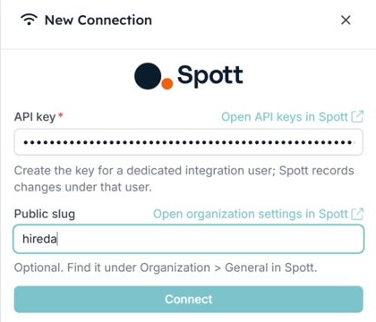
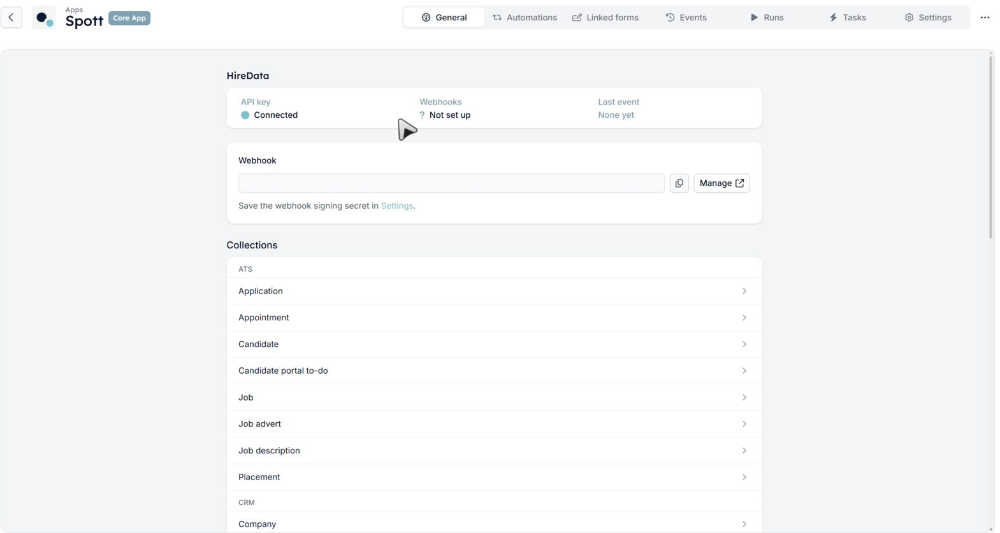

Koppel Spott één keer, en wijzigingen in Spott starten je HireData-automatiseringen.

## Voordat je begint

- Je hebt een Spott-gebruiker nodig die API-sleutels en webhook-endpoints kan aanmaken in Spott.
- Je hebt een HireData-admin nodig om de app toe te voegen.

## Stap 1: Voeg je API-sleutel toe

1. Ga naar **Settings** > [**Apps**](https://app.hiredata.com/settings/apps). Spott staat bovenaan.
2. Open **Spott** en klik op **Connect to Spott**.
3. Klik op **Open API keys in Spott**, maak een nieuwe sleutel aan en kopieer die. Gebruik een aparte integratiegebruiker: Spott registreert wijzigingen onder die gebruiker.
4. Plak de sleutel bij **API key**. De **Public slug** is optioneel; je vindt hem in Spott onder Organization > General.
5. Klik op **Connect**. HireData controleert de sleutel bij Spott voordat de koppeling wordt opgeslagen.

Daarna synchroniseert HireData je Spott-velddefinities en gebruikers. De tijdlijn **Data sync** op het tabblad **General** toont elke stap.

## Stap 2: Voeg de webhook toe in Spott

Spott laat HireData via een webhook weten wat er verandert. Je stelt die één keer in, in Spott.

1. Kopieer op het tabblad **General** van de Spott-koppeling het adres onder **Webhook**. **Manage** opent de webhookinstellingen in Spott.
2. Voeg in Spott een nieuw endpoint toe, plak het adres en selecteer alle events.
3. Kopieer het signing secret dat Spott je laat zien.
4. Open in HireData het tabblad **Settings** van de Spott-koppeling en plak het als webhook signing secret. Sla op.

HireData accepteert alleen events die met dit secret zijn ondertekend, dus zonder secret werkt de webhook niet.

## Stap 3: Controleer of events binnenkomen

Wijzig een testkandidaat in Spott. Het tabblad **General** laat dan zien wanneer het laatste event binnenkwam, en het event staat op het tabblad **Events**.

Je bent klaar om [je eerste Spott-automatisering te maken](/nl/apps/spott/create-a-spott-automation-in-hiredata).

<Note>
  De eerste synchronisatie importeert niet al je Spott-records. Records komen binnen wanneer ze in Spott veranderen, wanneer een automatisering ze opzoekt of wanneer een geplande automatisering loopt.
</Note>
