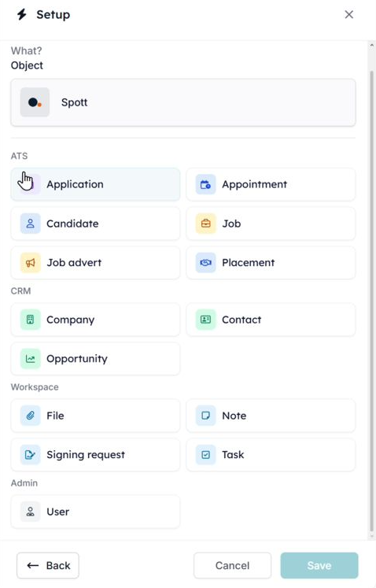
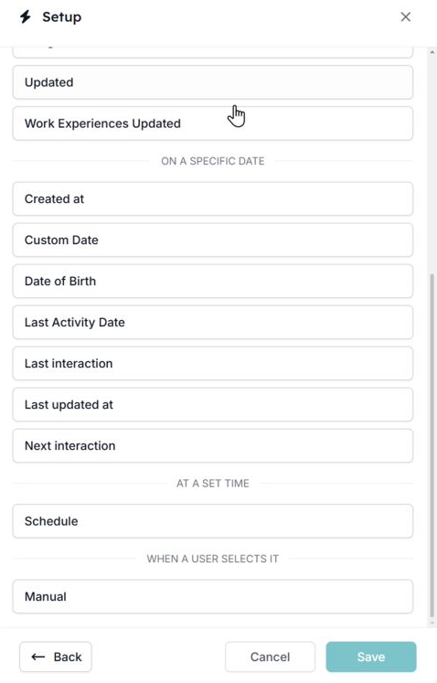

Zodra [Spott gekoppeld is](/nl/apps/spott/connect-with-spott), kan elke wijziging in Spott een automatisering starten.

## Stap 1: Kies een Spott-object

Ga naar [**Automations**](https://app.hiredata.com/automations) en maak een nieuwe automatisering. Kies in **Setup** voor **Spott** en daarna het object waar de automatisering over gaat.

De objecten zijn gegroepeerd zoals Spott ze groepeert: ATS, CRM, Workspace en Admin. De namen volgen Spott, zoals **Job** en **Job advert**.

## Stap 2: Kies hoe hij start

- **Een event**, zoals een sollicitatie die wordt aangemaakt, bijgewerkt of naar een andere fase gaat, of een opportunity die wordt aangemaakt, bijgewerkt, verwijderd of naar een andere fase gaat.
- **Op een bepaalde datum**, zoals een week na de startdatum van een plaatsing. Kies een van de datumvelden van het object, of **Custom Date**.
- **Op een vast moment**: **Schedule** laat de automatisering lopen over een groep records, bijvoorbeeld elke maandag.
- **Wanneer een gebruiker hem kiest**: **Manual** start hem handmatig voor één record.

## Stap 3: Alleen starten voor één track of fase

Gebruik je in Spott meerdere pipeline-tracks, dan kun je een sollicitatie-automatisering beperken tot één track, en tot een fase binnen die track.

- Voeg een startfilter toe op **Stage track IDs** om de track te kiezen.
- Voeg een startfilter toe op **Stage ID** om de fase te kiezen. Fases met dezelfde naam tonen hun track ernaast, zodat je ze uit elkaar houdt.

Een sollicitatie in een andere track start de automatisering niet, ook niet als de fase dezelfde naam heeft.

<Tip>
  **Track ID** is gemarkeerd als **(legacy)** omdat Spott het wil verwijderen. Gebruik in plaats daarvan **Stage track IDs**; dat werkt in filters op dezelfde manier.
</Tip>

### Geplande automatiseringen

Een geplande automatisering biedt alleen de filters waarop Spott zelf kan zoeken. Wil je de doelgroep verder beperken, voeg dan na de start een **Filter**-stap toe.

Spott geeft niet door hoeveel records overeenkomen, dus de builder kan de grootte van de doelgroep niet vooraf tonen. De automatisering loopt wel alle passende records door.

## Stap 4: Voeg je bericht toe

Voeg een stap toe zoals **Send Email** of een WhatsApp-bericht. Elk gesynchroniseerd Spott-veld is beschikbaar als variabele:

- Gekoppelde records komen mee: een sollicitatie bevat de kandidaat en de vacature, en een plaatsing de kandidaat, de klant en de vacature.
- Scorecards van sollicitaties en vacatures zijn beschikbaar.
- Klanten tonen hun laatste contactdatum en met wie dat contact was.

Wil je zien welke velden voor een record binnenkwamen, open dan het event op het tabblad **Events**, of bekijk het object in **Collections**.

## Stap 5: Testen en activeren

[Test de automatisering](/nl/automations/how-to-test-an-automation) met een testrecord en klik daarna op **Activate**.
