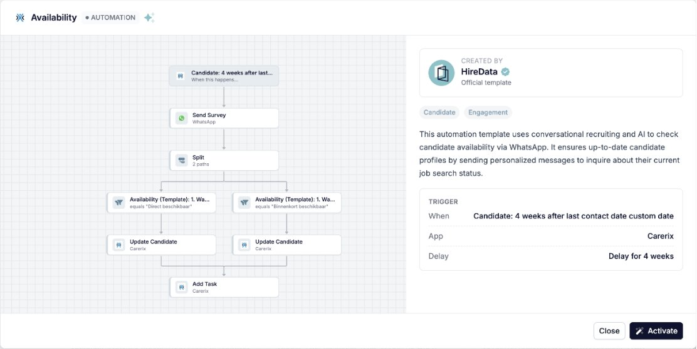
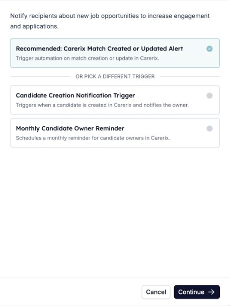

_Ontdek de kracht van automatiseringen in deze beknopte video-uitleg, die alles behandelt van basisconcepten tot het opzetten van je eigen automatisering. De video bevat een gedetailleerde productdemo en inzichten over event-getriggerde vs. geplande automatiseringen._

<iframe src="https://www.loom.com/embed/75f5e793351a48aaa98179881f670d91" title="Loom video" allowFullScreen className="w-full aspect-video rounded-xl"></iframe>

<CardGroup cols={3}>
  <Card title="Automation Builder: Overzicht" icon="diagram-project" href="/reference/automations/overview">
    Selecteer een stap en zie wat deze in een run doet.
  </Card>

  <Card title="Taakcatalogus" icon="list-check" href="/reference/automations/task-catalogue">
    Vind de taken die voor elke gekoppelde app beschikbaar zijn en de referentie voor elke taak.
  </Card>

  <Card title="Een run volgen" icon="route" href="/reference/automations/follow-a-run">
    Volg een event door zijn run, stapdata, taak en uitkomst.
  </Card>
</CardGroup>

## Starten vanuit een template

Je hoeft niet elke automatisering vanaf nul te bouwen. Klik op **New Automation** in [Automations](https://app.hiredata.com/automations) om de templatebibliotheek te openen: kant-en-klare automatiseringen, en e-mail- en WhatsApp-templates met een passende trigger. Filter op app of type, of zoek.

### Een automatiseringstemplate bekijken

Klik op een template om te zien wat het doet voordat je het gebruikt:

- de stappen van de automatisering, als diagram
- wie het heeft gemaakt, zoals HireData of een partner
- de tags en een korte beschrijving
- onder **Trigger**: wanneer het start (**When**), de **App** en een eventuele **Delay**

Klik op **Activate** om de automatisering vanuit het template te maken, of op **Close** om terug te gaan. Controleer de nieuwe automatisering en [test hem](/nl/automations/how-to-test-an-automation) voordat echte kandidaten erdoorheen gaan.

### Starten vanuit een e-mail- of WhatsApp-template

Kies een e-mail- of WhatsApp-template en de preview toont het bericht, met rechts de trigger om het mee te starten. De aanbevolen trigger is geselecteerd. Onder **Or pick a different trigger** kies je een andere. Klik op **Continue** om de automatisering met dat template en die trigger te maken.

