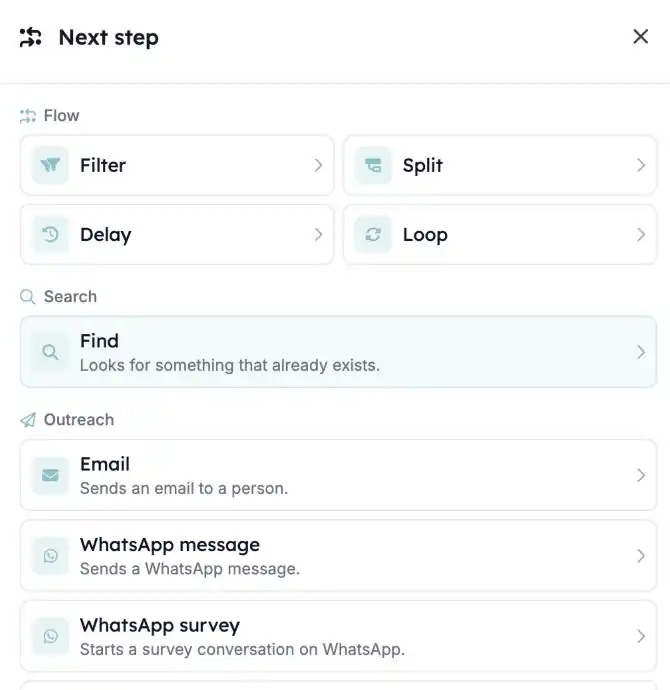

Een automatisering bouwen werkt nu als kiezen uit een opgeruimde gereedschapskist. Als je een stap toevoegt, staat elke optie in een sectie die zegt wat ze doet, zodat je vindt wat je nodig hebt zonder de technische naam te kennen.

<Note>
  De nieuwe automation builder is onderdeel van de HireData-bèta. Vraag je contactpersoon bij HireData om je workspace toe te voegen. Je bestaande automatiseringen blijven precies zo werken als nu.
</Note>

## Vind sneller de juiste stap

Open een nieuwe automatisering in [Automations](https://app.hiredata.com/automations) en klik op **\+**. De stappen zijn gegroepeerd op wat ze voor je doen.

### 1. Stappen gegroepeerd op wat ze doen

- **Flow**: bepaal wie doorgaat (Filter), neem verschillende routes (Split), wacht (Delay) of herhaal stappen (Loop).
- **Search**: zoek een kandidaat, contactpersoon of ander record op met **Find**.
- **Outreach**: stuur een **Email**, een **WhatsApp message**, een **WhatsApp survey** of een **Ratecard survey**. WhatsApp-opties verschijnen zodra WhatsApp is gekoppeld.
- **Records**: **Add** of **Update** een record in je ATS of in HireData.
- **AI and tools**: laat **Ask AI** schrijven, sorteren of informatie eruit halen, of stuur een **HTTP request** naar een ander systeem.
- **Human in the loop**: laat een collega een stap eerst goedkeuren met een [Review](/nl/automations/reviews).
- **Lifecycle**: **Archive**, **Restore** of **Delete** een record.

### 2. Eén manier om elk record te wijzigen

Records toevoegen, bijwerken, archiveren en herstellen werkt nu hetzelfde in elke gekoppelde app. In Carerix kun je bijvoorbeeld kandidaten, contactpersonen, bedrijven en vacatures toevoegen, of de opleiding en vaardigheden van een kandidaat bijwerken.

### 3. Je huidige automatiseringen blijven zoals ze zijn

Automatiseringen die je al hebt gebouwd, houden hun stappen en de vorige builder. Deelnemen aan de bèta zet ze niet over. Start een nieuwe automatisering om de nieuwe builder te proberen, en neem contact met ons op voordat je een bestaande overzet.

## Wat is er nog meer veranderd?

- **Prompt heet nu Ask AI.**
- **Sommige oudere stappen worden niet meer aangeboden in nieuwe automatiseringen**: Find Email, Verify Email, Search Domain, Sync Person (vervangen door de stappen voor HireData-personen) en Post Webhook (vervangen door HTTP request). Automatiseringen die ze al gebruiken, blijven draaien.
- **Om een automatisering te testen heb je bewerkrechten nodig**, omdat een test berichten kan versturen en records kan wijzigen.

## Probeer het zelf

Maak een nieuwe automatisering in [Automations](https://app.hiredata.com/automations) en klik op **\+** om de nieuwe stappenlijst te zien.
