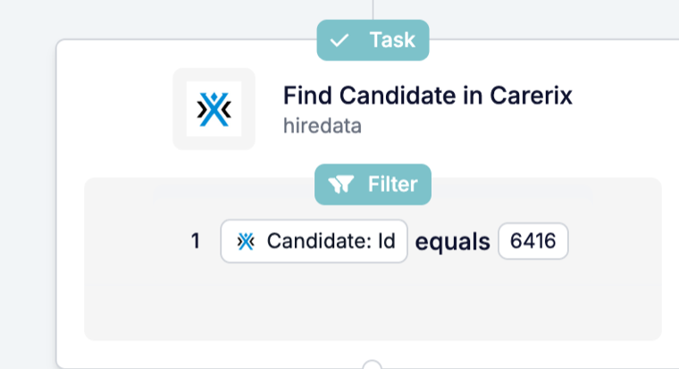

Vaak is het record dat je nodig hebt niet het record dat de automatisering startte. **Find** zoekt het op, zodat latere stappen het kunnen bijwerken, er een bericht naar kunnen sturen of de bestanden ervan kunnen bijvoegen.

<Note>
  Deze pagina beschrijft Find in de [nieuwe automation builder](/nl/automations/engine-1-3), onderdeel van de HireData-bèta.
</Note>

## Zoek halverwege een automatisering een record op

Klik op **\+** in je automatisering: **Find** staat onder **Search** en zoekt iets wat al bestaat, zoals een kandidaat, contactpersoon of HireData-persoon.

### 1. Kies wat je zoekt

Find gebruikt dezelfde objectkiezer als de nieuwe record steps, met dezelfde categorieën, iconen en kleuren. Zoek een Carerix-record op, of een **HireData-persoon**.

### 2. Match op velden die het record herkenbaar maken

Stel de veldwaarden in die het record herkenbaar maken, zoals een id of een e-mailadres. Find blijft matchen op velden die in Carerix zijn uitgezet, zodat lopende automatiseringen dezelfde records blijven vinden.

### 3. Gebruik het resultaat in latere stappen

Het record dat Find teruggeeft, is in latere stappen beschikbaar onder de naam van de stap. Een veelgebruikt patroon: zoek het record met Find en werk het daarna bij met [Update](/nl/reference/automations/steps/update).

## Wat is er nog meer veranderd?

- **Run history** toont de namen van de records die Find heeft gevonden, ook van HireData-personen.
- **Find Email** en **Search Domain** worden niet meer aangeboden in de nieuwe automation builder.

Alle instellingen vind je in de [Find-referentie](/nl/reference/automations/steps/find).

## Probeer het zelf

Open een automatisering in [Automations](https://app.hiredata.com/automations), klik op **\+** en kies **Find** onder **Search**.
