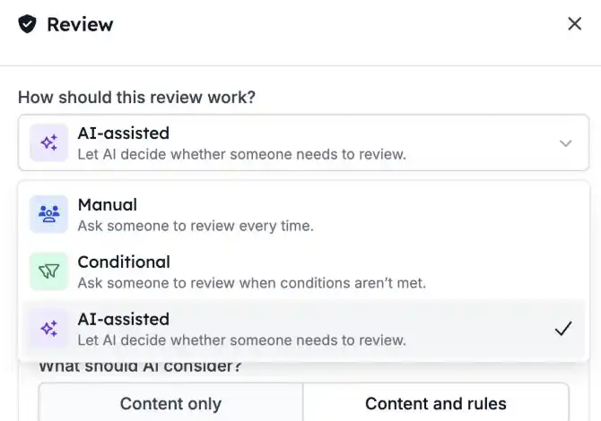
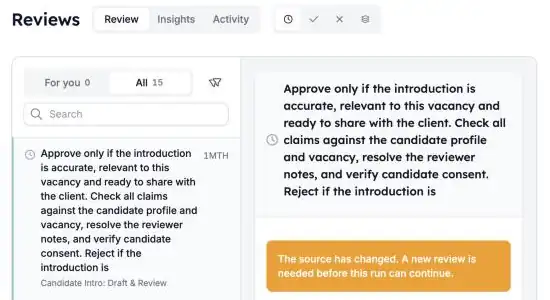

Sommige stappen wil je automatiseren, maar niet zonder eerst een menselijke check. Met **Reviews** pauzeert een automatisering tot iemand goedkeurt of afwijst. Keur je goed, dan gaat de run verder; wijs je af, dan stopt hij.

<Note>
  Reviews is onderdeel van de HireData-bèta en wordt per workspace aangezet. Vraag je contactpersoon bij HireData om het voor jouw workspace aan te zetten.
</Note>

## Pauzeer een run tot iemand beslist

Voeg een **Review**-stap toe waar de automatisering moet wachten. Klik in de [nieuwe automation builder](/nl/automations/engine-1-3) op **\+** en kies **Review** onder **Human in the loop**.

### 1. Kies hoe de review werkt

Een Review-stap heeft drie modi:

- **Manual**: er kijkt altijd een persoon naar. Dit is de standaard.
- **Conditional**: een persoon kijkt alleen als de voorwaarden die je instelt daarom vragen.
- **AI-assisted**: AI controleert de inhoud eerst aan de hand van je criteria en vraagt een persoon als het twijfelt of als er informatie ontbreekt.

Stel in wat de reviewer ziet: de inhoud om te beoordelen, de criteria en eventueel extra context. Je kunt variabelen uit eerdere stappen invoegen.

### 2. Beoordeel vanuit één wachtrij

Open [Reviews](https://app.hiredata.com/reviews). **For you** toont de verzoeken die aan jou zijn toegewezen. Admins zien ook **All** en kunnen een verzoek aan iemand anders toewijzen.

Filter op **Pending**, **Approved** of **Rejected**. Selecteer een verzoek om de inhoud, de criteria en links naar de automatisering en de run te zien.

### 3. Goedkeuren of afwijzen

- **Approve**: de run gaat verder met de volgende stap.
- **Reject**: de run stopt.

Je kunt beslissen vanuit de wachtrij of direct vanuit de run. Met een korte undo-periode kun je een beslissing terugdraaien voordat die ingaat.

## Goed om te weten

- **Testruns** maken reviews aan die je in de run zelf afhandelt. Ze blijven buiten de gewone wachtrij en buiten **Insights**.
- **Insights** toont het aantal verzoeken en de werklast van het team. **Activity** toont de geschiedenis van beslissingen.
- **Is een automatisering gewijzigd** nadat een review is aangevraagd, dan kan een admin het verouderde verzoek vervangen.

## Probeer het zelf

Open een automatisering in [Automations](https://app.hiredata.com/automations), voeg een **Review**-stap toe vóór de actie die je gecontroleerd wilt hebben en start een test. Keur hem daarna goed vanuit [Reviews](https://app.hiredata.com/reviews).
