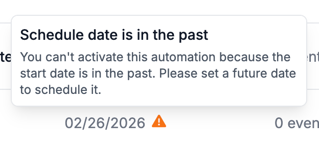
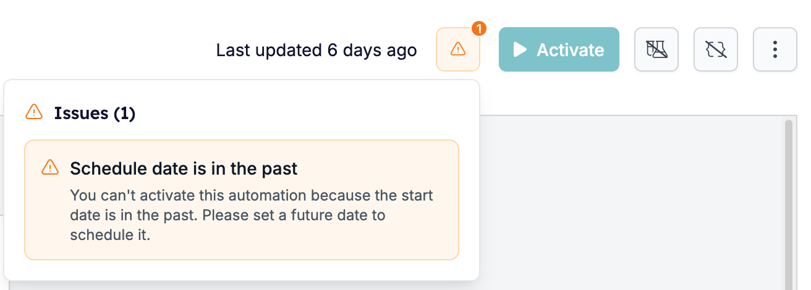

Sommige automatiseringen hoeven niet te wachten tot er iets gebeurt in je ATS. Een maandelijkse NPS-enquête, een nieuwsbrief of een jaarlijkse datacheck wil je versturen op een datum die jij kiest. Een geplande automatisering draait op het tijdstip dat je instelt, voor elk record in de doelgroep die je selecteert, eenmalig of herhaald.

## Het schema instellen

<Steps>
  <Step title="Kies het object">
    Open de automatisering en klik op het **Start**-blok. Kies je app en het object waarvoor de automatisering draait, zoals **Candidate**.
  </Step>
  <Step title="Kies Schedule">
    Ga onder **Timing** naar **AT A SET TIME** en klik op **Schedule**. Je ziet deze optie alleen bij objecten die je kunt inplannen.
  </Step>
  <Step title="Stel in wanneer hij draait">
    - **Run at** is de datum en tijd van de eerste run.
    - **Repeat every** bepaalt hoe vaak hij opnieuw draait: dagen, weken, maanden, kwartalen, een half jaar of een jaar. Kies **Don't repeat** voor één run. Bij weken en maanden zie je eronder op welke dag hij herhaalt, zoals "On day 28".
    - **Until** stopt de herhaling op een datum. Zet **Enable** aan om er een in te stellen. Laat je het uit, dan blijft de automatisering herhalen tot je hem pauzeert.
  </Step>
  <Step title="Selecteer de doelgroep">
    Voeg onder **Audience Selection** filters toe, zodat de automatisering alleen draait voor de records die je wilt.
  </Step>
  <Step title="Activeer">
    Klik op **Activate**. De automatisering staat nu gepland op de datum bij **Run at**.
  </Step>
</Steps>

## De startdatum moet in de toekomst liggen

Je kunt een geplande automatisering alleen activeren zolang de datum bij **Run at** nog moet komen. Is die datum voorbij, dan wordt de automatisering niet geactiveerd en houdt hij zijn vorige status. Je ziet dan de melding: "This automation could not be scheduled because the configured start date is in the past."

HireData waarschuwt je al eerder:

- **In de lijst met automatiseringen** staat een oranje waarschuwingsicoon naast de startdatum. Ga erop staan om de waarschuwing te lezen.
- **Op de pagina van de automatisering** staat een waarschuwingsknop naast **Activate**. Klik erop om het probleem **Schedule date is in the past** te zien.

<Frame caption="De waarschuwing naast een startdatum in de lijst met automatiseringen.">
  
</Frame>

<Frame caption="Het vak Issues naast de knop Activate.">
  
</Frame>

Oplossen doe je door een nieuwe **Run at**-datum in de toekomst te kiezen en de automatisering opnieuw te activeren.

Hetzelfde geldt voor een geplande automatisering die je hebt gepauzeerd. Pauzeren annuleert de volgende run. Is de startdatum voorbij tegen de tijd dat je hem weer aanzet, kies dan eerst een nieuwe **Run at**-datum.

## Wat het statusicoon je vertelt

Ga op het statusicoon van een automatisering staan om te zien wat het betekent.

| Tooltip | Wat het betekent |
| --- | --- |
| **Not Yet Activated** | De automatisering is nog nooit geactiveerd. |
| **Active** | De automatisering staat aan. |
| **Scheduled** | De automatisering is geactiveerd en de volgende run is gepland. |
| **Scheduling Runs** | De automatisering start op dit moment runs voor de doelgroep. |
| **Paused** | Er draait niets nieuws tot je de automatisering weer activeert. |
| **System Flagged The Automation** | HireData heeft de automatisering gestopt na een fout, bijvoorbeeld omdat de koppeling met de app niet meer werkte of runs niet konden worden ingepland. Los de oorzaak op en activeer hem daarna opnieuw. |
| **Finished Scheduling Runs** | De laatste geplande run is klaar en er is geen volgende datum, bijvoorbeeld omdat de **Until**-datum voorbij is. |

## Goed om te weten

- **De start zit vast terwijl runs worden ingepland.** Zolang de status **Scheduling Runs** is, kun je de trigger, het schema, de doelgroepfilters en het type automatisering niet wijzigen. Wacht tot dat klaar is.
- **Een automatisering die zijn schema kwijtraakt, wordt gepauzeerd.** Raakt een actieve geplande automatisering zijn schema kwijt, of lukt het niet om een nieuw schema in te stellen terwijl je hem bewerkt, dan pauzeert HireData hem, zodat hij niet op het verkeerde moment draait.
- **Een kopie neemt het schema niet over.** Dupliceer je een geplande automatisering, dan staat de kopie niet gepland. Activeer de kopie om hem in te plannen.
- **Activeer je meerdere automatiseringen tegelijk** vanuit de lijst, dan zie je hoeveel er gelukt zijn, bijvoorbeeld "2 of 3 automations activated. 1 could not be scheduled." Controleer de startdatum van de automatiseringen die niet lukten.

## Probeer het zelf

Open [Automations](https://app.hiredata.com/automations), klik op het **Start**-blok van een automatisering en kies **Schedule** onder **AT A SET TIME**.

## Gerelateerd

- [Je automatiseringen testen](/nl/automations/how-to-test-an-automation)
- [Waarom draaide mijn automatisering niet?](/nl/knowledge-base/why-didnt-my-automation-run)
- [Een e-mailnieuwsbrief naar je doelgroep sturen](/nl/apps/messaging/emails/sending-an-email-newsletter-to-your-audience)
- [Naslag: Setup-stap](/nl/reference/automations/steps/setup)
