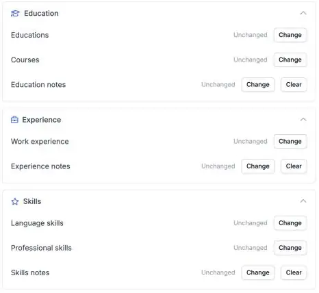

Een volledig kandidaatprofiel is makkelijker te matchen. Je automatiseringen kunnen nu de opleiding, vakvaardigheden en talen van een kandidaat in Carerix invullen, zodat niemand ze met de hand hoeft over te nemen.

<Note>
  Dit is onderdeel van de HireData-bèta en werkt in de [nieuwe automation builder](/nl/automations/engine-1-3). Zie [Zo werkt de bèta](/nl/beta/how-the-beta-works) om deel te nemen.
</Note>

## Vul het kandidaatprofiel automatisch aan

Klik in een nieuwe automatisering op **\+**, kies **Update** onder **Records**, daarna **Carerix** en **Candidate**. Selecteer de kandidaat en vul de sectie in die je nodig hebt.

<Frame caption="Education, Experience en Skills hebben elk een eigen sectie in de stap Update Candidate.">
  
</Frame>

### 1. Opleiding

Stel de naam van de opleiding in, het **instituut**, het diploma, het niveau of de richting, de datums en of het diploma is behaald.

### 2. Vakvaardigheden

Voeg een **vaardigheid** en de **specialisatie** toe.

### 3. Taalvaardigheden

Voeg een **taal** toe met aparte niveaus voor **spreken**, **schrijven** en **lezen**.

Je kunt ook **cursussen** en **werkervaring** toevoegen of bijwerken.

## Voordat je het gebruikt

- **Voeg één gegeven tegelijk toe of wijzig er één tegelijk.** Wil je een bestaande opleiding of vaardigheid wijzigen, kies dat gegeven dan in de stap.
- **Test eerst met een testkandidaat** en controleer in Carerix of de andere gegevens van de kandidaat hetzelfde zijn gebleven.

## Probeer het zelf

Maak een nieuwe automatisering in [Automations](https://app.hiredata.com/automations), klik op **\+**, kies **Update** onder **Records**, daarna **Carerix** en **Candidate**.
