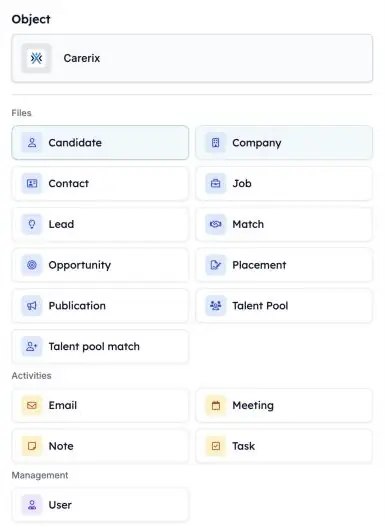
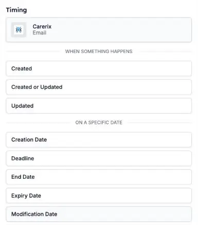

Je automatiseringen kunnen nu op meer reageren van wat er in Carerix gebeurt. Start er een als een consultant een notitie vastlegt, als er een e-mail wordt verstuurd of ontvangen, of als een kandidaat aan een talentpool wordt toegevoegd, zodat de opvolging gebeurt zonder dat iemand eraan hoeft te denken.

<Note>
  Dit is onderdeel van de HireData-bèta. Zie [Zo werkt de bèta](/nl/beta/how-the-beta-works) om deel te nemen.
</Note>

## Kies waarmee je automatisering start

Open je automatisering, klik op het **Start**-blok en kies **Carerix**. Kies onder **Object** waar de automatisering op moet reageren. Kies daarna **wanneer** hij start.

<Frame caption="Kies het Carerix-record waarmee de automatisering start.">
  
</Frame>

### 1. E-mails

Start een automatisering als een e-mail is **verstuurd of ontvangen** en aan Carerix is toegevoegd. Concepten, de outbox, mailings en bulkmails starten er geen.

### 2. Notities

Start een automatisering als er een **notitie** in Carerix wordt toegevoegd, bijvoorbeeld nadat een consultant een intakegesprek heeft vastgelegd.

### 3. Talentpoolmatches

Start een automatisering als het **talentpoollidmaatschap** van een kandidaat verandert, bijvoorbeeld als hij aan een pool wordt toegevoegd.

### 4. Leads en opportunities

Gebruikt je team het salesproces van Carerix, start dan een automatisering vanuit een **lead** of **opportunity**. Zie [Leads & opportunities](/nl/beta/leads-and-opportunities).

## Starten op een datum

Naast **wanneer er iets gebeurt** kun je een automatisering ook **op een bepaalde datum** laten starten, zoals een deadline of een einddatum. Je eigen Carerix-datumvelden staan ook in deze lijst. Een datumveld dat je in Carerix toevoegt, verschijnt hier de volgende dag.

<Frame caption="Kies wanneer de automatisering start: als er iets gebeurt, of op een datum.">
  
</Frame>

## Probeer het zelf

Open een automatisering in [Automations](https://app.hiredata.com/automations), klik op het **Start**-blok, kies **Carerix** en kies **Email**, **Note** of **Talent pool match**.
