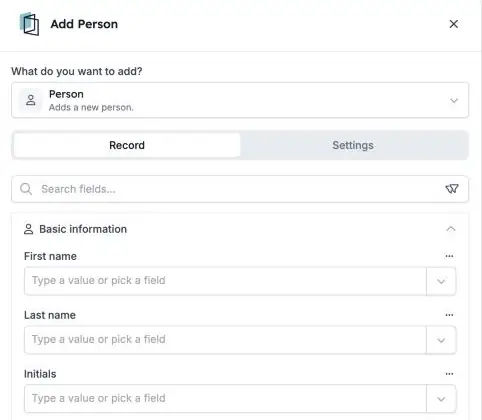

HireData houdt een eigen lijst bij van [personen](/nl/pages/people): de kandidaten, contactpersonen en collega's met wie je werkt. Je automatiseringen kunnen deze personen nu direct toevoegen, bijwerken, opzoeken en verwijderen, met dezelfde stappen die je voor andere records gebruikt.

<Note>
  Dit is onderdeel van de HireData-bèta en werkt in de [nieuwe automation builder](/nl/automations/engine-1-3). Het vervangt de stap **Sync Person** voor nieuwe automatiseringen.
</Note>

## Houd je lijst met personen up-to-date

Klik in een nieuwe automatisering op **\+**. Kies **Add** of **Update** onder **Records**, of **Delete** onder **Lifecycle**, en kies **HireData** en **Person**.

<Frame caption="De stap Add Person, met de gegevens van de persoon in secties.">
  
</Frame>

### 1. Personen toevoegen en bijwerken

Vul elk veld in dat Sync Person kon schrijven, inclusief **adressen** en **UTM-campagnegegevens** die laten zien waar iemand vandaan kwam.

### 2. Zoek de juiste persoon

Gebruik [Find](/nl/automations/look-up-records) met filters om te kiezen welke persoon een stap wijzigt. De run history toont de namen van de personen die gevonden zijn.

### 3. Verwijder zorgvuldig

Een persoon verwijderen is **definitief**. Maak je een stap ongedaan die een persoon heeft toegevoegd, dan verwijdert HireData die persoon weer.

## Goed om te weten

- **Sync Person** wordt niet meer aangeboden in nieuwe automatiseringen. Automatiseringen die het al gebruiken, blijven draaien.
- **Test eerst met een testpersoon**, zodat je niet per ongeluk iemand wijzigt of verwijdert.

## Probeer het zelf

Maak een nieuwe automatisering in [Automations](https://app.hiredata.com/automations), klik op **\+**, kies **Add** onder **Records** en kies **HireData** en **Person**.
