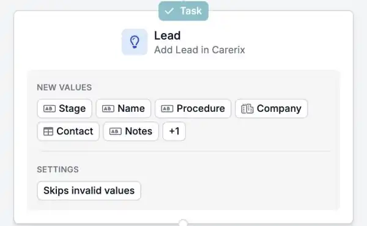

Gebruikt je team het salesproces van Carerix, dan kunnen je automatiseringen nu ook je leads en opportunities volgen. Start een workflow als er een lead binnenkomt of verandert, en houd Carerix up-to-date zonder iets over te typen.

<Note>
  Dit is onderdeel van de HireData-bèta en werkt in de [nieuwe automation builder](/nl/automations/engine-1-3). Het salesproces moet aanstaan in je Carerix-omgeving. Welke opties je ziet, hangt af van hoe Carerix voor jou is ingericht.
</Note>

## Draai je salesworkflows automatisch

### 1. Start een automatisering vanuit een lead of opportunity

Start een automatisering als een lead of opportunity in Carerix wordt **aangemaakt** of **bijgewerkt**, volgens een **schema**, of **handmatig**.

### 2. Zoeken, toevoegen en bijwerken

- **Find** zoekt een bestaande lead of opportunity op.
- **Add** maakt een nieuwe aan. Net als in Carerix zijn **procedure** en **categorie** verplicht.
- **Update** wijzigt een bestaande.

De velden en secties volgen de lead- en opportunityschermen die je al kent uit Carerix.

<Frame caption="Lead en Opportunity staan naast de andere Carerix-records.">
  
</Frame>

<Frame caption="Een stap die een lead in Carerix toevoegt, met de waarden die hij invult.">
  
</Frame>

### 3. Koppel je opvolging

Koppel **notities**, **taken** en **e-mails** aan een lead of opportunity, zodat je consultants de hele geschiedenis op één plek zien.

## Een voorbeeld

Een bedrijf vult je formulier voor een personeelsaanvraag in. Eén automatisering voegt het bedrijf en de contactpersoon toe in Carerix, maakt een lead aan met de gegevens uit het formulier en geeft een consultant een taak om terug te bellen.

## Probeer het zelf

Maak een nieuwe automatisering in [Automations](https://app.hiredata.com/automations), klik op **\+**, kies **Add** onder **Records** en kies **Lead** of **Opportunity**.
