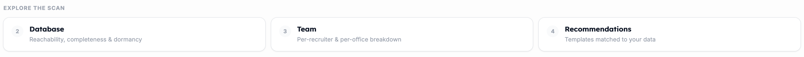
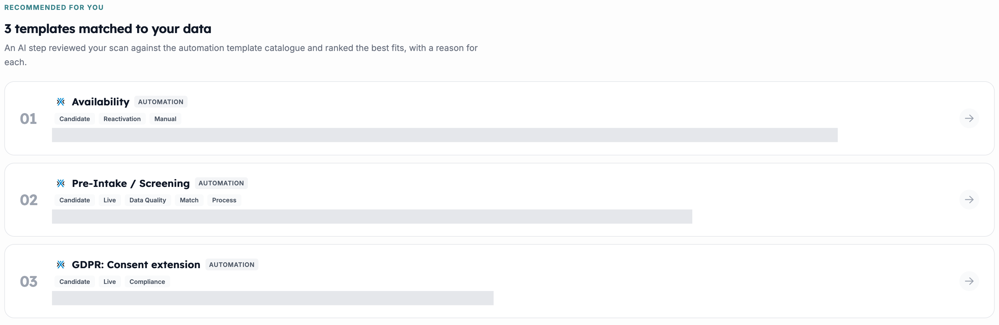

Een scan leest je recruitmentdatabase rechtstreeks uit Carerix en laat in één rapport zien hoe bereikbaar en actueel je kandidaten zijn, wat je team bereikt en welke automatiseringen de gaten zouden dichten.

<Note>
  Scan werkt vandaag met Carerix.
</Note>

## Wat het rapport laat zien

Het rapport heeft vier tabbladen: **Overview**, **Database**, **Team** en **Recommendations**.

### Overview

De omvang van je database in één oogopslag, wat HireData al voor je heeft gedaan, zoals runs, verstuurde e-mails en chats, en links naar de andere tabbladen.

### Database

Hoe volledig en bereikbaar je data is, met aparte weergaven voor **Candidates**, **Clients** en **Contacts**:

- **Bereikbaarheid:** hoeveel kandidaten je kunt bereiken via e-mail, mobiel, WhatsApp en LinkedIn, en hoeveel toestemming hebben gegeven.
- **Inactieve pool:** hoeveel kandidaten je voor het laatst 0–90 dagen, 90–180 dagen, 180–365 dagen of meer dan een jaar geleden hebt gesproken.
- **Volledigheid van profielen:** hoeveel profielen een cv, vaardigheden, werkervaring, opleiding en een voorkeurskanaal hebben.

### Team

Dezelfde cijfers per recruiter en per vestiging, op de tabbladen **Recruiters** en **Offices**. Een groep met te weinig records om te vergelijken is gemarkeerd als **small sample**.

### Recommendations

Een gerangschikte shortlist van automatiseringstemplates die gericht zijn op de gaten die de scan vond, elk met de reden waarom ze gekozen is. Open er een om haar te bekijken en te testen, en activeer haar om een conceptautomatisering te maken die je kunt nakijken voordat ze live gaat.

## Opnieuw uitvoeren

Klik op **Run again** om te zien wat er sinds de vorige scan is veranderd.

Kan een cijfer niet uit Carerix worden opgehaald, dan markeert het rapport het als ontbrekend in plaats van nul te tonen. **How this is measured**, onderaan het rapport, legt uit hoe elk cijfer wordt berekend.

## Gerelateerd

- [Overzicht van de Carerix-integratie](/nl/apps/carerix/overview)
