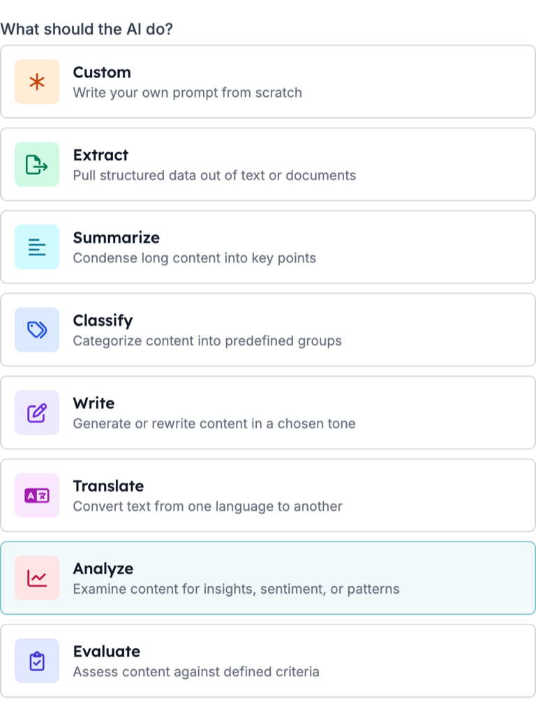
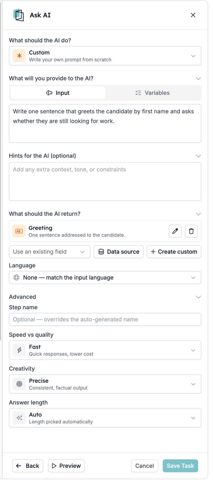
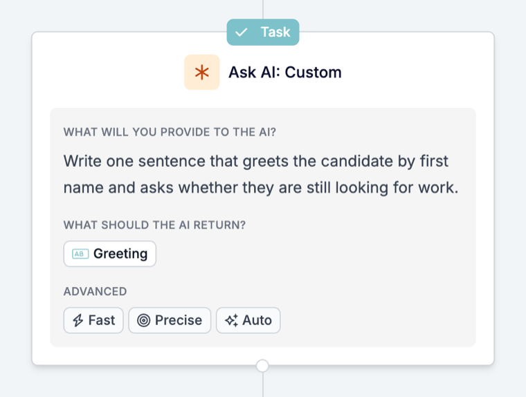

Ask AI is de stap in een automatisering die de gegevens van de run leest en de antwoorden teruggeeft waar je om vraagt: een fitscore, een samenvatting, een categorie, of één nette waarde uit een langere tekst. De antwoorden worden opgeslagen als velden, zodat de volgende stappen ze naar een record kunnen schrijven of kunnen bepalen wat er daarna gebeurt.

Een typisch voorbeeld: elke nieuwe match krijgt een fitscore ten opzichte van de vacature. Op basis van die score matcht de automatisering de kandidaat, wijst hem af of nodigt hem uit voor een pre-screening. Een ander voorbeeld: elke match krijgt een korte samenvatting voor de recruiter met sterke punten, hiaten en waarschuwingssignalen.

Jij bepaalt hoe de antwoorden worden gebruikt. Latere stappen kunnen er automatisch op handelen, zonder dat iemand eerst kijkt, en antwoorden kunnen per run verschillen. Test dus voordat je een antwoord een kandidaat laat afwijzen of een bericht laat versturen.

Deze gids loopt door het instellen, testen en veelvoorkomende problemen. Een beschrijving van elke instelling vind je in de [Prompt-referentie](/nl/reference/automations/steps/prompt).

## Voordat je begint

Bepaal eerst twee dingen:

- **De ene vraag die je beantwoord wilt hebben.** Bijvoorbeeld: "Past deze kandidaat goed bij deze vacature?" Een stap die één duidelijke vraag beantwoordt, is makkelijker te testen en te vertrouwen dan een stap die vijf dingen doet.
- **Wat er met het antwoord gebeurt.** Schrijf het naar de match, stuur de kandidaat een bepaalde kant op, of verstuur een bericht. Gebruikt niets het antwoord, dan kost de stap alleen tijd en geld bij elke run.

## De stap instellen

### 1. Voeg Ask AI toe aan de automatisering

Open de automatisering, klik op **\+** waar de stap moet komen en kies **Prompt**. Het paneel dat opent heeft de kop **Ask AI**.

Zet de stap na de trigger of taak die de benodigde gegevens laadt. Ask AI kan alleen lezen wat de run al heeft.

### 2. Kies wat de AI moet doen

Kies onder **What should the AI do?** de taak die past:

| Kies | Als je wilt |
| --- | --- |
| **Extract** | Specifieke waarden uit een tekst halen, zoals een straatnaam uit een adres |
| **Summarize** | Een lange tekst terugbrengen tot een paar regels voor een recruiter |
| **Classify** | Een record in een van je eigen categorieën plaatsen |
| **Write** | Een tekst opstellen of herschrijven in een gekozen toon |
| **Translate** | Een tekst in een andere taal zetten |
| **Analyze** | Iets beoordelen, zoals hoe goed een kandidaat bij een vacature past |
| **Evaluate** | Een tekst toetsen aan criteria die je beschrijft |
| **Custom** | De hele instructie zelf schrijven |

Elke optie behalve **Custom** maakt de outputvelden aan die bij die taak horen, zodat je begint met velden die al bestaan.

### 3. Geef de gegevens en de instructie

Onder **What will you provide to the AI?**:

- Schrijf in **Input** de instructie en voeg de variabelen in die nodig zijn, zoals de functietitel van de vacature en de ervaring van de kandidaat.
- Voeg in **Variables** velden toe die je naast de instructie wilt meegeven zonder ze in de tekst te zetten.

Gebruik **Hints for the AI (optional)** voor context en regels, zoals "Je bent een recruiter. Als het cv geen rijbewijs noemt, zeg dat dan in plaats van te gokken."

### 4. Bepaal wat er terugkomt

Voeg onder **What should the AI return?** één outputveld per antwoord toe:

- **Use an existing field** om het antwoord te koppelen aan een veld dat de automatisering al kent.
- **Create custom** om een nieuw veld te definiëren. Kies het type dat bij het antwoord past: **Number** voor een score, **Yes / No** voor een check, **List** voor een van je eigen opties, **Text** voor een samenvatting. Voeg bij een **List** de toegestane waarden toe onder **Options**.
- Vul **What is it for? (optional)** in. Dat vertelt het model wat er in het veld hoort.

Geef elk veld een eigen **Reference as**-naam. Met die naam vinden latere stappen het antwoord.

<Tip>
  Gebruik een **List**- of **Yes / No**-veld voor alles waarop een latere stap een vertakking maakt. Een lijst kan alleen een van je opties teruggeven; vrije tekst geeft elke keer een andere zin.
</Tip>

### 5. Stel de taal en modelopties in

- **Language**: laat dit op **None** staan om te antwoorden in de taal van de input, of stel een vaste taal in als het record of bericht daarom vraagt.
- **Advanced**: kies **Speed vs quality**, **Creativity** en **Answer length**. Voor scores en checks geeft **Precise** de meest consistente antwoorden.

Na het opslaan staat de stap op het canvas met de prompt, een chip per outputveld en de Advanced-instellingen:

## Test het met Preview

Klik op **Preview** onderaan het paneel, daarna op **Generate an example** om realistische voorbeeldgegevens in te vullen, en draai de stap voordat je opslaat. Je kunt de voorbeeldwaarden aanpassen om een specifiek geval te testen. Controleer elk outputveld, niet alleen het eerste.

Test meer dan één geval: een sterke kandidaat, een zwakke en een record met ontbrekende informatie. Is het antwoord bij het ontbrekende geval een gok, voeg dan een hint toe die zegt wat te doen als de informatie er niet is.

## Gebruik het antwoord in latere stappen

In latere stappen vind je elk antwoord onder de automatische naam van de stap, met een sleutel op basis van de **Reference as**-waarde, zoals `output.fit_score`. Staat Ask AI in een [Loop](/nl/reference/automations/steps/loop), gebruik het antwoord dan binnen die Loop of schrijf het daar naar een record; stappen na de Loop kunnen het niet lezen. De stap legt ook vast:

| Variabele | Bevat |
| --- | --- |
| `is_successful` | Of het model een antwoord gaf dat in de velden past |
| `reasoning` | Hoe het model tot het antwoord kwam |
| `error_message` | Waarom het niet kon antwoorden, leeg bij succes |

Veelgebruikte volgende stappen:

- **Schrijf het naar het record.** Een [Update](/nl/reference/automations/steps/update)-taak schrijft de samenvatting of score naar de match of kandidaat.
- **Ga alleen door als het past.** Een [Filter](/nl/reference/automations/steps/filter) laat de run alleen doorgaan als een score of lijstwaarde aan een voorwaarde voldoet. Runs die er niet aan voldoen, stoppen daar.
- **Stuur verschillende uitkomsten verschillende kanten op.** Een [Split](/nl/reference/automations/steps/split) met een Filter in elke tak, bijvoorbeeld een tak om te matchen, een om af te wijzen en een om uit te nodigen voor een pre-screening.

## Waar je op moet letten

- **Het antwoord wordt gebruikt zodra het terugkomt.** Test met Preview en een paar echte records voordat de automatisering op het antwoord handelt, zeker voordat die een kandidaat afwijst of een bericht verstuurt.
- **Een stap die geen antwoord krijgt, stopt de run.** Kan het model niet antwoorden, dan toont de stap Cancelled met de reden in de timeline, en de stappen erna draaien niet. Binnen een [Split](/nl/reference/automations/steps/split) of [Loop](/nl/reference/automations/steps/loop) stopt alleen die tak of iteratie; andere takken en de stappen na de Split of Loop kunnen nog draaien. Zie [Redenen voor geannuleerde runs](/nl/knowledge-base/run-cancellation-reasons).
- **Een onverwacht antwoord stopt de run niet.** Hangt een latere stap af van het antwoord, controleer het dan eerst met een [Filter](/nl/reference/automations/steps/filter).
- **Voor één regel in een e-mail** is een [AI-variabele](/nl/variables/ai-variables) in de template eenvoudiger dan een stap. Gebruik Ask AI als het antwoord moet worden opgeslagen of de run moet sturen.

## Problemen met Ask AI oplossen

| Wat je ziet | Wat je controleert |
| --- | --- |
| Het antwoord is vaag of negeert dit record | De instructie heeft geen variabelen. Voeg de benodigde velden in bij **Input** of voeg ze toe onder **Variables**. |
| Eén outputveld is altijd leeg of wordt overschreven | Twee velden hebben dezelfde **Reference as**. Geef elk veld een eigen naam. |
| Het antwoord is in de verkeerde taal | **Language** staat op **None**, dus het volgt de input. Stel een vaste taal in. |
| Antwoorden verschillen sterk tussen vergelijkbare records | Zet **Creativity** op **Precise** en maak de instructie specifieker over wat een goed antwoord bevat. |
| De run toont Cancelled bij de Ask AI-stap | Het model kon geen antwoord geven dat in de velden past. Lees de reden in de timeline, controleer de inputs en vereenvoudig de velden. |
| Een latere stap gebruikt een verkeerde waarde | Controleer de output met een **Filter** vóór die stap en test het geval in **Preview**. |
| De naam van de stap op het canvas veranderde niet | **Step name** verandert alleen de kop van het paneel. De kaart en de variabelenamen houden de automatische naam. |

Werkt de stap nog steeds niet zoals verwacht, neem dan contact op met [support@hiredata.com](mailto:support@hiredata.com) met de naam van de automatisering, de Ask AI-stap, een voorbeeldrecord en het antwoord dat je verwachtte.
