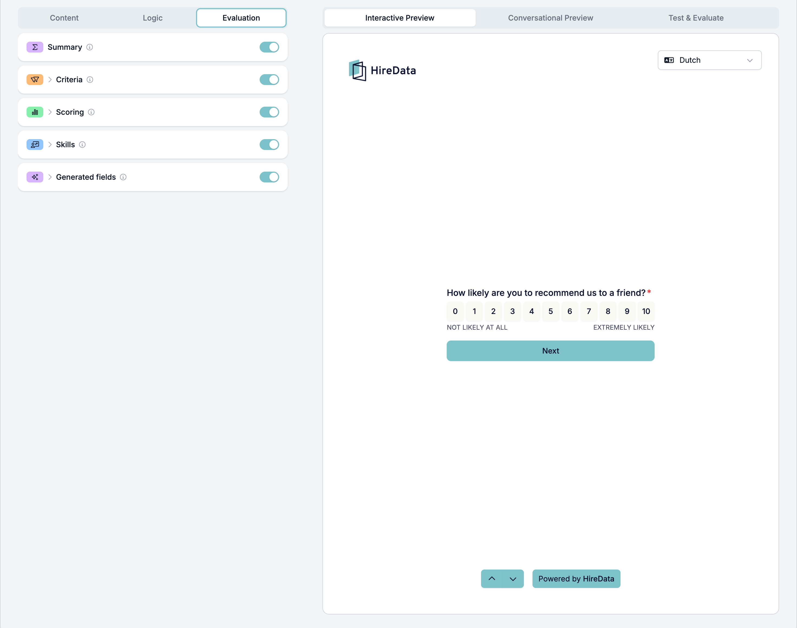
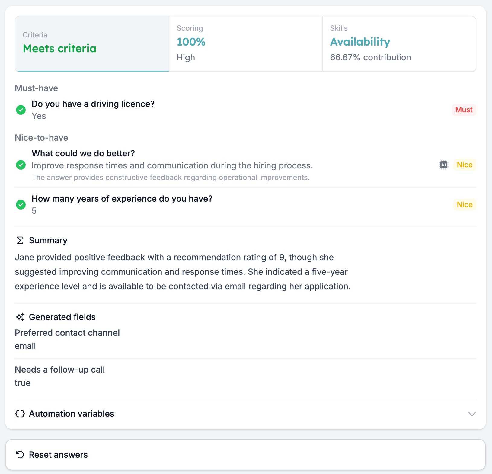
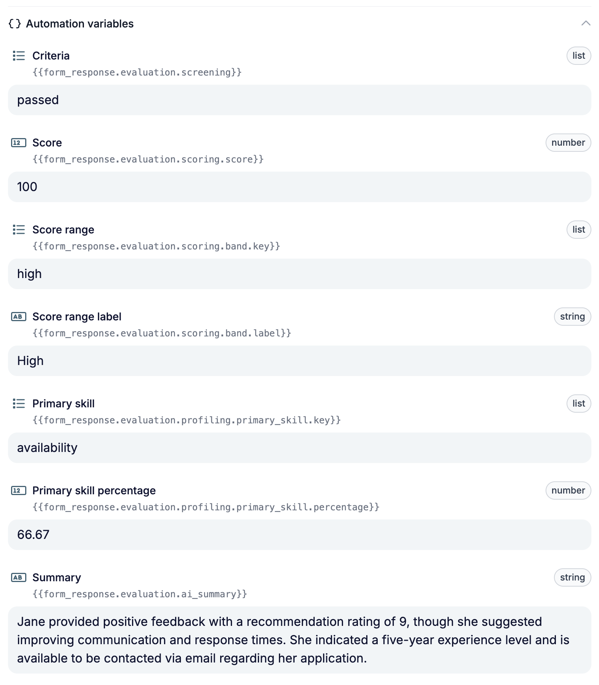

Formulierevaluaties nemen de eerste pre-screeningronde over. Je beschrijft één keer je knock-outvragen en hoe een goed antwoord eruitziet, en elke ingevulde reactie wordt op dezelfde manier gecontroleerd: een oordeel op je criteria, een score, een vaardighedenprofiel, een samenvatting voor je recruiter of eigen outputs. Je team neemt nog steeds de beslissingen.

Deze gids legt uit hoe je de evaluators instelt, hun resultaten controleert en veelvoorkomende instellingsproblemen oplost.

## Kies wat je nodig hebt

Je kunt één evaluator aanzetten of er meerdere combineren.

| Evaluator | Gebruik het om | Resultaat |
| --- | --- | --- |
| **Summary** | Je team een kort overzicht van de reactie te geven. | Een door AI geschreven alinea; geen instellingen nodig. |
| **Criteria** | Je must-haves (knock-outvragen) en nice-to-haves te controleren. | Meets criteria, Partially meets criteria, Does not meet criteria of Incomplete. |
| **Scoring** | Punten toe te kennen aan antwoorden. | Een percentage en een label voor de scorerange, zoals Low, Medium of High. |
| **Skills** | Vast te stellen welke ingestelde vaardigheden uit de antwoorden blijken. | Een percentage per vaardigheid en de sterkste vaardigheid. |
| **Generated fields** | Waarden uit de hele reactie te halen of te genereren. | Een waarde voor elke output die je definieert. |

Gebruik bijvoorbeeld Criteria om een verplichte kwalificatie te controleren en Scoring om punten te geven voor relevante ervaring. Een score vervangt het oordeel op de criteria niet: bekijk beide als je beslist wat er daarna gebeurt.

## Een evaluatie instellen

### 1. Zet de evaluator aan voor het formulier

Open je formulier en kies **Evaluation**, naast **Content** en **Logic**. Zet de evaluators aan die je nodig hebt en klik op de naam van een evaluator om de instellingen te openen.

### 2. Kies en stel de vragen in

Zet voor **Criteria**, **Scoring** en **Skills** elke vraag aan die je wilt evalueren.

<Warning>
  Zowel de schakelaar op formulierniveau als die op vraagniveau moet aanstaan. Zet je een evaluator uit voor het formulier, dan stopt die met evalueren, ook als de schakelaars per vraag nog aanstaan.
</Warning>

Stel elke gekozen vraag in:

- **Criteria:** kies **Must-have** voor een knock-outvraag (of killer question), waarbij een verkeerd antwoord betekent dat de kandidaat niet aan je criteria voldoet. Kies **Nice-to-have** voor iets dat helpt bepalen wie je eerst belt, zonder iemand uit te sluiten. Leg daarna het verwachte antwoord of de AI-instructies vast.
- **Scoring:** stel het maximale aantal punten voor de vraag in en bepaal wanneer punten worden toegekend. Gebruik je AI, dan moet het maximum groter zijn dan nul.
- **Skills:** voeg de vaardigheden toe die je wilt beoordelen en bepaal welke antwoorden aan elke vaardigheid bijdragen en met welk gewicht. Voeg minstens één vaardigheid toe voordat je AI-beoordeling gebruikt.

**Summary** werkt op de hele reactie en heeft geen instellingen per vraag nodig. Zet voor **Generated fields** de evaluator aan en voeg minstens één output toe met **Create custom**, **Suggest with AI** of **Data source**.

### 3. Kies antwoordregels of AI

Kies onder **How to evaluate?**:

- **Use answer rules** voor vaste waarden of vergelijkingen, zoals een gekozen optie of een minimaal aantal jaren. Regels geven voor hetzelfde antwoord altijd hetzelfde resultaat.
- **Evaluate with AI** als de interpretatie van het antwoord ertoe doet, zoals een toelichting in vrije tekst. Schrijf specifieke instructies over het bewijs waar de AI naar moet zoeken.

De AI-instructie wordt voor dezelfde vraag gedeeld door Criteria, Scoring en Skills. Houd de instructies consistent over alle evaluators die die vraag gebruiken.

Alle instellingen vind je bij [Criteria](/nl/reference/forms/evaluation/criteria), [Scoring](/nl/reference/forms/evaluation/scoring), [Skills](/nl/reference/forms/evaluation/skills) en [Generated fields](/nl/reference/forms/evaluation/generated-fields).

## Test je resultaten

Open **Test & Evaluate** in het previewpaneel. Vul antwoorden handmatig in of gebruik **Autofill with AI** om een testreactie te maken. De evaluatie draait automatisch als je een antwoord invult of wijzigt.

<Note>
  Een evaluatie uitvoeren slaat eerst het formulier op, inclusief niet-opgeslagen wijzigingen. Er wordt geen ingediende reactie gemaakt, het aantal reacties stijgt niet en er start geen automatisering.
</Note>

Test antwoorden die aan je eisen voldoen, antwoorden die dat niet doen en onbeantwoorde vragen. Test voor scoring ook waarden net onder en precies op elke drempel.

Open de resultaatpanelen en controleer de details per vraag:

- **Criteria:** controleer welke eisen geslaagd of mislukt zijn en, bij AI-evaluaties, de redenering.
- **Scoring:** controleer de punten per vraag en het totale percentage.
- **Skills:** controleer hoe elk antwoord bijdraagt aan het vaardighedenprofiel.

Vergelijk de samenvatting en de gegenereerde outputs met de oorspronkelijke antwoorden. Vraagt een output om informatie die kan ontbreken, leg dan met **Hints for the AI (optional)** uit hoe ontbrekende informatie moet worden behandeld, bijvoorbeeld door de output leeg te laten.

Zie [Test & Evaluate](/nl/reference/forms/testing/test-and-evaluate) voor de testscenario's en resultaatpanelen.

## De resultaten begrijpen

**Criteria gebruikt een oordeel in vaste volgorde.** Een beantwoorde must-have die niet slaagt, geeft **Does not meet criteria**. Anders geeft een ontbrekend antwoord op een geëvalueerde vraag **Incomplete**. Zijn alle geëvalueerde vragen beantwoord, dan geeft een mislukte nice-to-have **Partially meets criteria**; slaagt alles, dan is het resultaat **Meets criteria**. Controleer vragen die door formulierlogica zijn overgeslagen als je een onvolledig resultaat onderzoekt.

**Scoring is gebaseerd op het totaal aantal punten.** Het percentage is het aantal behaalde punten gedeeld door de opgetelde maximumpunten van de ingestelde vragen. Een onbeantwoorde vraag met score levert nul punten op, maar telt wel mee voor het maximum. Overeenkomende regels worden bij elkaar opgeteld, tot het maximum van die vraag.

**Vaardigheidspercentages tonen relatieve bijdragen.** Ze beschrijven het aandeel van elke vaardigheid in het totale gewicht. Een vaardigheid op 80% betekent niet dat de respondent een vaardigheidsscore van 80% heeft gehaald.

**Generated fields draaien na Criteria, Scoring en Skills.** Ze kunnen de antwoorden en die evaluatieresultaten gebruiken om de outputs te maken die je hebt gedefinieerd.

## Problemen met een evaluatie oplossen

| Wat je ziet | Wat je controleert |
| --- | --- |
| Er verschijnt geen resultaat | Zet de evaluator aan voor het formulier, zet de relevante vragen aan en stel hun regels of AI-instellingen in. Vul een testantwoord in. |
| Een criterium met regels beïnvloedt het oordeel nooit | Controleer of het voorwaarden heeft. Een criterium zonder voorwaarden wordt overgeslagen. |
| AI-scoring geeft een fout | Stel het maximum aantal punten van de vraag in op een getal groter dan nul. |
| AI-vaardigheidsbeoordeling geeft een fout | Voeg minstens één vaardigheid toe aan het formulier. |
| Een score heeft een percentage maar geen rangelabel | Neem een scorerange op met een minimum van 0% en controleer de andere drempels. |
| De score is lager dan verwacht | Controleer onbeantwoorde of overgeslagen vragen met score en het maximum aantal punten per vraag. |
| Generated fields geven niets terug | Voeg minstens één outputveld toe. |
| AI-resultaten komen niet overeen met wat je bedoelde | Bekijk de gedeelde AI-instructies van de vraag, de beschrijvingen van vaardigheden of de hints van generated fields en test opnieuw. |

## De evaluatieresultaten gebruiken

Ingevulde reacties worden geëvalueerd en de resultaten worden erbij opgeslagen. Gebruik **Export CSV** of **Export Excel** in het menu met de drie puntjes van de builder om resultaten te exporteren, inclusief vaardigheidspercentages en generated fields.

Wil je een resultaat in een automatisering gebruiken, open dan **Automation variables** onderaan **Test & Evaluate** en kopieer de variabele naast je testwaarde. Het oordeel van Criteria gebruikt bijvoorbeeld `{{form_response.evaluation.screening}}`, met de waarden `passed`, `passed_with_restrictions`, `rejected` of `incomplete`.

Omdat elke reactie wordt geëvalueerd zodra die is ingevuld, kan een automatisering elke kandidaat direct opvolgen. Zet de Match bijvoorbeeld door naar de volgende fase als het resultaat **Meets criteria** is, en stuur kandidaten die niet aan je criteria voldoen een korte update, zodat niemand blijft wachten.

<Warning>
  Er is nog geen goedkeuringsstap: een automatisering gebruikt het resultaat zodra het is opgeslagen. Test je AI-instructies in **Test & Evaluate** voordat een resultaat een bericht naar kandidaten start.
</Warning>

Een uitgewerkt voorbeeld vind je in [Sollicitanten screenen en scoren met een pre-screeningformulier](/nl/knowledge-base/cookbook/pre-screening-form).

Ziet een resultaat er nog steeds verkeerd uit, neem dan contact op met [support@hiredata.com](mailto:support@hiredata.com) met de naam van het formulier, de evaluator en vraag, het antwoord dat je testte, en het verwachte en werkelijke resultaat.
