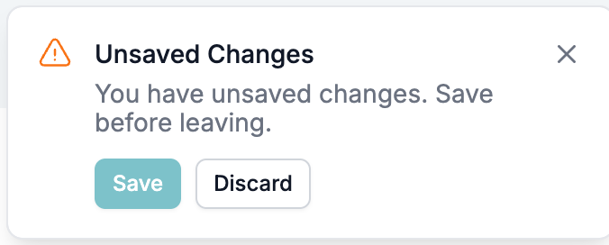

Een e-mailtemplate is een bericht dat je één keer schrijft en vele keren verstuurt, in een automatisering of een nieuwsbrief. Open **Settings**, dan **Emails** onder **Templates**, en klik op **New Email**. Selecteer **Blank Email** of een van de kant-en-klare templates, en de nieuwe template opent in de builder.

Deze pagina brengt de builder in kaart. Voor een walkthrough die één e-mail van blanco naar verzendklaar brengt, lees je [Een e-mailtemplate opzetten in HireData](/nl/apps/messaging/emails/setting-up-an-email-template-in-hiredata).

## De builder in vogelvlucht

De builder heeft drie delen.

- Het **Subject**-vak bovenaan. Het is de regel die de ontvanger in zijn inbox ziet, en het accepteert variabelen.
- De e-mail zelf, op de breedte die je ontvangers zien. Je selecteert en bewerkt alles direct erin.
- De zijbalk rechts, met drie tabbladen: **Styles** voor de instellingen van wat je selecteerde, **Add** voor nieuwe blocks, lay-outs en sectietemplates, en **Global** voor de instellingen van de hele e-mail.

Een template bevat secties, en een sectie bevat de blocks die de ontvanger leest. [Template](/nl/reference/email-builder/template) legt uit hoe de niveaus nesten.

## Selecteren en bewerken

- **Beweeg** over een block of sectie om het te omlijnen met zijn naam.
- **Klik** om het te selecteren. De instellingen openen in **Styles**.
- **Klik nog eens op een geselecteerd tekstblock**, of dubbelklik erop, om de tekst te bewerken.
- **Escape** stopt eerst het bewerken en wist daarna de selectie.
- **Toetsenbord:** **Tab** selecteert het eerste block, met de pijltjestoetsen ga je naar een ander block, **Enter** bewerkt en **Delete** verwijdert.

Een geselecteerd block toont een actiebalk met **Move**, **Add below**, **Duplicate** en **Delete**, en een menu met de instellingen voor dat soort block. Bij een block dat hoger is dan het scherm blijft het menu in beeld.

### Tekst

- **Enter** begint een nieuwe regel in de paragraaf of kop. Er komt geen nieuw block bij.
- **Lijsten:** maak regels genummerd of met opsommingstekens. Enter zet de lijst voort.
- **Het tekstmenu** stelt het lettertype, de grootte, kleur, markering, uitlijning, lijst en link in, met meer onder **More**. Het maakt het hele block op, of alleen de tekst die je selecteerde.
- **Links:** de linkknop opent een menu om een link toe te voegen, te wijzigen of te verwijderen. Een link zonder "https" krijgt die er automatisch bij.

## Toevoegen, kopiëren en verplaatsen

- **Het tabblad Add** toont lay-outs, sectietemplates en content-blocks. Sleep er een naar de e-mail: een lijn laat zien waar het terechtkomt.
- **Add below** voegt een block toe onder het geselecteerde. Een nieuw tekstblock start meteen in bewerkmodus.
- **Duplicate** kopieert een block of sectie, inclusief de vertalingen.
- **Move** sleept een block of sectie naar de lijn waar je het loslaat. Escape annuleert.
- **Secties** staan alleen op het bovenste niveau van de e-mail, nooit in een andere sectie.
- **Een leeggemaakte sectie of kolom** houdt haar plek en toont een zone waar je een block kunt neerzetten of toevoegen.

## Een block kiezen {#choosing-a-block}

| Block | Wat het in de e-mail zet |
| --- | --- |
| [Sectie](/nl/reference/email-builder/sections) | een band over de e-mail, met eigen achtergrond, padding en rand |
| Gesplitste sectie | een sectie verdeeld in kolommen naast elkaar, met eigen lay-out en tussenruimte. Je selecteert en verplaatst haar als één block |
| [Paragraph](/nl/reference/email-builder/blocks/paragraph) | lopende tekst, ook genummerde lijsten en lijsten met opsommingstekens |
| [Heading](/nl/reference/email-builder/blocks/heading) | een kop, op het niveau dat jij kiest |
| [Form](/nl/reference/email-builder/blocks/form) | knoppen die een vraag uit een van je formulieren beantwoorden |
| [Image](/nl/reference/email-builder/blocks/image) | een afbeelding uit je mediabibliotheek, of een uit een variabele |
| [Socials](/nl/reference/email-builder/blocks/socials) | een rij social-iconen, één per link |
| [Button](/nl/reference/email-builder/blocks/button) | een call-to-action die een URL opent |
| Divider | een lijn tussen blocks |
| Whitespace | lege ruimte tussen blocks |
| [HTML](/nl/reference/email-builder/blocks/html) | markup die je zelf schrijft |
| [Signature](/nl/reference/email-builder/blocks/signature) | een afbeelding naast een blok afsluitende tekst |

Kolommen voeg je toe als gesplitste sectie. Kolommen in e-mails van vóór deze wijziging blijven bestaan en kun je nog dupliceren.

## Spacing

Selecteer een block en klik op **Spacing** om de marges en padding op het canvas te zien. Sleep een handle of typ een waarde, en gebruik het slotje om zijden samen te wijzigen. **Done** bewaart de waarden. Het spacing-vak in **Styles** wijzigt dezelfde waarden. Paragraph-, heading- en socials-blocks hebben ook een linker- en rechtermarge.

## Instellingen voor de hele e-mail

Het tabblad **Global** bevat de template-instellingen en **All sections**. Een wijziging onder **All sections** geldt voor elke sectie, ook voor secties die je later toevoegt.

**Section width** stel je één keer in voor de hele e-mail: **Default**, **Wide** (640px), **Large** (700px) of **Custom** (tussen 640 en 1240 pixels). Ook de achtergrond, linkkleur en lettertypes stel je hier in.

## De toolbar

De toolbar loopt langs de bovenkant van de builder, van **Save** tot de vier drawer-knoppen rechts.

**Save** slaat je wijzigingen op. **Undo** en **Redo** staan ernaast en werken ook met de gewone sneltoetsen. Elke actie is één stap, zoals een hele sleepbeweging of één wijziging in een veld van de zijbalk.

Er volgen twee knoppen:

- Het oog opent een [preview](/nl/reference/email-builder/testing#the-preview) van de afgewerkte e-mail, op mobiele, tablet- of desktopbreedte, met een taalkiezer en een **Copy Preview URL**-knop. De tooltip waarschuwt dat hij de e-mail eerst opslaat.
- Het papieren vliegtuigje opent [Test Email](/nl/reference/email-builder/testing#sending-a-test-email). Het stuurt de e-mail naar jou met realistische waarden ingevuld.

**Brand** kiest het merk waar de kleuren, lettertypes en het logo van de e-mail vandaan komen.

Na de brand-selector volgen twee toggles:

- **Show variable values** is een weergavetoggle voor het canvas. Om een e-mail met echte waarden erin te lezen, gebruik je de [preview](/nl/reference/email-builder/testing#the-preview).
- **Show code editor** opent de gegenereerde markup. Hij verschijnt alleen voor accounts die templates rechtstreeks mogen bewerken.

Vier knoppen aan het eind openen drawers over de e-mail heen:

- **Show variable list** toont de variabelen die deze e-mail kan gebruiken, en voegt eigen variabelen toe. Zie [Variabelen](/nl/reference/email-builder/variables).
- **Manage Template** publiceert de geopende e-mail naar de gedeelde templatebibliotheek. Hij verschijnt alleen voor accounts die die bibliotheek beheren.
- **Show objects** koppelt records zoals een vacature of een match aan de e-mail. Hun velden worden dan [variabelen](/nl/reference/email-builder/variables#bringing-in-a-records-fields) die je erin kunt schrijven.
- **Manage Languages** stelt de standaardtaal van de e-mail en zijn [vertalingen](/nl/reference/email-builder/translations) in.

## Merk en thema

Elke kleur en elk lettertype in een nieuwe e-mail begint als een waarde uit het merk dat je in **Brand** kiest. Het paneel benoemt de waarde in plaats van een hexcode te tonen, zoals "Theme: Palette Surface Color".

Wissel van **Brand** en de hele e-mail wordt gerestyled, inclusief blocks die je al schreef. Vervang een van die waarden door een eigen kleur en die ene knop volgt het merk niet langer. Zie [Template](/nl/reference/email-builder/template#brand-theme-and-metadata) voor de instellingen die dit bepalen, en voor het verschil tussen van merk wisselen en een thema instellen.

## Opslaan

De e-mailbuilder slaat niet op terwijl je typt. **Save** slaat op. De preview-knop en **Send test email** slaan elk eerst op voordat ze draaien, dus elk van die twee legt vast wat je hebt gewijzigd. Zie [Testen](/nl/reference/email-builder/testing).

Maak je elke wijziging ongedaan, dan geldt de e-mail niet meer als niet-opgeslagen.

Probeer je de builder te verlaten met niet-opgeslagen wijzigingen, dan verschijnt een waarschuwing. Die biedt aan ze op te slaan met **Save**, of ze te verwerpen met **Discard** en door te gaan.

Herlaad je de pagina of sluit je het tabblad in plaats daarvan, dan vraagt je browser om bevestiging voordat je ze kwijtraakt.

## Gerelateerd

- [Een e-mailtemplate opzetten in HireData](/nl/apps/messaging/emails/setting-up-an-email-template-in-hiredata) brengt één e-mail van blanco naar verzendklaar.
- [Afbeeldingen toevoegen aan je e-mails](/nl/apps/messaging/emails/adding-images-to-your-emails) behandelt de mediabibliotheek.
- [Variabelen](/nl/reference/email-builder/variables) behandelt de picker, de fallbacks en hoe een ontbrekende waarde eruitziet.
- [Vertalingen](/nl/reference/email-builder/translations) behandelt het versturen van één e-mail in meerdere talen.
- [Testen](/nl/reference/email-builder/testing) behandelt de preview, de testverzending en wat geen van beide bewijst.
- [Form Builder: Overzicht](/nl/reference/forms/overview) behandelt de formulieren waar een Form-block naar kan wijzen.
