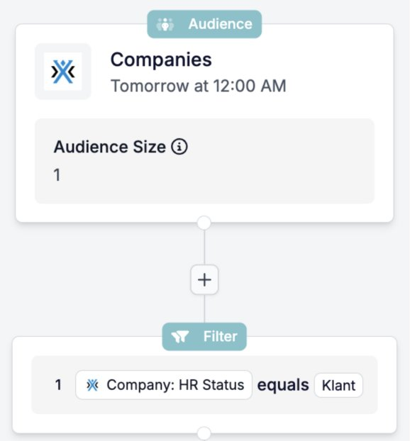
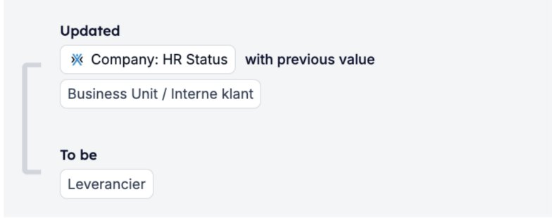

No Carerix, uma empresa pode ter um estado por linha de negócio (business line), por exemplo um para HR e outro para Finance. A HireData mostra cada um desses estados como um campo próprio, com o nome da linha de negócio, por exemplo **Company: HR Status**. Uma automação pode agora verificar ou alterar o estado de uma única linha de negócio.

Antes, todos os estados das linhas de negócio chegavam num só campo, **Company: Status**, e uma automação não sabia que linha de negócio estava a consultar ou a atualizar.

## Filtrar por uma linha de negócio

Use o campo da linha de negócio em qualquer sítio onde filtre empresas:

- o filtro de início de uma automação
- um passo **Filter**
- o público de uma automação agendada sobre empresas

Por exemplo, **Company: HR Status** igual ao estado que pretende. As empresas com esse estado noutra linha de negócio não passam.

## Atualizar uma linha de negócio

Numa [tarefa **Update Field(s)** no Carerix](/pt/apps/carerix/update-fields-in-carerix-with-hiredata), escolha o campo de estado da linha de negócio que quer alterar, como **Company: HR Status**, e escolha o novo valor. Só o estado dessa linha de negócio muda. As outras linhas de negócio mantêm o seu.

Por exemplo: quando é criada uma colocação, defina o estado do cliente nessa linha de negócio com o valor que a sua equipa usa para clientes ativos.

## Verificar o que mudou

Abra um run e clique no passo de atualização. Mostra o campo com o valor anterior e o novo valor em **To be**.

## Artigos relacionados

- [Atualizar campos no Carerix](/pt/apps/carerix/update-fields-in-carerix-with-hiredata)
- [Filter](/pt/reference/automations/steps/filter)
- [Ativar campos e relações do Carerix](/pt/apps/carerix/how-to-enable-carerix-fields-and-relationships-in-your-automations)
