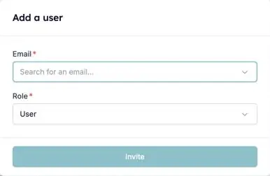

Ativou a RMA da HireData no Carerix, mas alguns colegas não estão na HireData. A HireData sincroniza os seus utilizadores do Carerix quando liga a integração e depois todos os dias. Se alguém continuar em falta após uma [sincronização manual](/pt/apps/carerix/manually-sync-carerix-with-hiredata), normalmente o motivo é um dos seguintes.

### 1. O utilizador já usa a HireData noutra conta

Cada pessoa tem um único acesso à HireData, e esse acesso pode pertencer a várias contas. Isto acontece quando a sua organização tem mais do que um ambiente Carerix, por exemplo um por marca ou label.

Se a pessoa já usa a HireData através de outro ambiente, convide-a também para esta conta:

1. Abra **Settings** e vá a **Users**.
2. Clique em **Add User**, introduza o endereço de e-mail da pessoa e escolha a função.
3. A pessoa aceita o convite a partir do seu e-mail.

<Frame caption="Convide um colega que já usa a HireData noutra conta.">
  
</Frame>

Depois de aceitar, a pessoa abre o menu por baixo do seu nome, escolhe **Switch Account** e seleciona a conta de que precisa. Consulte [Convidar utilizadores para a sua conta](/pt/introduction/invite-users-to-your-account) para funções e reenvio de convites.

### 2. O utilizador não tem endereço de e-mail no Carerix

A HireData reconhece os utilizadores pelo endereço de e-mail. Um utilizador do Carerix sem e-mail não pode ser associado a um utilizador da HireData. Adicione o endereço de e-mail no Carerix e execute uma [sincronização manual](/pt/apps/carerix/manually-sync-carerix-with-hiredata).

### 3. O utilizador tem um endereço genérico partilhado

Endereços como `projects@carerix.com` e `test@example.com` não pertencem a uma pessoa real, por isso a HireData nunca os sincroniza. Dê ao utilizador o seu próprio endereço de e-mail no Carerix e sincronize novamente.

## Experimente

Abra [Users na HireData](https://app.hiredata.com/settings/account/users) para ver quem está sincronizado e convidar quem estiver em falta. Ainda com dúvidas? Contacte-nos através do chat na HireData.
