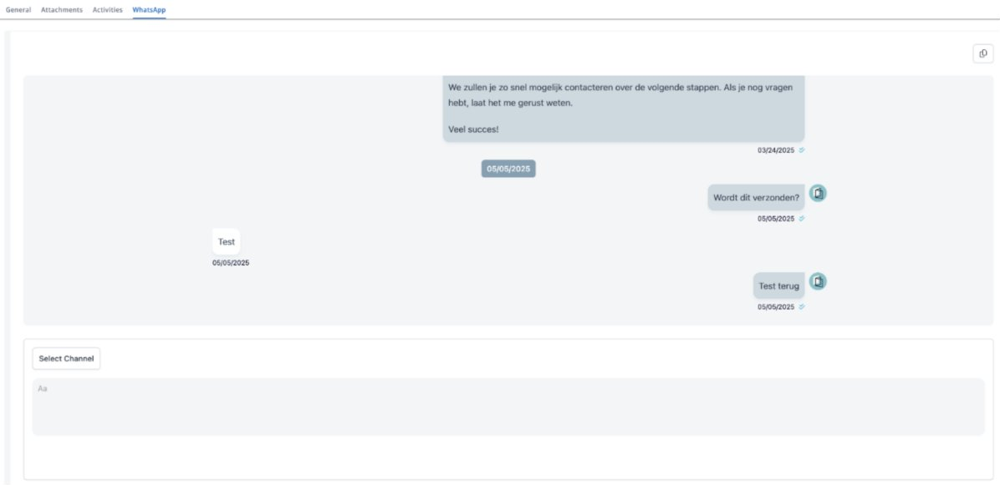

Quando abre um candidato ou um match no Carerix, o separador **WhatsApp** mostra a conversa de WhatsApp com esse candidato. Vê a conversa onde já está a trabalhar, por exemplo ao preparar uma chamada, em vez de a procurar na caixa de entrada.

## Onde o encontrar

- **Candidato:** abra o candidato e clique no separador **WhatsApp**, no fim da fila de separadores.
- **Match:** abra o match e clique no separador **WhatsApp**, ao lado de **General**, **Attachments** e **Activities**. Mostra a conversa com o candidato desse match.

O separador faz parte da app HireData no Carerix (Carerix RMA). Se não o vir, verifique se a app está [ligada](/pt/apps/carerix/connect-with-carerix).

## O que o separador mostra

- Todas as mensagens da conversa, enviadas e recebidas, cada uma com a sua data.
- Ficheiros que o candidato lhe enviou, como um CV.
- Uma caixa de mensagem em baixo. Escolha um canal em **Select Channel**, escreva a sua mensagem e envie-a.

O WhatsApp só permite enviar uma mensagem livre nas 24 horas seguintes à última resposta do candidato. Depois disso, comece com um modelo aprovado. Consulte [Noções básicas da caixa de entrada do WhatsApp](/pt/apps/messaging/whatsapp/whatsapp-inbox-basics).

## Artigos relacionados

- [Contador de conversas ativas de WhatsApp no Carerix RMA](/pt/apps/carerix/whatsapp-active-chats-counter-in-carerix-rma)
- [Registar conversas de WhatsApp no Carerix](/pt/apps/carerix/logging-whatsapp-conversations-in-carerix-with-hiredata)
