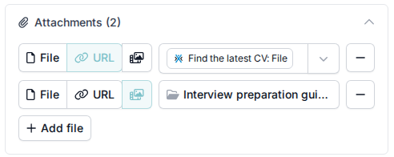
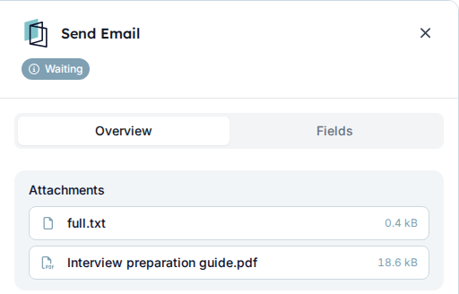

A tarefa **Send Email** já pode anexar ficheiros. Envie o CV mais recente de um candidato ao recrutador ou a um cliente, ou adicione o mesmo PDF, como um guia de preparação para a entrevista, a cada email que uma automação envia.

## Onde adicionar anexos

Abra a tarefa **Send Email** na sua automação. Em **Settings** encontra a secção **Attachments**, ao lado de **Recipient**, **CC and BCC** e **Sender**.

Clique em **Add file** para adicionar uma linha. Cada linha tem três origens à escolha:

- **File** anexa um ficheiro de um passo anterior da automação, como o CV de um candidato. Escolha-o em **Choose an uploaded file**.
- **URL** anexa o ficheiro que está num endereço web.
- **Media library** (o ícone de imagem) anexa um ficheiro que carregou na HireData, como um PDF padrão.

Adicione as linhas de que precisar. O botão **−** remove uma linha.

## Anexar o CV mais recente de um candidato

Para anexar um ficheiro guardado num registo do Carerix ou do Spott, encontre-o primeiro com um passo **Find** e depois anexe-o.

1. Antes da tarefa **Send Email**, adicione um passo **Find** que procura os ficheiros do candidato. Se houver vários, o mais recente aparece primeiro, por isso obtém o CV mais recente. Consulte [Procurar registos](/pt/automations/look-up-records).
2. Na tarefa **Send Email**, abra **Attachments** e clique em **Add file**.
3. Mantenha **File** selecionado e escolha o ficheiro do seu passo **Find**, por exemplo **Find the latest CV: File**.
4. Guarde a tarefa.

## Verificar o que foi enviado

Abra uma execução da automação. O passo **Send Email** lista os ficheiros anexados ao email.

<Tip>
  Teste primeiro com um candidato de teste e o seu próprio endereço, e verifique o email recebido antes de ativar a automação para candidatos reais.
</Tip>

Os anexos funcionam em todas as automações, incluindo as criadas antes do novo construtor de automações.

## Artigos relacionados

- [Tarefa Send Email](/pt/reference/automations/tasks/send-email) explica cada definição da tarefa.
- [Procurar registos](/pt/automations/look-up-records) explica o passo Find.
