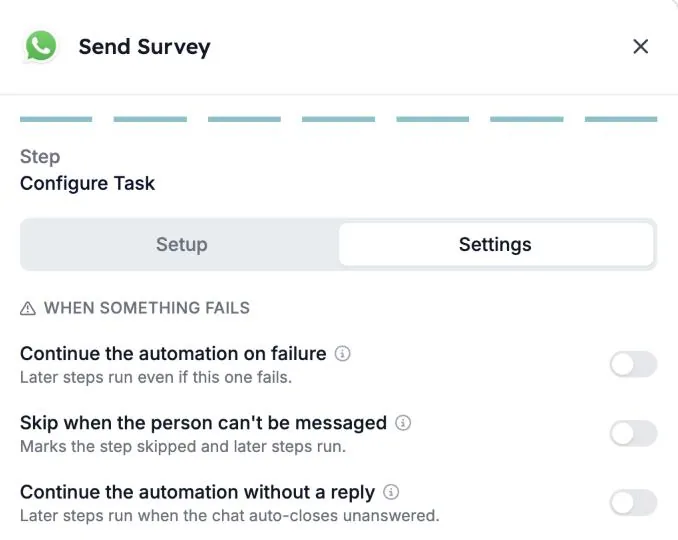
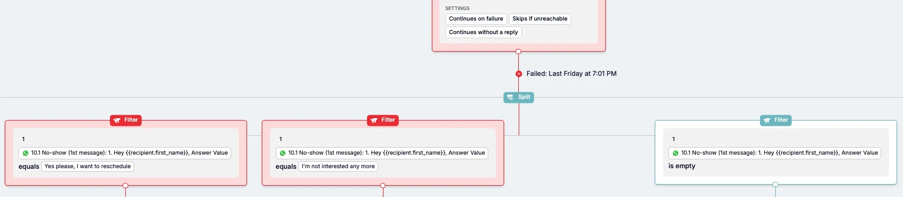

Nem todos os candidatos respondem ao seu WhatsApp. Alguns nunca respondem, outros nem sequer podem ser contactados. Cada passo de WhatsApp numa automação tem agora definições que decidem o que acontece a seguir: parar a execução, ou continuar para que um passo seguinte faça o seguimento.

Este guia explica as três definições, como ativá-las e como criar um seguimento para candidatos que não respondem.

## As três definições

Encontra-as no passo de WhatsApp, no separador **Settings**, em **When something fails**.

| Definição | O que faz |
| --- | --- |
| **Continue the automation on failure** | Os passos seguintes são executados, mesmo que o passo de WhatsApp falhe. |
| **Skip when the person can't be messaged** | O passo é marcado como ignorado e os passos seguintes são executados. |
| **Continue the automation without a reply** | Os passos seguintes são executados quando a conversa fecha sem resposta. |

**Continue the automation without a reply** só está disponível para conversas de WhatsApp.

### Quem “não pode ser contactado”

**Skip when the person can't be messaged** aplica-se a pessoas que:

- não têm número de telefone
- cancelaram a subscrição
- estão bloqueadas
- já têm uma conversa aberta
- atingiram o limite de conversas da automação

## O que acontece se não alterar nada

- **Os novos passos de WhatsApp** param a execução quando o passo falha e quando o candidato não responde.
- **Os passos de WhatsApp existentes** mantêm o comportamento que tinham. As novas definições ficam desativadas até alguém as ativar.

<Note>
  Os candidatos que respondem e depois deixam de responder não são afetados. As suas execuções continuam sempre.
</Note>

## Ativar uma definição

<Steps>
  <Step title="Abra o passo de WhatsApp">
    Abra a sua automação e clique no passo de WhatsApp, por exemplo **Send Survey**.
  </Step>
  <Step title="Vá ao separador Settings">
    No último ecrã do passo, **Configure Task**, mude de **Setup** para **Settings**.
  </Step>
  <Step title="Ative o que precisa">
    Em **When something fails**, ative uma ou mais definições. Cada definição tem uma descrição curta, e o ícone de informação ao lado dá mais detalhes.
  </Step>
  <Step title="Verifique a tela">
    De volta à tela da automação, o passo mostra as definições ativas, como **Continues without a reply**, **Continues on failure** e **Skips if unreachable**.
  </Step>
</Steps>

## Exemplo: seguimento de candidatos que não respondem

Imagine que envia um questionário por WhatsApp e quer tentar novamente, ou atualizar o registo do candidato, quando ninguém responde.

1. Ative **Continue the automation without a reply** no passo de WhatsApp.
2. Depois do passo, adicione um **Split** com um **Filter** por resultado.
3. Use a resposta do candidato nos filtros. Por exemplo, um filtro para cada botão de resposta e um filtro em que a resposta **is empty** para os candidatos que não responderam.
4. No filtro “sem resposta”, adicione o seguimento: uma mensagem de lembrete, um e-mail ou uma atualização no seu ATS.

O passo guarda também o motivo pelo qual não correu como previsto, como “no reply” ou “opted out”. Os filtros e ramos também podem usar esse motivo, por exemplo para enviar um lembrete apenas a quem não respondeu.

## Bom saber

- **Uma mensagem que nunca chega conta como falha, não como falta de resposta.** Use **Continue the automation on failure** se os passos seguintes tiverem de ser executados mesmo nesse caso.
- **As definições funcionam por passo.** Uma automação com vários passos de WhatsApp precisa das definições em cada passo onde a execução deve continuar.
- **Parar continua a ser uma opção.** Os fluxos que devem terminar quando o candidato não responde podem manter as definições desativadas.

## Resolução de problemas

| O que vê | O que verificar |
| --- | --- |
| A execução para no passo de WhatsApp com “Receiver did not reply” | **Continue the automation without a reply** está desativado nesse passo. Ative-o e confirme que os passos seguintes tratam o caso sem resposta. |
| Os passos seguintes não são executados para pessoas sem número de telefone ou que cancelaram a subscrição | Ative **Skip when the person can't be messaged**. |
| Os passos seguintes não são executados quando uma mensagem não foi entregue | Ative **Continue the automation on failure**. |

Consulte [Motivos de cancelamento de execuções](/pt/knowledge-base/run-cancellation-reasons) para outros motivos pelos quais uma execução pode parar.

## Relacionado

- [Criar uma automação de WhatsApp na HireData](/pt/apps/messaging/whatsapp/create-a-whatsapp-automation-in-hiredata)
- [Como usar formulários em conversas de WhatsApp](/pt/apps/messaging/whatsapp/how-to-use-forms-in-whatsapp-conversations)
- Passos [Filter](/pt/reference/automations/steps/filter) e [Split](/pt/reference/automations/steps/split)
- [Limites de segurança das automações](/pt/settings/automation-safety-limits)
