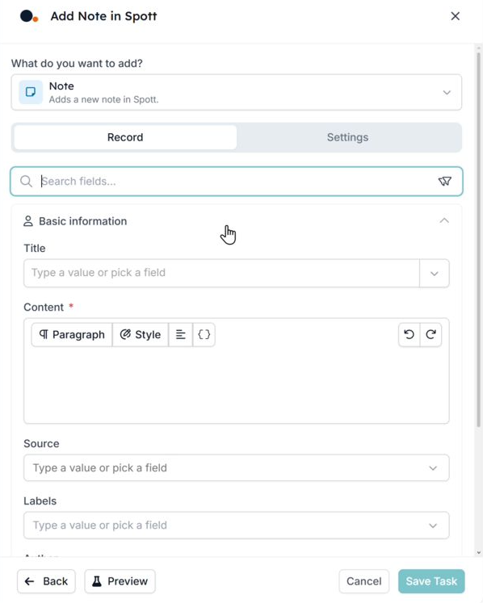
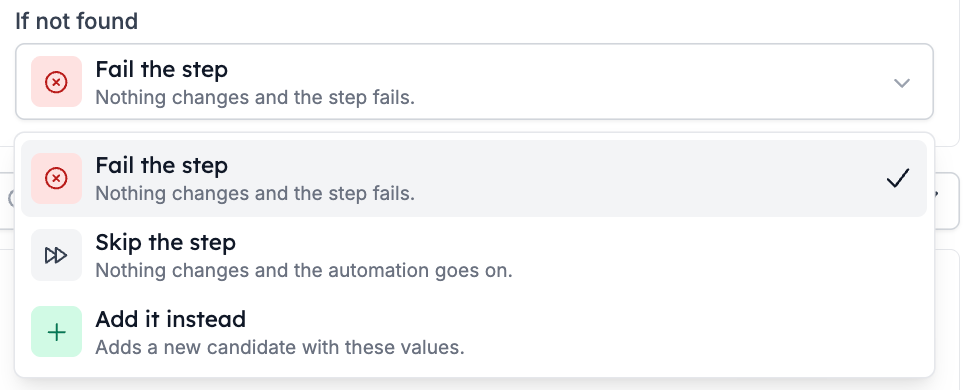
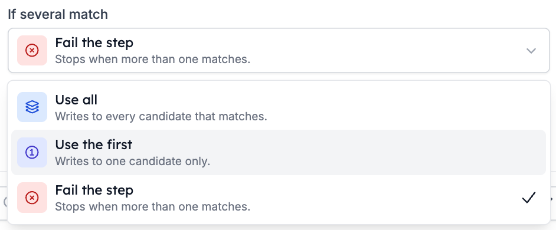
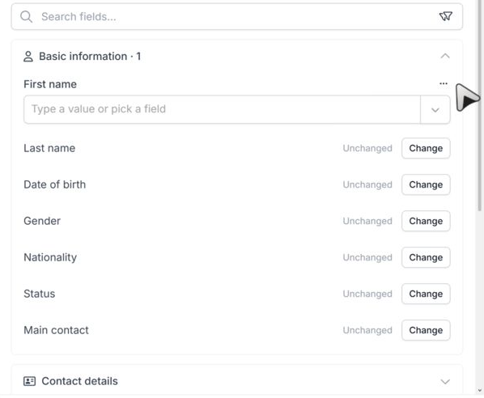
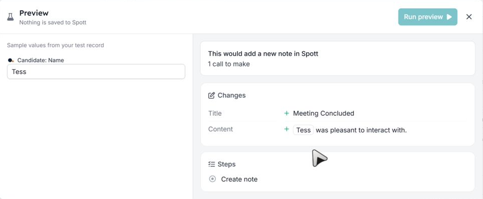
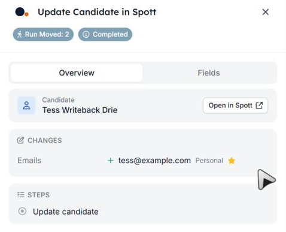

As suas automações já podem escrever no Spott. Registe uma nota depois de uma conversa no WhatsApp, passe uma candidatura para a fase seguinte quando um candidato preenche um formulário, ou mantenha os contactos de um candidato atualizados, sem que ninguém tenha de voltar a escrever tudo no Spott.

## Passo 1: Adicionar um passo do Spott

Na sua automação, clique em **\+** e escolha o passo do Spott de que precisa. Existe um passo por ação e objeto do Spott, como **Add Note in Spott**, **Update Candidate in Spott** ou **Delete Note in Spott**.

Em **What do you want to add?** pode mudar para outro objeto do Spott a qualquer momento.

## Passo 2: Escolher o registo a alterar

Para atualizar ou eliminar, indique ao HireData que registo do Spott deve alterar:

- **Por ID**, por exemplo o candidato que iniciou a automação.
- **Com condições** que encontram o registo, por exemplo o candidato com um determinado endereço de email.

Depois escolha o que acontece se o registo não for encontrado:

- **Fail the step:** nada muda e o passo falha. É a opção predefinida.
- **Skip the step:** nada muda e a automação continua.
- **Add it instead:** adiciona um novo registo com estes valores.

Se as suas condições encontrarem mais do que um registo, escolha **Use all**, **Use the first** ou **Fail the step**.

## Passo 3: Preencher os campos

Escreva um valor ou escolha um campo de um passo anterior da automação, como uma resposta a um formulário. Os campos em que não mexe mostram **Unchanged** e ficam como estão no Spott. Clique em **Change** para definir um novo valor ou limpar o campo.

Nas listas, como os endereços de email de um candidato, pode adicionar um item, substituir a lista inteira ou remover os itens correspondentes.

O HireData trata de algumas coisas por si:

- **As respostas são associadas às opções do Spott** por nome ou valor, para que uma resposta de formulário como "sim" ou o nome de uma fase fique na opção certa.
- **Números e datas** são lidos tal como o seu workspace os escreve.
- **Novas candidaturas e vagas** podem ser colocadas num track específico do pipeline, e uma candidatura numa subfase.
- **Um valor que não pode ser lido** para o passo e mostra qual era, em vez de esvaziar o campo no Spott.

<Tip>
  Uma atualização só altera os campos que definir. Se nada mudasse, o passo é ignorado em vez de guardar os mesmos valores, e a execução explica porquê.
</Tip>

## Passo 4: Pré-visualizar antes de guardar

Clique em **Preview**, procure um registo de exemplo pelo nome e clique em **Run preview**. Vê exatamente o que seria adicionado ou alterado. Nada é guardado no Spott.

## Passo 5: Verificar o que foi guardado

Abra uma execução e clique no passo do Spott. Vê que registo foi alterado, cada campo alterado com o valor antigo e o novo, e **Open in Spott** para ir diretamente ao registo.

Se algo correr mal, a execução explica-o em linguagem simples, como **Record not found**.

## O que ainda não é possível

- **As vagas** não podem ser eliminadas, porque o Spott não o permite.
- **As colocações** podem ser atualizadas, mas não adicionadas nem eliminadas.

## Artigos relacionados

- [Criar uma automação do Spott](/pt/apps/spott/create-a-spott-automation-in-hiredata)
- [Testar uma automação](/pt/automations/how-to-test-an-automation)
