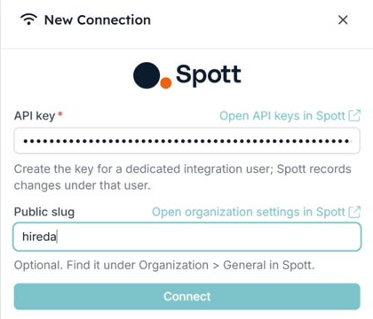
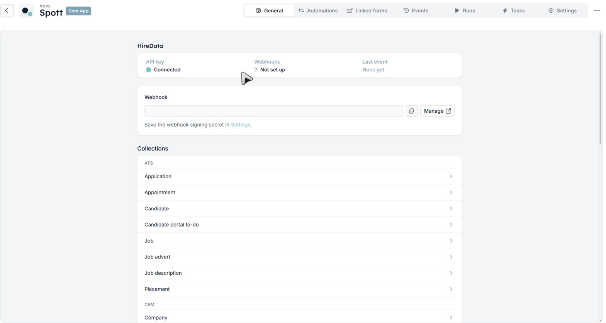

Ligue o Spott uma única vez e as alterações no Spott iniciam as suas automações do HireData.

## Antes de começar

- Precisa de um utilizador do Spott que possa criar chaves de API e endpoints de webhook no Spott.
- Precisa de um administrador do HireData para adicionar a app.

## Passo 1: Adicionar a chave de API

1. Vá a **Settings** > [**Apps**](https://app.hiredata.com/settings/apps). O Spott está no topo.
2. Abra o **Spott** e clique em **Connect to Spott**.
3. Clique em **Open API keys in Spott**, crie uma nova chave e copie-a. Use um utilizador de integração próprio: o Spott regista as alterações em nome desse utilizador.
4. Cole a chave em **API key**. O **Public slug** é opcional; encontra-o no Spott em Organization > General.
5. Clique em **Connect**. O HireData verifica a chave junto do Spott antes de guardar a ligação.

De seguida, o HireData sincroniza as definições de campos e os utilizadores do Spott. A cronologia **Data sync** no separador **General** mostra cada passo.

## Passo 2: Adicionar o webhook no Spott

O Spott informa o HireData das alterações através de um webhook. Configura-o uma única vez, no Spott.

1. No separador **General** da ligação ao Spott, copie o endereço em **Webhook**. **Manage** abre as definições de webhook no Spott.
2. No Spott, adicione um novo endpoint, cole o endereço e selecione todos os eventos.
3. Copie o signing secret que o Spott lhe mostra.
4. No HireData, abra o separador **Settings** da ligação ao Spott e cole-o como webhook signing secret. Guarde.

O HireData só aceita eventos assinados com este secret, por isso sem ele o webhook não funciona.

## Passo 3: Verificar se os eventos chegam

Altere um candidato de teste no Spott. O separador **General** mostra então quando chegou o último evento, e o evento aparece no separador **Events**.

Está pronto para [criar a sua primeira automação do Spott](/pt/apps/spott/create-a-spott-automation-in-hiredata).

<Note>
  A primeira sincronização não importa todos os seus registos do Spott. Os registos chegam quando mudam no Spott, quando uma automação os procura ou quando uma automação agendada é executada.
</Note>
