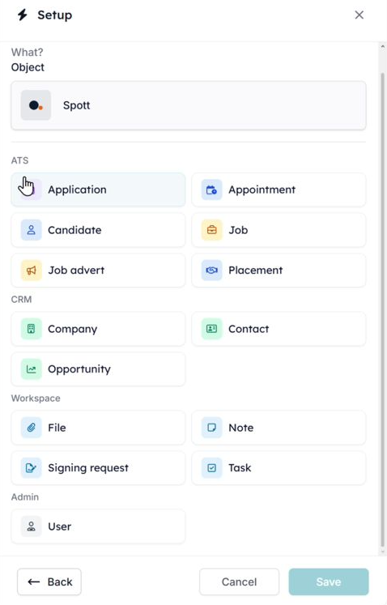
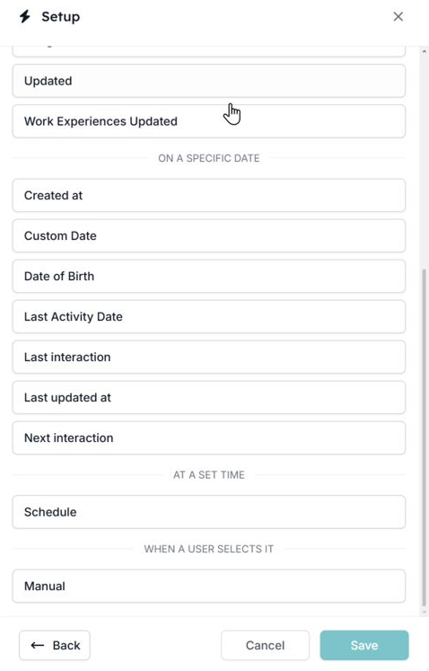

Assim que [o Spott estiver ligado](/pt/apps/spott/connect-with-spott), qualquer alteração no Spott pode iniciar uma automação.

## Passo 1: Escolher um objeto do Spott

Vá a [**Automations**](https://app.hiredata.com/automations) e crie uma nova automação. Em **Setup**, escolha **Spott** e depois o objeto a que a automação se refere.

Os objetos estão agrupados como no Spott: ATS, CRM, Workspace e Admin. Os nomes seguem o Spott, como **Job** e **Job advert**.

## Passo 2: Escolher como começa

- **Um evento**, como uma candidatura criada, atualizada ou movida para outra fase, ou uma oportunidade criada, atualizada, eliminada ou movida para outra fase.
- **Numa data específica**, como uma semana depois da data de início de uma colocação. Escolha um dos campos de data do objeto, ou **Custom Date**.
- **A uma hora definida**: **Schedule** executa a automação sobre um grupo de registos, por exemplo todas as segundas-feiras.
- **Quando um utilizador a escolhe**: **Manual** inicia-a manualmente para um registo.

## Passo 3: Iniciar só para um track ou fase

Se usa vários tracks do pipeline no Spott, pode limitar uma automação de candidaturas a um track, e a uma fase dentro desse track.

- Adicione um filtro de início em **Stage track IDs** para escolher o track.
- Adicione um filtro de início em **Stage ID** para escolher a fase. As fases com o mesmo nome mostram o respetivo track ao lado, para as distinguir.

Uma candidatura noutro track não inicia a automação, mesmo que a fase tenha o mesmo nome.

<Tip>
  **Track ID** está marcado como **(legacy)** porque o Spott o vai remover. Use antes **Stage track IDs**, que funciona da mesma forma nos filtros.
</Tip>

### Automações agendadas

Uma automação agendada só oferece os filtros que o próprio Spott consegue pesquisar. Para restringir mais o público, adicione um passo **Filter** depois do início.

O Spott não indica quantos registos correspondem, por isso o builder não consegue mostrar antecipadamente o tamanho do público. Mesmo assim, a automação percorre todos os registos correspondentes.

## Passo 4: Adicionar a sua mensagem

Adicione um passo como **Send Email** ou uma mensagem de WhatsApp. Cada campo sincronizado do Spott está disponível como variável:

- Os registos associados vêm incluídos: uma candidatura inclui o candidato e a vaga, e uma colocação o candidato, o cliente e a vaga.
- Os scorecards de candidaturas e vagas estão disponíveis.
- Os clientes mostram a data do último contacto e com quem foi.

Para ver que campos chegaram para um registo, abra o evento no separador **Events** ou consulte o objeto em **Collections**.

## Passo 5: Testar e ativar

[Teste a automação](/pt/automations/how-to-test-an-automation) com um registo de teste e depois clique em **Activate**.
