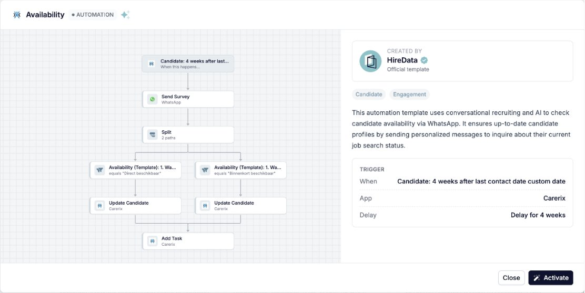
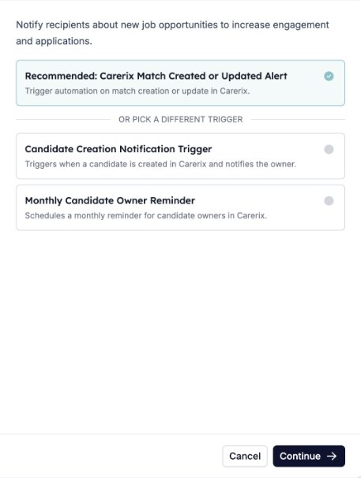

_Explore o poder das automações neste guia em vídeo conciso, que cobre tudo desde conceitos básicos até à configuração da sua própria automação. O vídeo inclui uma demonstração detalhada do produto e insights sobre automações acionadas por eventos versus agendadas._

<iframe src="https://www.loom.com/embed/75f5e793351a48aaa98179881f670d91" title="Loom video" allowFullScreen className="w-full aspect-video rounded-xl"></iframe>

<CardGroup cols={3}>
  <Card title="Automation Builder: Visão geral" icon="diagram-project" href="/reference/automations/overview">
    Selecione um passo e veja o que ele faz num run.
  </Card>

  <Card title="Catálogo de tarefas" icon="list-check" href="/reference/automations/task-catalogue">
    Encontre as tarefas disponíveis para cada app ligada e a referência de cada uma.
  </Card>

  <Card title="Seguir um run" icon="route" href="/reference/automations/follow-a-run">
    Acompanhe um evento através do seu run, dos dados dos passos, da tarefa e do resultado.
  </Card>
</CardGroup>

## Começar a partir de um modelo

Não precisa de construir todas as automações do zero. Clique em **New Automation** em [Automations](https://app.hiredata.com/automations) para abrir a biblioteca de modelos: automações prontas a usar e modelos de email e WhatsApp com um trigger adequado. Filtre por app ou por tipo, ou pesquise.

### Pré-visualizar um modelo de automação

Clique num modelo para ver o que faz antes de o usar:

- os passos da automação, em diagrama
- quem o criou, como a HireData ou um parceiro
- as etiquetas e uma descrição curta
- em **Trigger**: quando começa (**When**), a **App** e um eventual **Delay**

Clique em **Activate** para criar a automação a partir do modelo, ou em **Close** para voltar. Verifique a nova automação e [teste-a](/pt/automations/how-to-test-an-automation) antes de candidatos reais passarem por ela.

### Começar a partir de um modelo de email ou WhatsApp

Escolha um modelo de email ou WhatsApp e a pré-visualização mostra a mensagem, com o trigger que a inicia à direita. O trigger recomendado está selecionado. Em **Or pick a different trigger** pode escolher outro. Clique em **Continue** para criar a automação com esse modelo e esse trigger.

