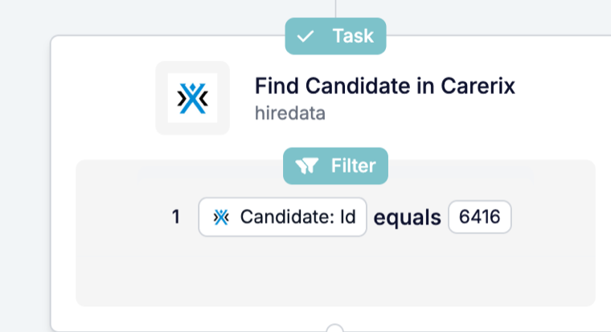

Muitas vezes, o registo de que precisa não é o que iniciou a automação. O **Find** procura-o, para que os passos seguintes o possam atualizar, enviar-lhe uma mensagem ou anexar os seus ficheiros.

<Note>
  Esta página descreve o Find no [novo construtor de automações](/pt/automations/engine-1-3), que faz parte da beta da HireData.
</Note>

## Procurar um registo a meio da automação

Clique em **\+** na sua automação: o **Find** está em **Search** e procura algo que já existe, como um candidato, um contacto ou uma pessoa HireData.

### 1. Escolha o que procurar

O Find usa o mesmo seletor de objetos que os novos passos de registo, com as mesmas categorias, ícones e cores. Procure um registo do Carerix ou uma **pessoa HireData**.

### 2. Faça corresponder os campos que identificam o registo

Defina os valores dos campos que identificam o registo, como um ID ou um endereço de e-mail. O Find continua a fazer correspondência com campos desativados no Carerix, para que as automações em execução encontrem sempre os mesmos registos.

### 3. Use o resultado nos passos seguintes

O registo devolvido pelo Find fica disponível nos passos seguintes com o nome do passo. Um padrão comum: use o Find para encontrar o registo e depois faça o [Update](/pt/reference/automations/steps/update).

## O que mais mudou?

- **O histórico de execuções** mostra os nomes dos registos devolvidos pelo Find, incluindo pessoas HireData.
- **Find Email** e **Search Domain** deixaram de estar disponíveis no novo construtor de automações.

Para todas as definições, consulte a [referência do Find](/pt/reference/automations/steps/find).

## Experimente

Abra uma automação em [Automations](https://app.hiredata.com/automations), clique em **\+** e escolha **Find** em **Search**.
