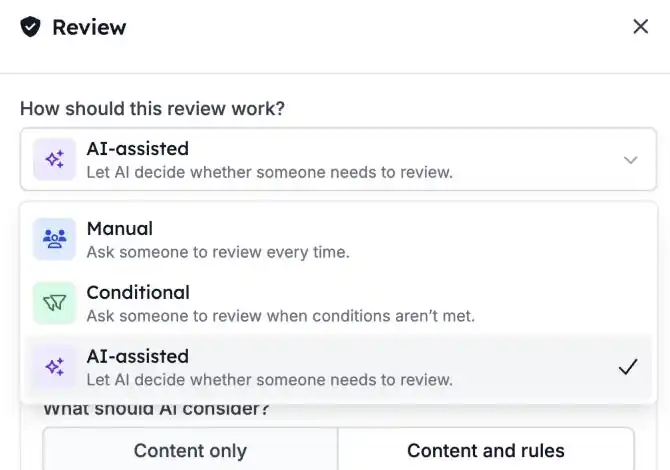
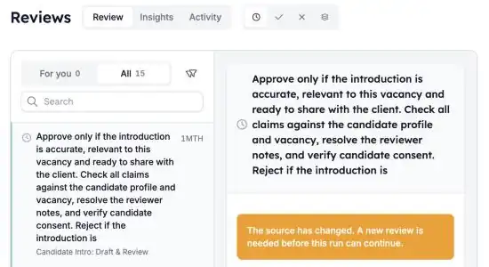

Há passos que quer automatizar, mas não sem uma verificação humana primeiro. Com as **Reviews**, uma automação fica em pausa até alguém aprovar ou rejeitar. Se aprovar, a execução continua; se rejeitar, para.

<Note>
  As Reviews fazem parte da beta da HireData e são ativadas por espaço de trabalho. Peça ao seu contacto HireData para as ativar no seu.
</Note>

## Pausar uma execução até alguém decidir

Adicione um passo **Review** onde a automação deve esperar. No [novo construtor de automações](/pt/automations/engine-1-3), clique em **\+** e escolha **Review** em **Human in the loop**.

### 1. Escolha como funciona a review

Um passo Review tem três modos:

- **Manual**: uma pessoa revê sempre. É o modo predefinido.
- **Conditional**: uma pessoa revê apenas quando as condições que definiu o exigem.
- **AI-assisted**: a IA verifica primeiro o conteúdo segundo os seus critérios e pede a uma pessoa quando tem dúvidas ou falta informação.

Defina o que o revisor vê: o conteúdo a rever, os critérios e um contexto opcional. Pode inserir variáveis de passos anteriores.

### 2. Reveja a partir de uma só fila

Abra [Reviews](https://app.hiredata.com/reviews). **For you** mostra os pedidos atribuídos a si. Os administradores veem também **All** e podem reatribuir um pedido a outra pessoa.

Filtre por **Pending**, **Approved** ou **Rejected**. Selecione um pedido para ver o conteúdo, os critérios e as ligações para a automação e a execução.

### 3. Aprove ou rejeite

- **Approve**: a execução continua com o passo seguinte.
- **Reject**: a execução para.

Pode decidir a partir da fila de reviews ou diretamente na execução. Um curto período para anular permite-lhe voltar atrás numa decisão antes de esta produzir efeito.

## O que mais deve saber

- **As execuções de teste** criam reviews que trata na própria execução. Ficam fora da fila normal e fora de **Insights**.
- **Insights** mostra o volume de pedidos e a carga de trabalho da equipa. **Activity** mostra o histórico de decisões.
- **Se uma automação mudou** depois de uma review ter sido pedida, um administrador pode substituir o pedido desatualizado.

## Experimente

Abra uma automação em [Automations](https://app.hiredata.com/automations), adicione um passo **Review** antes da ação que quer verificar e execute um teste. Depois aprove-o em [Reviews](https://app.hiredata.com/reviews).
