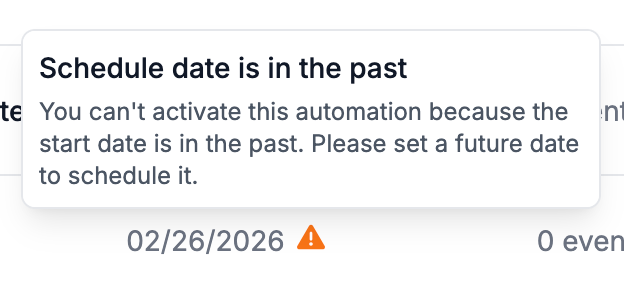
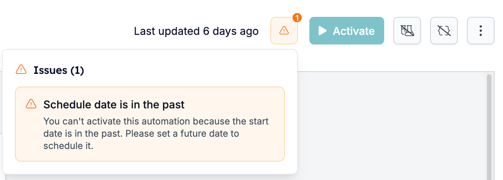

Algumas automações não devem esperar que algo aconteça no seu ATS. Um inquérito NPS mensal, uma newsletter ou uma verificação anual dos dados devem sair na data que escolher. Uma automação agendada corre à hora definida, para cada registo do público que selecionar, uma vez ou de forma repetida.

## Definir o agendamento

<Steps>
  <Step title="Escolha o objeto">
    Abra a automação e clique no bloco **Start**. Escolha a sua app e o objeto para o qual a automação corre, por exemplo **Candidate**.
  </Step>
  <Step title="Escolha Schedule">
    Em **Timing**, vá a **AT A SET TIME** e clique em **Schedule**. Só vê esta opção nos objetos que podem ser agendados.
  </Step>
  <Step title="Defina quando corre">
    - **Run at** é a data e hora da primeira execução.
    - **Repeat every** define com que frequência volta a correr: dias, semanas, meses, trimestres, meio ano ou um ano. Escolha **Don't repeat** para uma única execução. Para semanas e meses, a linha abaixo mostra o dia em que se repete, por exemplo "On day 28".
    - **Until** pára as repetições numa data. Ative **Enable** para definir uma. Se o deixar desligado, a automação continua a repetir-se até a colocar em pausa.
  </Step>
  <Step title="Selecione o público">
    Em **Audience Selection**, adicione filtros para que a automação só corra para os registos que pretende.
  </Step>
  <Step title="Ative">
    Clique em **Activate**. A automação fica agendada para a data em **Run at**.
  </Step>
</Steps>

## A data de início tem de ser no futuro

Só pode ativar uma automação agendada enquanto a data em **Run at** ainda não passou. Se já passou, a automação não é ativada e mantém o estado anterior. A mensagem diz: "This automation could not be scheduled because the configured start date is in the past."

A HireData avisa-o antes disso:

- **Na lista de automações**, aparece um ícone de aviso laranja ao lado da data de início. Passe o rato por cima para ler o aviso.
- **Na página da automação**, aparece um botão de aviso ao lado de **Activate**. Clique nele para ver o problema **Schedule date is in the past**.

<Frame caption="O aviso ao lado de uma data de início na lista de automações.">
  
</Frame>

<Frame caption="A caixa Issues ao lado do botão Activate.">
  
</Frame>

Para resolver, escolha uma nova data **Run at** no futuro e volte a ativar a automação.

O mesmo se aplica a uma automação agendada que colocou em pausa. A pausa cancela a próxima execução. Se a data de início já tiver passado quando a quiser retomar, escolha primeiro uma nova data **Run at**.

## O que o ícone de estado lhe diz

Passe o rato sobre o ícone de estado de uma automação para ver o que significa.

| Dica | O que significa |
| --- | --- |
| **Not Yet Activated** | A automação nunca foi ativada. |
| **Active** | A automação está ligada. |
| **Scheduled** | A automação está ativada e a próxima execução está agendada. |
| **Scheduling Runs** | A automação está neste momento a iniciar execuções para o seu público. |
| **Paused** | Nada de novo corre até voltar a ativar a automação. |
| **System Flagged The Automation** | A HireData parou a automação depois de um erro, por exemplo porque a ligação à app deixou de funcionar ou as execuções não puderam ser agendadas. Resolva a causa e volte a ativá-la. |
| **Finished Scheduling Runs** | A última execução prevista terminou e não há data seguinte, por exemplo porque a data **Until** já passou. |

## Bom saber

- **O início fica bloqueado enquanto as execuções são agendadas.** Enquanto o estado for **Scheduling Runs**, não pode alterar o acionador, o agendamento, os filtros do público nem o tipo de automação. Espere até terminar.
- **Uma automação que perde o agendamento é colocada em pausa.** Se uma automação agendada ativa perder o agendamento, ou se não for possível definir um novo enquanto a edita, a HireData coloca-a em pausa para que não corra na altura errada.
- **Uma cópia não fica com o agendamento.** Quando duplica uma automação agendada, a cópia não fica agendada. Ative a cópia para a agendar.
- **Se ativar várias automações de uma vez** a partir da lista, uma mensagem indica quantas resultaram, por exemplo "2 of 3 automations activated. 1 could not be scheduled." Verifique a data de início das que falharam.

## Experimente

Abra [Automations](https://app.hiredata.com/automations), clique no bloco **Start** de uma automação e escolha **Schedule** em **AT A SET TIME**.

## Relacionado

- [Testar as suas automações](/pt/automations/how-to-test-an-automation)
- [Porque é que a minha automação não correu?](/pt/knowledge-base/why-didnt-my-automation-run)
- [Enviar uma newsletter por e-mail ao seu público](/pt/apps/messaging/emails/sending-an-email-newsletter-to-your-audience)
- [Referência: passo Setup](/pt/reference/automations/steps/setup)
