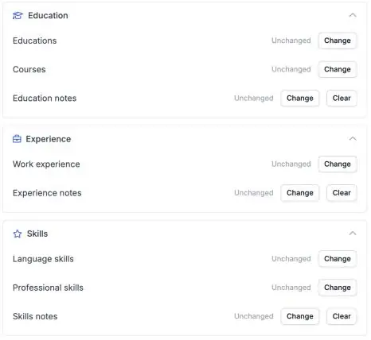

Um perfil de candidato completo é mais fácil de fazer match. As suas automações podem agora preencher a formação, as competências profissionais e as línguas de um candidato no Carerix, para que ninguém tenha de as copiar à mão.

<Note>
  Faz parte da beta da HireData e funciona no [novo construtor de automações](/pt/automations/engine-1-3). Consulte [Como funciona a beta](/pt/beta/how-the-beta-works) para aderir.
</Note>

## Complete o perfil do candidato automaticamente

Numa nova automação, clique em **\+**, escolha **Update** em **Records**, depois **Carerix** e **Candidate**. Selecione o candidato e preencha a secção de que precisa.

<Frame caption="Education, Experience e Skills têm cada uma a sua secção no passo Update Candidate.">
  
</Frame>

### 1. Formação

Defina o nome da formação, o **estabelecimento de ensino**, o diploma, o nível ou a área, as datas e se o certificado foi obtido.

### 2. Competências profissionais

Adicione uma **competência** e a respetiva **especialização**.

### 3. Competências linguísticas

Adicione uma **língua** com níveis separados para **falar**, **escrever** e **ler**.

Também pode adicionar ou atualizar **cursos** e **histórico profissional**.

## Antes de usar

- **Adicione ou altere uma entrada de cada vez.** Para alterar uma formação ou competência existente, escolha essa entrada no passo.
- **Teste primeiro com um candidato de teste** e confirme no Carerix que as outras entradas do candidato ficaram como estavam.

## Experimente

Crie uma nova automação em [Automations](https://app.hiredata.com/automations), clique em **\+**, escolha **Update** em **Records**, depois **Carerix** e **Candidate**.
