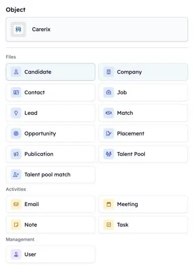
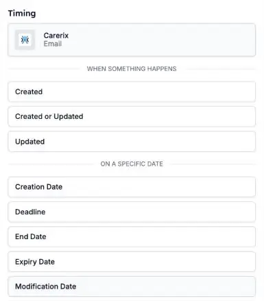

As suas automações podem agora reagir a mais do que acontece no Carerix. Inicie uma quando um consultor regista uma nota, quando um e-mail é enviado ou recebido, ou quando um candidato entra numa talent pool, para que o seguimento aconteça sem ninguém ter de se lembrar.

<Note>
  Faz parte da beta da HireData. Consulte [Como funciona a beta](/pt/beta/how-the-beta-works) para aderir.
</Note>

## Escolha o que inicia a sua automação

Abra a sua automação, clique no bloco **Start** e escolha **Carerix**. Em **Object**, escolha o que a automação deve acompanhar. Depois escolha **quando** começa.

<Frame caption="Escolha o registo do Carerix que inicia a automação.">
  
</Frame>

### 1. E-mails

Inicie uma automação quando um e-mail é **enviado ou recebido** e adicionado ao Carerix. Rascunhos, a caixa de saída, mailings e e-mails em massa não iniciam nenhuma.

### 2. Notas

Inicie uma automação quando uma **nota** é adicionada no Carerix, por exemplo depois de um consultor registar uma entrevista inicial.

### 3. Matches de talent pool

Inicie uma automação quando a **participação numa talent pool** de um candidato muda, por exemplo quando entra numa pool.

### 4. Leads e oportunidades

Se a sua equipa usa o processo comercial do Carerix, inicie uma automação a partir de um **lead** ou de uma **oportunidade**. Consulte [Leads e oportunidades](/pt/beta/leads-and-opportunities).

## Iniciar numa data

Além de **quando algo acontece**, pode iniciar uma automação **numa data específica**, como um prazo ou uma data de fim. Os seus próprios campos de data do Carerix também estão nesta lista. Um campo de data que adicione no Carerix aparece aqui no dia seguinte.

<Frame caption="Escolha quando a automação começa: quando algo acontece ou numa data.">
  
</Frame>

## Experimente

Abra uma automação em [Automations](https://app.hiredata.com/automations), clique no bloco **Start**, escolha **Carerix** e selecione **Email**, **Note** ou **Talent pool match**.
