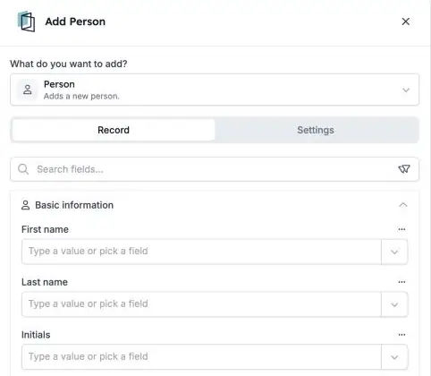

A HireData mantém a sua própria lista de [pessoas](/pt/pages/people): os candidatos, contactos e colegas com quem trabalha. As suas automações podem agora adicionar, atualizar, procurar e eliminar estas pessoas diretamente, com os mesmos passos que usa para outros registos.

<Note>
  Faz parte da beta da HireData e funciona no [novo construtor de automações](/pt/automations/engine-1-3). Substitui o passo **Sync Person** nas novas automações.
</Note>

## Mantenha a sua lista de pessoas atualizada

Numa nova automação, clique em **\+**. Escolha **Add** ou **Update** em **Records**, ou **Delete** em **Lifecycle**, e selecione **HireData** e **Person**.

<Frame caption="O passo Add Person, com os dados da pessoa agrupados em secções.">
  
</Frame>

### 1. Adicione e atualize pessoas

Preencha todos os campos que o Sync Person podia escrever, incluindo **moradas** e dados de **campanha UTM** que mostram de onde veio alguém.

### 2. Encontre a pessoa certa

Use o [Find](/pt/automations/look-up-records) com filtros para escolher que pessoa um passo altera. O histórico de execuções mostra os nomes das pessoas encontradas.

### 3. Elimine com cuidado

Eliminar uma pessoa é **definitivo**. Se anular um passo que adicionou uma pessoa, a HireData volta a eliminar essa pessoa.

## O que mais deve saber

- **Sync Person** deixou de estar disponível em novas automações. As automações que já o usam continuam a funcionar.
- **Teste primeiro com uma pessoa de teste**, para não alterar nem eliminar alguém por engano.

## Experimente

Crie uma nova automação em [Automations](https://app.hiredata.com/automations), clique em **\+**, escolha **Add** em **Records** e selecione **HireData** e **Person**.
