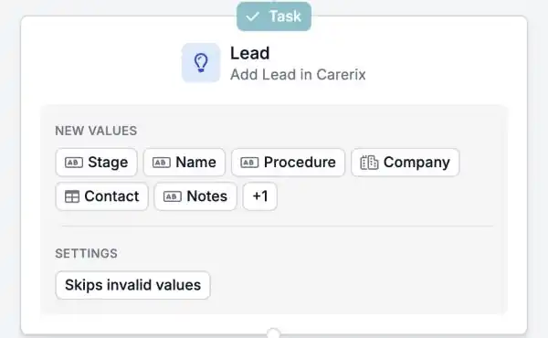

Se a sua equipa usa o processo comercial do Carerix, as suas automações podem agora acompanhar também os seus leads e oportunidades. Inicie um fluxo quando entra ou muda um lead, e mantenha o Carerix atualizado sem voltar a escrever nada.

<Note>
  Faz parte da beta da HireData e funciona no [novo construtor de automações](/pt/automations/engine-1-3). O processo comercial tem de estar ativo no seu ambiente Carerix. As opções que vê dependem da forma como o Carerix está configurado para si.
</Note>

## Execute os seus fluxos comerciais automaticamente

### 1. Inicie uma automação a partir de um lead ou oportunidade

Inicie uma automação quando um lead ou uma oportunidade é **criado** ou **atualizado** no Carerix, segundo um **agendamento** ou **manualmente**.

### 2. Procurar, adicionar e atualizar

- **Find** procura um lead ou uma oportunidade existente.
- **Add** cria um novo. Tal como no Carerix, o **procedimento** e a **categoria** são obrigatórios.
- **Update** altera um que já existe.

Os campos e secções seguem os ecrãs de lead e oportunidade que já conhece do Carerix.

<Frame caption="Lead e Opportunity aparecem junto aos outros registos do Carerix.">
  
</Frame>

<Frame caption="Um passo que adiciona um lead no Carerix, com os valores que preenche.">
  
</Frame>

### 3. Ligue o seu seguimento

Ligue **notas**, **tarefas** e **e-mails** a um lead ou oportunidade, para que os seus consultores vejam todo o histórico num só lugar.

## Um exemplo

Uma empresa preenche o seu formulário de pedido de pessoal. Uma automação adiciona a empresa e a pessoa de contacto no Carerix, cria um lead com os detalhes do formulário e dá a um consultor uma tarefa para ligar de volta.

## Experimente

Crie uma nova automação em [Automations](https://app.hiredata.com/automations), clique em **\+**, escolha **Add** em **Records** e selecione **Lead** ou **Opportunity**.
