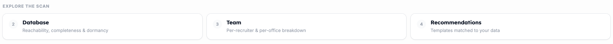
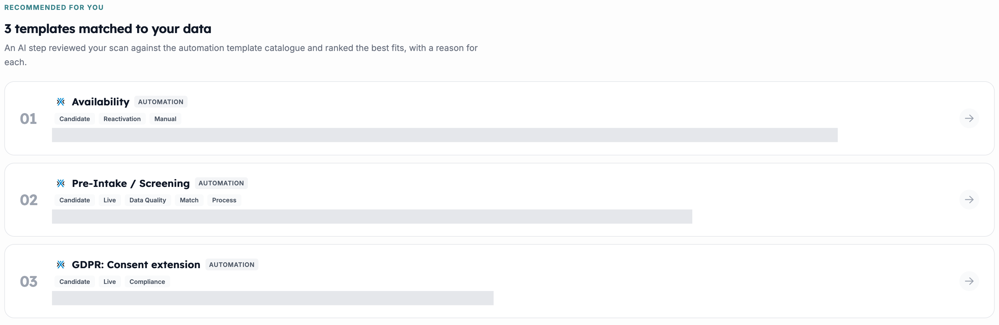

Um scan lê a sua base de dados de recrutamento diretamente do Carerix e mostra, num só relatório, até que ponto os seus candidatos são contactáveis e estão atualizados, o que a sua equipa alcança e que automações resolveriam as lacunas.

<Note>
  O Scan funciona hoje com o Carerix.
</Note>

## O que o relatório mostra

O relatório tem quatro separadores: **Overview**, **Database**, **Team** e **Recommendations**.

### Overview

O tamanho da sua base de dados num relance, o que a HireData já fez por si, como execuções, emails enviados e conversas, e ligações para os outros separadores.

### Database

Até que ponto os seus dados estão completos e contactáveis, com vistas separadas para **Candidates**, **Clients** e **Contacts**:

- **Contactabilidade:** quantos candidatos consegue contactar por email, telemóvel, WhatsApp e LinkedIn, e quantos deram consentimento.
- **Bolsa inativa:** com quantos candidatos trabalhou pela última vez há 0–90 dias, 90–180 dias, 180–365 dias ou há mais de um ano.
- **Completude dos perfis:** quantos perfis têm CV, competências, experiência profissional, formação e um canal preferido.

### Team

Os mesmos números por recrutador e por escritório, nos separadores **Recruiters** e **Offices**. Um grupo com registos insuficientes para comparar é marcado como **small sample**.

### Recommendations

Uma lista ordenada de modelos de automação dirigidos às lacunas que o scan encontrou, cada um com o motivo da escolha. Abra um para o pré-visualizar e testar, e ative-o para criar uma automação em rascunho que pode rever antes de entrar em funcionamento.

## Executar novamente

Clique em **Run again** para ver o que mudou desde o scan anterior.

Quando um número não pode ser obtido do Carerix, o relatório marca-o como em falta em vez de mostrar zero. **How this is measured**, no fundo do relatório, explica como cada número é calculado.

## Artigos relacionados

- [Visão geral da integração com o Carerix](/pt/apps/carerix/overview)
