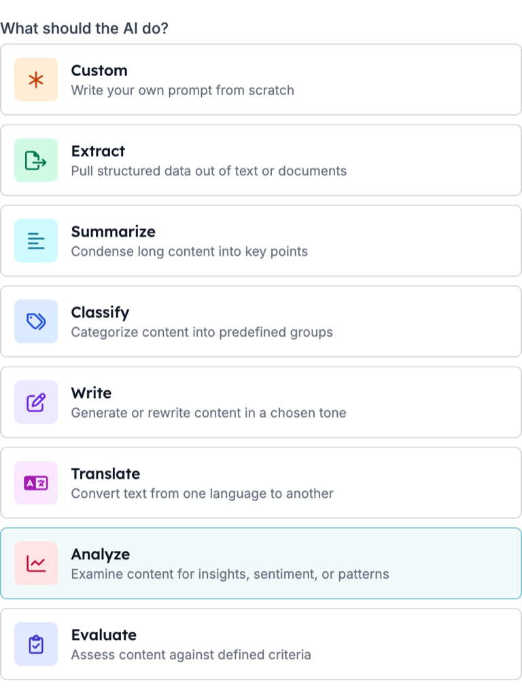
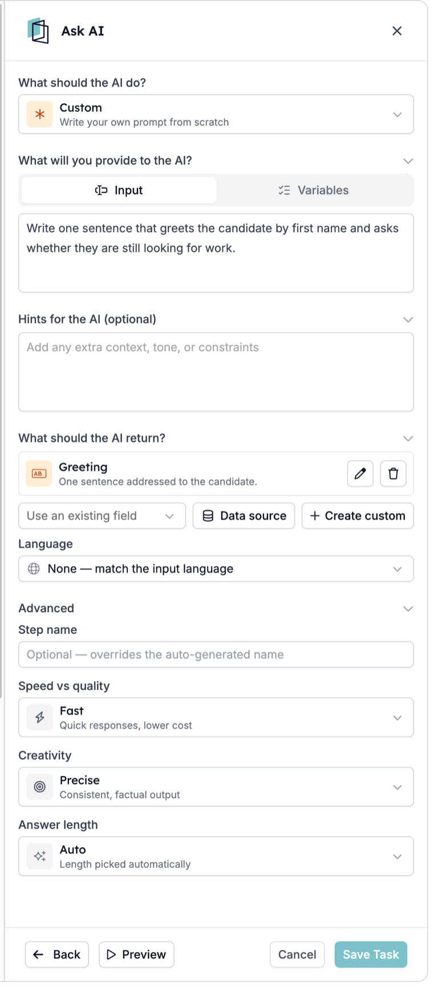
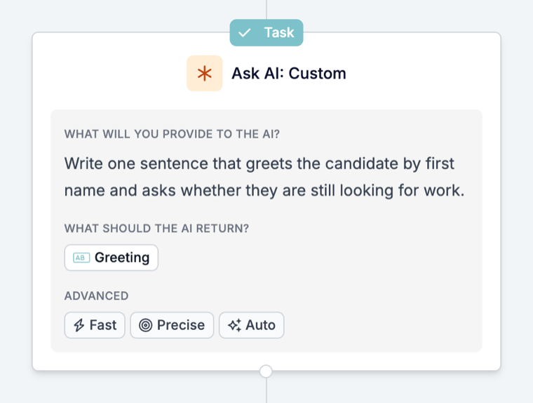

O Ask AI é o passo de uma automação que lê os dados da execução e devolve as respostas que pede: uma pontuação de adequação, um resumo, uma categoria ou um valor limpo retirado de um texto mais longo. As respostas ficam guardadas como campos, para que os passos seguintes as possam escrever num registo ou decidir o que acontece a seguir.

Um exemplo típico: cada novo match recebe uma pontuação de adequação à vaga. Com base nessa pontuação, a automação faz match do candidato, recusa-o ou convida-o para uma pré-seleção. Outro: cada match recebe um resumo curto para o recrutador com pontos fortes, lacunas e sinais de alerta.

É você que decide como as respostas são usadas. Os passos seguintes podem agir sobre elas automaticamente, sem ninguém verificar antes, e as respostas podem variar entre execuções. Por isso, teste antes de deixar uma resposta recusar um candidato ou enviar uma mensagem.

Este guia percorre a configuração, os testes e os problemas comuns. Para a descrição de cada definição, consulte a [referência do Prompt](/pt/reference/automations/steps/prompt).

## Antes de começar

Decida primeiro duas coisas:

- **A pergunta a que quer resposta.** Por exemplo: “Este candidato é adequado para esta vaga?” Um passo que responde a uma pergunta clara é mais fácil de testar e de confiar do que um que faz cinco coisas.
- **O que acontece com a resposta.** Escrevê-la no match, encaminhar o candidato ou enviar uma mensagem. Se nada usar a resposta, o passo só acrescenta tempo e custo a cada execução.

## Configurar o passo

### 1. Adicione o Ask AI à automação

Abra a automação, clique em **\+** onde o passo deve ficar e escolha **Prompt**. O painel que abre tem o título **Ask AI**.

Coloque o passo depois do trigger ou da tarefa que carrega os dados de que precisa. O Ask AI só consegue ler o que a execução já tem.

### 2. Escolha o que a IA deve fazer

Em **What should the AI do?**, escolha a tarefa adequada:

| Escolha | Quando quer |
| --- | --- |
| **Extract** | Retirar valores específicos de um texto, como o nome de uma rua numa morada |
| **Summarize** | Reduzir um texto longo a poucas linhas para um recrutador |
| **Classify** | Colocar um registo numa das suas categorias |
| **Write** | Redigir ou reescrever um texto num tom escolhido |
| **Translate** | Traduzir um texto para outra língua |
| **Analyze** | Avaliar algo, como a adequação de um candidato a uma vaga |
| **Evaluate** | Verificar um texto segundo critérios que descreve |
| **Custom** | Escrever você mesmo toda a instrução |

Todas as opções exceto **Custom** criam os campos de resultado que essa tarefa costuma devolver, para começar a partir de campos que já existem.

### 3. Dê-lhe os dados e a instrução

Em **What will you provide to the AI?**:

- Em **Input**, escreva a instrução e insira as variáveis de que precisa, como o título da vaga e a experiência do candidato.
- Em **Variables**, adicione campos para enviar com a instrução sem os escrever no texto.

Use **Hints for the AI (optional)** para contexto e regras, como “És recrutador. Se o CV não mencionar carta de condução, diz isso em vez de adivinhar.”

### 4. Decida o que é devolvido

Em **What should the AI return?**, adicione um campo de resultado por resposta:

- **Use an existing field** para associar a resposta a um campo que a automação já conhece.
- **Create custom** para definir um novo campo. Escolha o tipo que corresponde à resposta: **Number** para uma pontuação, **Yes / No** para uma verificação, **List** para uma das suas opções, **Text** para um resumo. Numa **List**, adicione os valores permitidos em **Options**.
- Preencha **What is it for? (optional)**. Indica ao modelo o que deve ir para o campo.

Dê a cada campo o seu próprio nome em **Reference as**. É por esse nome que os passos seguintes encontram a resposta.

<Tip>
  Use um campo **List** ou **Yes / No** para tudo aquilo em que um passo seguinte se baseia para escolher um ramo. Uma lista só pode devolver uma das suas opções; texto livre dá uma frase diferente de cada vez.
</Tip>

### 5. Defina a língua e as opções do modelo

- **Language**: deixe em **None** para responder na língua da entrada, ou defina uma língua fixa quando o registo ou a mensagem a exige.
- **Advanced**: escolha **Speed vs quality**, **Creativity** e **Answer length**. Para pontuações e verificações, **Precise** dá as respostas mais consistentes.

Depois de guardado, o passo aparece na tela com o seu prompt, uma etiqueta por campo de resultado e as definições Advanced:

## Teste com Preview

Clique em **Preview** no rodapé do painel, depois em **Generate an example** para preencher dados de exemplo realistas, e execute o passo antes de guardar. Pode editar os valores de exemplo para testar um caso específico. Verifique todos os campos de resultado, não só o primeiro.

Teste mais do que um caso: um candidato forte, um fraco e um registo com informação em falta. Se a resposta no caso incompleto for um palpite, adicione uma dica que diga o que fazer quando a informação não existe.

## Use a resposta nos passos seguintes

Nos passos seguintes, encontra cada resposta com o nome automático do passo, com uma chave baseada no valor de **Reference as**, como `output.fit_score`. Se o Ask AI estiver dentro de um [Loop](/pt/reference/automations/steps/loop), use a resposta ou escreva-a num registo dentro desse Loop; os passos depois do Loop não a conseguem ler. O passo regista também:

| Variável | Contém |
| --- | --- |
| `is_successful` | Se o modelo devolveu uma resposta que corresponde aos campos |
| `reasoning` | Como o modelo chegou à resposta |
| `error_message` | Porque não conseguiu responder, vazio em caso de sucesso |

Passos seguintes comuns:

- **Escrever no registo.** Uma tarefa [Update](/pt/reference/automations/steps/update) escreve o resumo ou a pontuação no match ou no candidato.
- **Continuar só quando é adequado.** Um [Filter](/pt/reference/automations/steps/filter) só deixa a execução continuar quando uma pontuação ou valor de lista cumpre uma condição. As execuções que não a cumprem param aí.
- **Enviar resultados diferentes por caminhos diferentes.** Um [Split](/pt/reference/automations/steps/split) com um Filter em cada ramo, por exemplo um ramo para fazer match, um para recusar e um para convidar para uma pré-seleção.

## Atenção a

- **A resposta é usada assim que é devolvida.** Teste com Preview e alguns registos reais antes de a automação agir sobre a resposta, sobretudo antes de recusar um candidato ou enviar uma mensagem.
- **Um passo sem resposta para a sua execução.** Quando o modelo não consegue responder, o passo aparece como Cancelled com o motivo na cronologia, e os passos seguintes não são executados. Dentro de um [Split](/pt/reference/automations/steps/split) ou [Loop](/pt/reference/automations/steps/loop), só esse ramo ou iteração para; os outros ramos e os passos depois do Split ou Loop podem continuar. Consulte [Motivos de cancelamento de execuções](/pt/knowledge-base/run-cancellation-reasons).
- **Uma resposta inesperada não para a execução.** Se um passo seguinte depender da resposta, verifique-a primeiro com um [Filter](/pt/reference/automations/steps/filter).
- **Para uma linha dentro de um e-mail**, uma [variável de IA](/pt/variables/ai-variables) no modelo é mais simples do que um passo. Use o Ask AI quando a resposta tem de ser guardada ou orientar a execução.

## Resolver problemas no Ask AI

| O que vê | O que verificar |
| --- | --- |
| A resposta é vaga ou ignora este registo | A instrução não tem variáveis. Insira os campos necessários em **Input** ou adicione-os em **Variables**. |
| Um campo de resultado está sempre vazio ou é substituído | Dois campos têm o mesmo **Reference as**. Dê a cada campo o seu próprio nome. |
| A resposta vem na língua errada | **Language** está em **None**, por isso segue a entrada. Defina uma língua fixa. |
| As respostas variam muito entre registos semelhantes | Defina **Creativity** como **Precise** e torne a instrução mais específica sobre o que uma boa resposta contém. |
| A execução aparece como Cancelled no passo Ask AI | O modelo não conseguiu devolver uma resposta que corresponda aos campos. Leia o motivo na cronologia, verifique as entradas e simplifique os campos. |
| Um passo seguinte usa um valor errado | Verifique o resultado com um **Filter** antes desse passo e teste o caso em **Preview**. |
| O nome do passo na tela não mudou | **Step name** só altera o título do painel. O cartão e os nomes das variáveis mantêm o nome automático. |

Se o passo continuar a não se comportar como esperado, contacte [support@hiredata.com](mailto:support@hiredata.com) com o nome da automação, o passo Ask AI, um registo de exemplo e a resposta que esperava.
