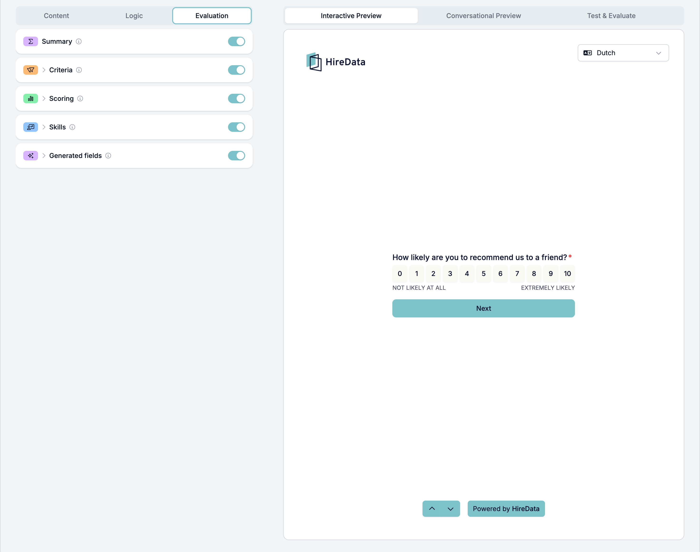
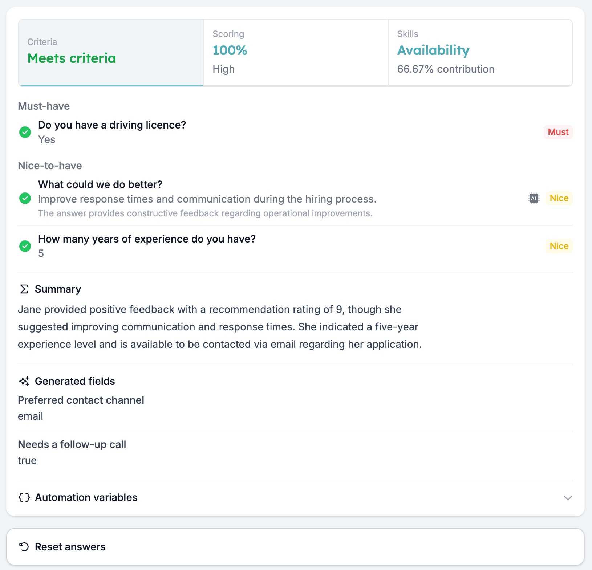
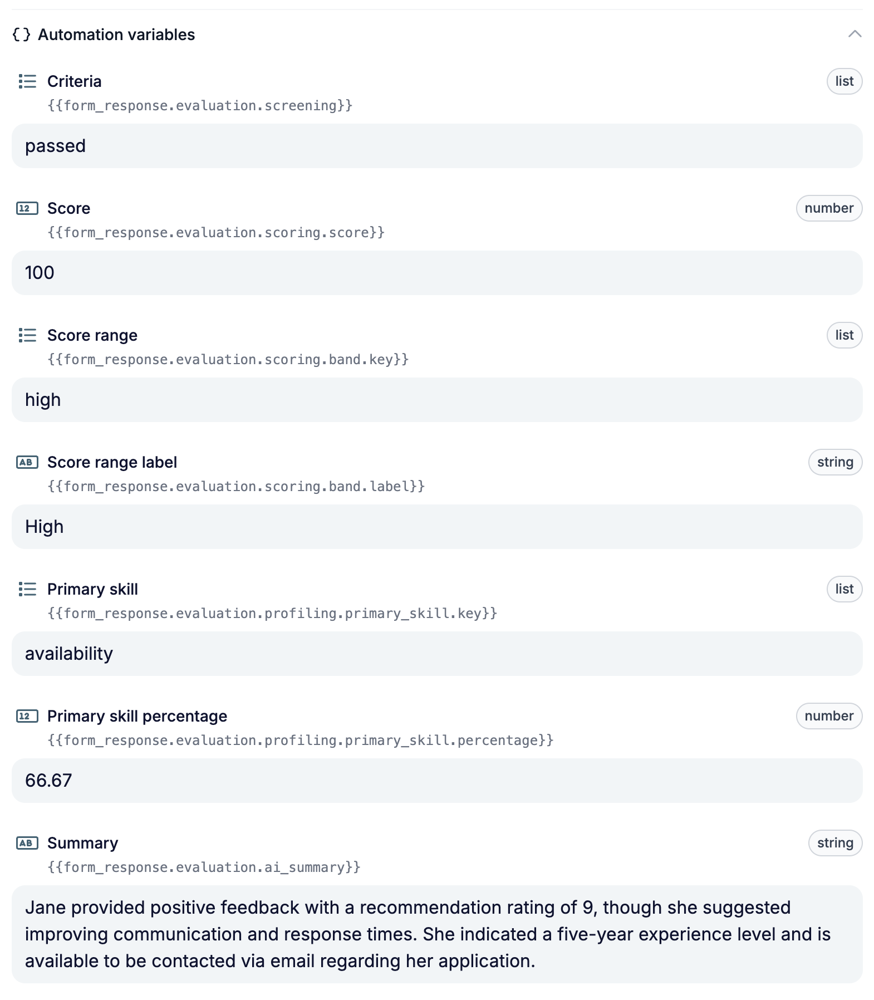

As avaliações de formulário tratam da primeira ronda de pré-seleção. Descreve uma vez as suas perguntas eliminatórias e o que é uma boa resposta, e cada resposta completa é verificada da mesma forma: um veredicto sobre os critérios, uma pontuação, um perfil de competências, um resumo para o seu recrutador ou resultados personalizados. A sua equipa continua a tomar as decisões.

Este guia explica como configurar os avaliadores, verificar os resultados e resolver problemas de configuração comuns.

## Escolha o que precisa

Pode ativar um avaliador ou combinar vários.

| Avaliador | Use-o para | Resultado |
| --- | --- | --- |
| **Summary** | Dar à sua equipa uma visão rápida da resposta. | Um parágrafo escrito pela IA; sem definições para configurar. |
| **Criteria** | Verificar os requisitos obrigatórios (perguntas eliminatórias) e os desejáveis. | Meets criteria, Partially meets criteria, Does not meet criteria ou Incomplete. |
| **Scoring** | Atribuir pontos às respostas. | Uma percentagem e uma etiqueta de intervalo, como Low, Medium ou High. |
| **Skills** | Identificar que competências configuradas as respostas revelam. | Uma percentagem por competência e a competência mais forte. |
| **Generated fields** | Extrair ou gerar valores a partir de toda a resposta. | Um valor para cada resultado que definir. |

Por exemplo, use Criteria para verificar uma qualificação obrigatória e Scoring para atribuir pontos pela experiência relevante. Uma pontuação não substitui o veredicto dos critérios: analise ambos antes de decidir o passo seguinte.

## Configurar uma avaliação

### 1. Ative o avaliador no formulário

Abra o seu formulário e selecione **Evaluation**, ao lado de **Content** e **Logic**. Ative os avaliadores de que precisa e clique no nome de um avaliador para abrir as suas definições.

### 2. Selecione e configure as perguntas

Em **Criteria**, **Scoring** e **Skills**, ative cada pergunta que quer avaliar.

<Warning>
  O interruptor do formulário e o interruptor da pergunta têm de estar ambos ativos. Desativar um avaliador no formulário impede a avaliação, mesmo que os interruptores das perguntas continuem ativos.
</Warning>

Configure cada pergunta selecionada:

- **Criteria:** escolha **Must-have** para uma pergunta eliminatória, em que a resposta errada significa que o candidato não cumpre os seus critérios. Escolha **Nice-to-have** para algo que ajuda a decidir a quem ligar primeiro sem excluir ninguém. Depois defina a resposta esperada ou as instruções para a IA.
- **Scoring:** defina o máximo de pontos da pergunta e depois quando são atribuídos pontos. Se usar IA, o máximo tem de ser superior a zero.
- **Skills:** adicione as competências que quer avaliar e defina que respostas contribuem para cada competência e com que peso. Adicione pelo menos uma competência antes de usar a avaliação por IA.

**Summary** funciona sobre toda a resposta e não precisa de configuração por pergunta. Em **Generated fields**, ative o avaliador e adicione pelo menos um resultado com **Create custom**, **Suggest with AI** ou **Data source**.

### 3. Escolha regras de resposta ou IA

Em **How to evaluate?**, escolha:

- **Use answer rules** para valores fixos ou comparações, como uma opção selecionada ou um número mínimo de anos. As regras dão sempre o mesmo resultado para a mesma resposta.
- **Evaluate with AI** quando a interpretação da resposta importa, como uma explicação em texto livre. Escreva instruções específicas sobre o que a IA deve procurar.

A instrução para a IA é partilhada entre Criteria, Scoring e Skills para a mesma pergunta. Mantenha as instruções coerentes em todos os avaliadores que usam essa pergunta.

Para todas as definições, consulte [Criteria](/pt/reference/forms/evaluation/criteria), [Scoring](/pt/reference/forms/evaluation/scoring), [Skills](/pt/reference/forms/evaluation/skills) e [Generated fields](/pt/reference/forms/evaluation/generated-fields).

## Teste os resultados

Abra **Test & Evaluate** no painel de pré-visualização. Introduza respostas manualmente ou use **Autofill with AI** para criar uma resposta de teste. A avaliação é executada automaticamente quando introduz ou altera uma resposta.

<Note>
  Executar uma avaliação guarda primeiro o formulário, incluindo alterações por guardar. Não cria uma resposta submetida, não aumenta o número de respostas nem inicia uma automação.
</Note>

Teste respostas que cumprem os seus requisitos, respostas que não os cumprem e perguntas sem resposta. Na pontuação, teste também valores logo abaixo e exatamente em cada limite.

Abra os painéis de resultados e verifique o detalhe por pergunta:

- **Criteria:** veja que requisitos foram cumpridos ou não e, nas avaliações por IA, o raciocínio.
- **Scoring:** veja os pontos atribuídos por pergunta e a percentagem total.
- **Skills:** veja como cada resposta contribui para o perfil de competências.

Compare o resumo e os resultados gerados com as respostas originais. Se um resultado pede informação que pode faltar, use **Hints for the AI (optional)** para explicar como tratar a informação em falta, por exemplo deixando o resultado vazio.

Consulte [Test & Evaluate](/pt/reference/forms/testing/test-and-evaluate) para os cenários de teste e os painéis de resultados.

## Compreender os resultados

**Criteria usa um veredicto ordenado.** Um requisito obrigatório respondido mas não cumprido devolve **Does not meet criteria**. Caso contrário, uma resposta em falta a uma pergunta avaliada devolve **Incomplete**. Se todas as perguntas avaliadas tiverem resposta, um requisito desejável não cumprido devolve **Partially meets criteria**; se tudo for cumprido, o resultado é **Meets criteria**. Verifique as perguntas ignoradas pela lógica do formulário quando analisar um resultado incompleto.

**A pontuação baseia-se no total de pontos.** A percentagem corresponde aos pontos obtidos a dividir pelo total de pontos máximos das perguntas configuradas. Uma pergunta pontuada sem resposta vale zero pontos mas conta para o máximo. As regras que correspondem somam-se, até ao máximo da pergunta.

**As percentagens de competências mostram contribuições relativas.** Descrevem a parte de cada competência no peso total. Uma competência a 80% não significa que a pessoa tem um nível de proficiência de 80%.

**Os campos gerados são executados depois de Criteria, Scoring e Skills.** Podem usar as respostas e esses resultados de avaliação para produzir os resultados que definiu.

## Resolver problemas numa avaliação

| O que vê | O que verificar |
| --- | --- |
| Não aparece nenhum resultado | Ative o avaliador no formulário, ative as perguntas relevantes e configure as regras ou definições de IA. Introduza uma resposta de teste. |
| Um critério baseado em regras nunca afeta o veredicto | Confirme que tem condições. Um critério sem condições é ignorado. |
| A pontuação por IA devolve um erro | Defina o máximo de pontos da pergunta para um número superior a zero. |
| A avaliação de competências por IA devolve um erro | Adicione pelo menos uma competência ao formulário. |
| Uma pontuação tem percentagem mas não tem etiqueta de intervalo | Inclua um intervalo com mínimo de 0% e verifique os outros limites. |
| A pontuação é mais baixa do que o esperado | Verifique as perguntas pontuadas sem resposta ou ignoradas e o máximo de pontos de cada pergunta. |
| Os campos gerados não devolvem nada | Adicione pelo menos um campo de resultado. |
| Os resultados da IA não correspondem à avaliação pretendida | Reveja as instruções de IA partilhadas da pergunta, as descrições das competências ou as dicas dos campos gerados, e teste novamente. |

## Usar os resultados da avaliação

As respostas completas são avaliadas e os resultados ficam guardados com elas. Use **Export CSV** ou **Export Excel** no menu de três pontos do editor para exportar os resultados, incluindo percentagens de competências e campos gerados.

Para usar um resultado numa automação, abra **Automation variables** no fundo de **Test & Evaluate** e copie a variável mostrada ao lado do seu valor de teste. Por exemplo, o veredicto de Criteria usa `{{form_response.evaluation.screening}}`, com os valores `passed`, `passed_with_restrictions`, `rejected` ou `incomplete`.

Como cada resposta é avaliada assim que fica completa, uma automação pode fazer o seguimento de cada candidato de imediato. Por exemplo, avance o match para a fase seguinte quando o resultado é **Meets criteria** e envie uma mensagem curta aos candidatos que não cumprem os critérios, para que ninguém fique à espera.

<Warning>
  Ainda não existe um passo de aprovação: uma automação usa o resultado assim que é guardado. Teste as suas instruções de IA em **Test & Evaluate** antes de um resultado enviar uma mensagem aos candidatos.
</Warning>

Para um exemplo completo, consulte [Selecionar e pontuar candidatos com um formulário de pré-seleção](/pt/knowledge-base/cookbook/pre-screening-form).

Se um resultado continuar a parecer errado, contacte [support@hiredata.com](mailto:support@hiredata.com) com o nome do formulário, o avaliador e a pergunta em causa, a resposta testada e os resultados esperado e obtido.
