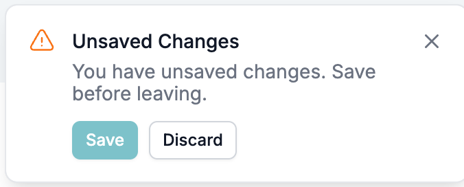

Um template de email é uma mensagem que escreve uma vez e envia muitas vezes, numa automação ou numa newsletter. Abra **Settings**, depois **Emails** em **Templates**, e clique em **New Email**. Selecione **Blank Email** ou um dos templates prontos a usar, e o novo template abre-se no construtor.

Esta página mapeia o construtor. Para um passo a passo que leva um email do zero até estar pronto, leia [Configurar um template de email na HireData](/pt/apps/messaging/emails/setting-up-an-email-template-in-hiredata).

## O construtor num relance

O construtor tem três partes.

- A caixa **Subject** ao longo do topo. É a linha que o destinatário vê na caixa de entrada, e aceita variáveis.
- O próprio email, à largura que os seus destinatários veem. Seleciona e edita tudo diretamente nele.
- A barra lateral à direita, com três separadores: **Styles** para as definições do que selecionou, **Add** para novos blocos, esquemas e modelos de secção, e **Global** para as definições de todo o email.

Um template contém secções, e uma secção contém os blocos que o destinatário lê. [Template](/pt/reference/email-builder/template) explica como os níveis se aninham.

## Selecionar e editar

- **Passe o rato** sobre um bloco ou secção para o contornar com o seu nome.
- **Clique** para o selecionar. As definições abrem-se em **Styles**.
- **Clique de novo num bloco de texto selecionado**, ou faça duplo clique, para editar o texto.
- **Escape** termina primeiro a edição e depois limpa a seleção.
- **Teclado:** **Tab** seleciona o primeiro bloco, as setas passam de um bloco para outro, **Enter** edita e **Delete** remove.

Um bloco selecionado mostra uma barra de ações com **Move**, **Add below**, **Duplicate** e **Delete**, e um menu com as definições desse tipo de bloco. Num bloco mais alto do que o ecrã, o menu mantém-se visível.

### Texto

- **Enter** começa uma nova linha no parágrafo ou título. Não cria um bloco novo.
- **Listas:** transforme linhas numa lista com marcadores ou numerada. Enter continua a lista.
- **O menu de texto** define a fonte, o tamanho, a cor, o realce, o alinhamento, a lista e a ligação, com mais opções em **More**. Formata todo o bloco, ou apenas o texto selecionado.
- **Ligações:** o botão de ligação abre um menu para adicionar, alterar ou remover uma ligação. A uma ligação escrita sem "https" é acrescentado automaticamente.

## Adicionar, copiar e mover

- **O separador Add** lista esquemas, modelos de secção e blocos de conteúdo. Arraste um para o email: uma linha mostra onde fica.
- **Add below** adiciona um bloco por baixo do selecionado. Um novo bloco de texto começa logo em modo de edição.
- **Duplicate** copia um bloco ou secção, incluindo as traduções.
- **Move** arrasta um bloco ou secção até à linha onde o largar. Escape cancela.
- **As secções** só ficam no nível superior do email, nunca dentro de outra secção.
- **Uma secção ou coluna esvaziada** mantém o seu lugar e mostra uma zona onde pode largar ou adicionar um bloco.

## Escolher um bloco {#choosing-a-block}

| Bloco | O que coloca no email |
| --- | --- |
| [Section](/pt/reference/email-builder/sections) | uma faixa ao longo do email, com o seu próprio fundo, padding e borda |
| Secção dividida | uma secção dividida em colunas lado a lado, com esquema e espaçamento próprios. É selecionada e movida como um só bloco |
| [Paragraph](/pt/reference/email-builder/blocks/paragraph) | texto de corpo, incluindo listas com marcadores e numeradas |
| [Heading](/pt/reference/email-builder/blocks/heading) | um título, no nível que escolher |
| [Form](/pt/reference/email-builder/blocks/form) | botões que respondem a uma pergunta de um dos seus formulários |
| [Image](/pt/reference/email-builder/blocks/image) | uma imagem da sua Media Library, ou uma guardada numa variável |
| [Socials](/pt/reference/email-builder/blocks/socials) | uma fila de ícones sociais, um por link |
| [Button](/pt/reference/email-builder/blocks/button) | uma chamada à ação que abre um URL |
| Divider | uma linha entre blocos |
| Whitespace | espaço vazio entre blocos |
| [HTML](/pt/reference/email-builder/blocks/html) | markup escrito por si |
| [Signature](/pt/reference/email-builder/blocks/signature) | uma imagem ao lado de um bloco de texto de despedida |

As colunas adicionam-se como secção dividida. As colunas dos emails criados antes desta alteração mantêm-se e ainda podem ser duplicadas.

## Espaçamento

Selecione um bloco e clique em **Spacing** para ver as margens e o padding no canvas. Arraste uma pega ou escreva um valor, e use o cadeado para alterar vários lados em conjunto. **Done** guarda os valores. A caixa de espaçamento em **Styles** altera os mesmos valores. Os blocos Paragraph, Heading e Socials têm também margens esquerda e direita.

## Definições de todo o email

O separador **Global** contém as definições do template e **All sections**. Uma alteração em **All sections** aplica-se a todas as secções, incluindo as que adicionar depois.

**Section width** define-se uma vez para todo o email: **Default**, **Wide** (640px), **Large** (700px) ou **Custom** (entre 640 e 1240 píxeis). O fundo, a cor das ligações e as fontes também se definem aqui.

## A barra de ferramentas

A barra de ferramentas percorre o topo do construtor, de **Save** até aos quatro botões de painel à direita.

**Save** guarda as suas alterações. **Undo** e **Redo** ficam ao lado e também funcionam com os atalhos de teclado habituais. Cada ação conta como um passo, como um arrastamento inteiro ou uma alteração num campo da barra lateral.

Seguem-se dois botões:

- O olho abre uma [pré-visualização](/pt/reference/email-builder/testing#the-preview) do email final, à largura de telemóvel, tablet ou desktop, com um seletor de idioma e um botão **Copy Preview URL**. A sua tooltip avisa que guarda primeiro o email.
- O avião de papel abre o [Test Email](/pt/reference/email-builder/testing#sending-a-test-email). Envia-lhe o email a si, com valores realistas preenchidos.

**Brand** escolhe a marca de onde vêm as cores, as fontes e o logótipo do email.

Dois interruptores seguem-se ao seletor de marca:

- **Show variable values** é um interruptor de apresentação para o canvas. Para ler um email com valores reais, use a [pré-visualização](/pt/reference/email-builder/testing#the-preview).
- **Show code editor** abre o markup gerado. Só aparece para contas que podem editar templates diretamente.

Quatro botões no fim abrem painéis sobre o email:

- **Show variable list** lista as variáveis que este email pode usar, e adiciona variáveis suas. Veja [Variáveis](/pt/reference/email-builder/variables).
- **Manage Template** publica o email aberto na biblioteca partilhada de templates. Só aparece para contas que mantêm essa biblioteca.
- **Show objects** liga registos, como uma vaga ou um match, ao email. Os campos desses registos tornam-se então [variáveis](/pt/reference/email-builder/variables#bringing-in-a-records-fields) que pode escrever nele.
- **Manage Languages** define o idioma por defeito do email e as suas [traduções](/pt/reference/email-builder/translations).

## Marca e tema

Todas as cores e fontes de um email novo começam como um valor da marca que escolher em **Brand**. O painel nomeia o valor em vez de mostrar um código hexadecimal, como "Theme: Palette Surface Color".

Mude o **Brand** e o email inteiro é reestilizado, incluindo os blocos que já escreveu. Substitua um desses valores por uma cor sua e esse controlo deixa de seguir a marca. Veja [Template](/pt/reference/email-builder/template#brand-theme-and-metadata) para as definições que o decidem, e para a diferença entre mudar de marca e definir um tema.

## Guardar

O construtor de emails não guarda enquanto escreve. **Save** guarda. O botão de pré-visualização e **Send test email** guardam ambos antes de correr, por isso qualquer um deles regista o que quer que tenha alterado. Veja [Testar](/pt/reference/email-builder/testing).

Anule todas as alterações e o email deixa de contar como tendo alterações por guardar.

Tente sair do construtor com alterações por guardar e aparece um aviso. Oferece-se para as guardar com **Save**, ou para as descartar com **Discard** e seguir em frente.

Recarregue a página ou feche o separador e é o seu browser que lhe pede confirmação antes de as perder.

## Relacionados

- [Configurar um template de email na HireData](/pt/apps/messaging/emails/setting-up-an-email-template-in-hiredata) leva um email do zero até estar pronto.
- [Adicionar imagens aos seus emails](/pt/apps/messaging/emails/adding-images-to-your-emails) cobre a Media Library.
- [Variáveis](/pt/reference/email-builder/variables) cobre o seletor, os valores de recurso e o aspeto de um valor em falta.
- [Traduções](/pt/reference/email-builder/translations) cobre o envio de um email em vários idiomas.
- [Testar](/pt/reference/email-builder/testing) cobre a pré-visualização, o envio de teste e o que nenhum dos dois prova.
- [Form Builder: Visão geral](/pt/reference/forms/overview) cobre os formulários para os quais um bloco Form pode apontar.
